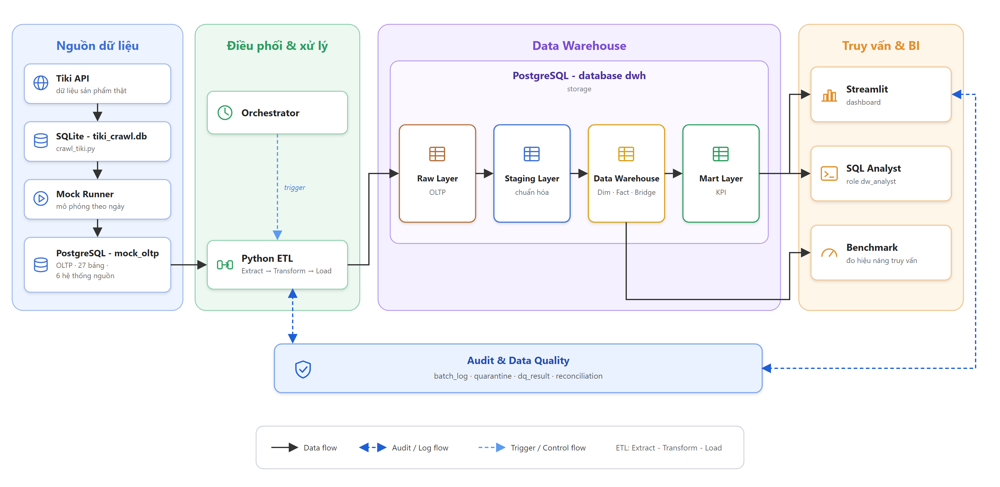

# Kho dữ liệu sàn thương mại điện tử đa người bán — Nhóm 5 (PTIT)

Dự án môn Kho dữ liệu: dữ liệu sản phẩm **thật** (crawl Tiki) + các hệ thống nghiệp vụ **mô phỏng** (Mock Studio) → ETL →
kho dữ liệu PostgreSQL (galaxy schema: 3 fact, 14 dimension, 2 bridge) → mart/KPI → dashboard Streamlit.



Tài liệu chính (tiếng Việt): kiến trúc tổng thể và thiết kế ở [docs/MASTER_BLUEPRINT.md](docs/MASTER_BLUEPRINT.md);
kế hoạch xây dựng ở [docs/DW_BUILD_PLAN.md](docs/DW_BUILD_PLAN.md); nhật ký từng bước ở [docs/implementation/README.md](docs/implementation/README.md);
báo cáo kiểm thử T1–T7 ở [docs/BAO_CAO_KIEM_THU_T1_T7.md](docs/BAO_CAO_KIEM_THU_T1_T7.md).

## 1. Môi trường

| Thành phần | Phiên bản / ghi chú |
|---|---|
| Hệ điều hành | Windows 11 + WSL2 Ubuntu-20.04 (Mock Studio và ETL chạy trong WSL; crawler chạy được trên Windows) |
| Python | 3.12, môi trường ảo `.venv` của repo (WSL). Gói: `requirements.txt` (crawler), `scripts/requirements-mock.txt` (Mock Studio), `dashboard/requirements.txt` (Streamlit 1.50, Plotly, Pandas), `psycopg[binary]` 3.x |
| Cơ sở dữ liệu | PostgreSQL 15 trong Docker: container `scripts-mock-postgres-1`, cổng `127.0.0.1:55432`. Ba database: `mock_oltp` (nguồn), `mock_control` (điều khiển Mock Studio), `dwh` (kho) |
| Docker | Docker Desktop (khởi động thủ công sau mỗi lần bật máy, đợi 1–2 phút) |
| Ổ đĩa | Mọi dữ liệu (volume Postgres, log, kết quả đo) để ở ổ D |

Khởi động Postgres: `docker compose -p scripts -f scripts/compose.mock.yaml up -d` (giữ nguyên volume `scripts_mock-platform-data`).

## 2. Tái lập dữ liệu nguồn

**Seed 42** cho mọi ngẫu nhiên (engine dùng một RNG có seed duy nhất; sắp xếp tập thực thể theo ID trước khi lấy mẫu, nên cùng cấu hình → cùng dữ liệu).
Đã kiểm chứng: sinh lại dữ liệu 01–12/01/2026 cho md5 trùng lần sinh trước (xem [docs/implementation/00_sinh-du-lieu-oltp.md](docs/implementation/00_sinh-du-lieu-oltp.md)).

| Tham số | Giá trị |
|---|---|
| Sản phẩm thật | `data/tiki_crawl.db` (3.532 sản phẩm, 5 danh mục gốc), tạo bằng `scripts/crawl_tiki.py`; WSL đọc bản sao `data/tiki_crawl_share.db` |
| Settings (hồ sơ thực thể, kho, hãng vận chuyển) | medium-ecommerce.json (trong worktree, xem dưới) — 10.000 khách nền, 481 người bán, 6 kho |
| Kịch bản phiên bản 1 | `docs/mock-design/examples/dw-lite-2026.json` — từ 01/01/2026 (rút gọn clickstream, ~100 đơn/ngày) |
| Kịch bản phiên bản 2 (có SCD + quảng cáo đa kênh) | `docs/mock-design/examples/dw-scd-2026.json` — từ **25/01/2026**, sinh bằng `scripts/mock_runner/make_dw_scd_config.py` ([bước 1.0](docs/implementation/01_buoc-1.0_cau-hinh-mock-scd.md)) |
| Ngày bắt đầu / đích | 01/01/2026 → 31/12/2026, ~15 phút thực cho một ngày mô phỏng |

Hai file kịch bản nằm trong repo; settings medium-ecommerce.json (thư mục examples/settings) và engine Mock Studio chạy từ git worktree
`D:/PTIT/mock_run` (nhánh `main` + bản vá hiệu năng), vì nhánh `quybruno` thiếu một số file của engine.

```bash
# trong WSL, từ thư mục worktree D:/PTIT/mock_run
bash scripts/mock_runner/start_all.sh     # serve (cổng 8765) + worker + pipeline tự nối tiếp từ ngày đã xong
bash scripts/mock_runner/stop_all.sh      # dừng
```

## 3. Khởi tạo kho và chạy ETL

```bash
# trong WSL, từ thư mục gốc repo
bash dw/sql/00_init/run_init.sh           # role (dw_reader, dw_etl, dw_analyst) + schema raw/stg/dw/mart/audit/bench
bash dw/sql/run_ddl.sh                    # stg, dimension, fact, audit, từ điển dữ liệu, mart (idempotent)

bash dw/etl/run.sh extract                # B1: OLTP → raw.* (batch mới, watermark = last_day của mock)
bash dw/etl/run.sh transform --batch N    # B2: raw → stg, DQ, cách ly lỗi
bash dw/etl/run.sh load                   # B3–B5: dimension/SCD, fact, đối soát; B6: refresh mart (chỉ khi batch SUCCESS)
bash dw/etl/run.sh load --reload          # nạp lại batch SUCCESS mới nhất (kiểm tra idempotent, T3)
```

Chạy lại khi mock tiến thêm ngày: `extract` → `transform --batch N` (N là batch_id vừa tạo, in ở cuối bước extract) → `load`.
Mỗi lần chỉ nạp batch **nối tiếp** mốc SUCCESS gần nhất.

**Log batch.** Mỗi bước ghi JSON vào `data/logs/etl.log`; trạng thái và thời gian nằm ở `audit.batch_log`, từng bảng ở `audit.batch_table_log`:

```text
{"ts": "2026-11-09 14:19:37", "event": "batch_success", "batch_id": 7, "sec": 12.3}
{"ts": "2026-11-09 14:19:40", "event": "mart_refreshed", "batch_id": 7, "sec": 2.9, "mvs": {"mv_sales_day_product": 2974, ...}}
```

```bash
docker exec -i scripts-mock-postgres-1 psql -U mock -d dwh -c \
  "SELECT batch_id, status, watermark_from, watermark_to, message FROM audit.batch_log ORDER BY batch_id"
```

## 4. Dashboard, thí nghiệm hiệu năng, kiểm thử

```bash
bash dashboard/run.sh                     # http://localhost:8501 — chế độ Thống kê (4 màn hình) và Kỹ thuật (5 màn hình), xuất CSV, role dw_analyst (chỉ đọc dw, mart)
bash bench/run.sh                         # BM01 MV, BM02 partition, BM03 index (tạm dừng mock khi đo); kết quả trong bench/results/
bash dw/tests/run_tests.sh --quick        # kiểm thử T1–T7 chỉ đọc, ~20 giây
bash dw/tests/run_tests.sh                # đầy đủ, ~5 phút: nạp lại batch (T3), SCD có kiểm soát, dashboard
```

Mã thoát ≠ 0 nếu có FAIL; kết quả ghi thêm vào `data/logs/test.log`. Kết quả mẫu: `docs/implementation/evidence/11_kiem_thu_T1-T7.txt`.

## 5. Cấu trúc thư mục

| Thư mục | Nội dung |
|---|---|
| `scripts/` | Crawler Tiki, Mock Studio (`mock_platform/`), runner (`mock_runner/`) |
| `dw/sql/` | DDL: `00_init`, `05_profiling`, `20_stg`, `30_dw`, `40_mart`, `50_audit` |
| `dw/etl/` | `extract.py`, `transform.py`, `load.py`, `config.py`, `mappings/*.csv`, `inject_test_errors.py` |
| `dw/tests/` | `run_tests.py` (T1–T7), `test_scd_load.py`, `test_mart.sql`, `measure_*.sql` |
| `dw/demo_sql/` | Các câu SQL demo, mỗi file một tab DBeaver (batch log, tích hợp mã kênh, MV vs fact, index, cách ly, `mart.v_consistency_check`); kịch bản ở [docs/KICH_BAN_DEMO.md](docs/KICH_BAN_DEMO.md) |
| `dashboard/` | Streamlit + Plotly |
| `bench/` | Thí nghiệm hiệu năng |
| `docs/` | Thiết kế (M1–M3), kế hoạch, Blueprint, báo cáo kiểm thử, `implementation/` (nhật ký + bằng chứng) |
