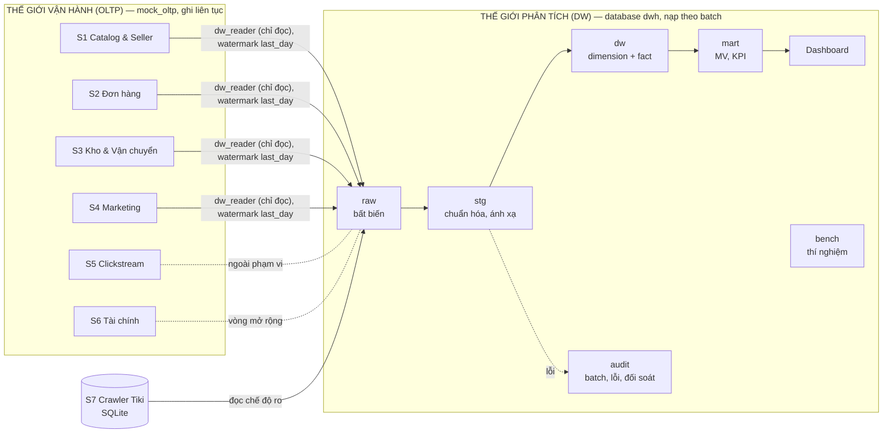
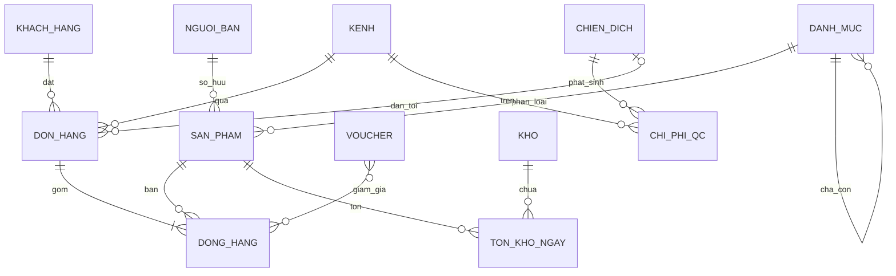

# Milestone 1 — Khảo sát nguồn, chủ đề cốt lõi và quy tắc tích hợp

Sản phẩm của Milestone 1 (lộ trình, Inmon chương 1–2): **1.1** bản đồ hệ thống nguồn và ranh giới OLTP ↔ DW, **1.2** danh mục chủ đề, **1.3** bảng quy tắc tích hợp và quy tắc lưu vết.

Số liệu được đo trên `mock_oltp` lúc 22:26 ngày 07/11/2026, khi dữ liệu mô phỏng đã có từ 01/01 đến 12/01/2026, bằng role chỉ đọc `dw_reader`. Script đo: [dw/sql/05_profiling/m1_source_profile.sql](../../../dw/sql/05_profiling/m1_source_profile.sql); output đầy đủ: [evidence/03_m1_source_profile.txt](../../implementation/evidence/03_m1_source_profile.txt). Dữ liệu vẫn đang được sinh nên số dòng sẽ tăng, nhưng cấu trúc và các quy tắc không đổi.

---

## 1.1. Bản đồ hệ thống nguồn

### 1.1.1. Các nguồn vận hành

Sàn có **6 hệ thống vận hành** dùng chung một database OLTP (`mock_oltp`, 33 bảng), cộng **1 nguồn bên ngoài** là dữ liệu crawl từ Tiki.

| # | Hệ thống nguồn | Bảng | Số dòng (12 ngày) | Grain | Vai trò với DW |
|---|---|---|---:|---|---|
| S1 | **Catalog & Người bán** | `products` | 3.532 | Thực thể | Dim_Product |
| | | `categories` | 49 | Thực thể (2 cấp) | Dim_Category |
| | | `sellers` | 481 | Thực thể | Dim_Seller |
| | | `seller_commission_rates` | 132 | Chính sách có hiệu lực | Hoa hồng theo thời gian |
| S2 | **Đơn hàng** | `orders` | 1.382 | Đơn | Fact_Order_Item |
| | | `order_items` | 1.586 | Dòng hàng | **Fact_Order_Item (grain)** |
| | | `payments` | 1.237 | Giao dịch thanh toán | Dim_Payment_Method |
| | | `customers` | 10.361 | Thực thể | Dim_Customer |
| | | `customer_addresses` | 1.209 | Thực thể | (mở rộng) |
| | | `channels`, `payment_methods` | 3, 5 | Danh mục | Dim_Channel, Dim_Payment_Method |
| | | `checkouts`, `checkout_lines` | 1.231, 1.586 | Phiên thanh toán | (mở rộng) |
| | | `returns`, `refunds`, `product_reviews` | 6, 9, 177 | Sự kiện hậu mãi | Fact_Return (vòng 3) |
| S3 | **Kho & Vận chuyển** | `inventory_daily_balance` | 219.067 | SKU × kho × ngày | **Fact_Inventory_Snapshot (grain)** |
| | | `inventory_movements` | 19.672 | Biến động | Nhập / bán / điều chỉnh trong ngày |
| | | `inventory_levels` | 18.257 | SKU × kho (hiện tại) | Không dùng (chỉ trạng thái hiện tại) |
| | | `warehouses` | 6 | Thực thể | Dim_Warehouse |
| | | `shipments`, `delivery_attempts`, `carriers` | 1.175, 1.084, 5 | Vận đơn, lần giao | Fact_Order_Fulfillment (vòng 2) |
| S4 | **Marketing & Khuyến mãi** | `ad_spend_logs` | 8 | Chiến dịch × kênh × ngày | **Fact_Ad_Spend** (gộp tháng) |
| | | `marketing_campaigns` | 1 | Thực thể | Dim_Campaign |
| | | `promotions`, `order_item_promotions`, `promotion_usages` | 3, 188, 367 | Voucher, phân bổ | Dim_Promotion + Bridge |
| S5 | **Clickstream** | `sessions`, `page_events`, `cart_items` | 12.037, 29.036, 5.829 | Phiên, sự kiện | Ngoài phạm vi (đề xuất mục 2) |
| S6 | **Tài chính** | `seller_payouts`, `seller_payout_items` | 0, 0 | Kỳ thanh toán | Fact_Seller_Settlement (vòng 4) |
| S7 | **Crawler Tiki** (SQLite) | `products`, `product_raw`, `product_categories` | 3.532 | Sản phẩm | Cây danh mục nhiều cấp (`primary_category_path`) |

Bảng tài chính hiện còn trống vì tiền trả seller có thời gian giữ (`payout_hold_days`), không phải lỗi. Quảng cáo đa kênh bắt đầu có từ ngày mô phỏng 30/01 (xem [ghi chép bước 01](../../implementation/01_buoc-1.0_cau-hinh-mock-scd.md)).

### 1.1.2. Sơ đồ ranh giới OLTP ↔ DW

Ranh giới được thực thi bằng quyền truy cập (đã kiểm tra ở bước 02):
- ETL chỉ **đọc** OLTP; phiên luôn ở chế độ `read_only`;
- kho nằm ở database riêng `dwh`;
- người phân tích chỉ đọc `dw` và `mart`.

### 1.1.3. Vì sao không chạy báo cáo trực tiếp trên OLTP

| # | Lý do | Bằng chứng trên nguồn hiện tại |
|---|---|---|
| L1 | **OLTP chỉ lưu trạng thái hiện tại, không có lịch sử.** Khi hạng seller, tỉnh khách hay hạng thành viên đổi, giá trị cũ bị ghi đè. | Các bảng thực thể chỉ có `updated_at`, không có bảng lịch sử. `inventory_levels` (18.257 dòng) chỉ giữ tồn **hiện tại**; tồn kho từng ngày chỉ có vì engine ghi thêm `inventory_daily_balance`. Câu hỏi "doanh thu theo hạng seller **tại thời điểm bán**" (đề xuất mục 2) không trả lời được trên OLTP. |
| L2 | **Khóa và mã không thống nhất giữa các hệ thống** (chi tiết ở 1.3). | Kho dùng `sku`; vận chuyển dùng `order_code`; marketing dùng `WEB`; bảng kênh dùng `Web`. |
| L3 | **Grain khác nhau.** Ghép trực tiếp sẽ nhân đôi số liệu. | Dòng hàng (đơn), SKU × kho × ngày (kho), chiến dịch × kênh × ngày (QC). Join `orders` với `payments` rồi với `order_item_promotions` sẽ nhân dòng. |
| L4 | **Truy vấn phân tích tranh tài nguyên với giao dịch, và chậm dần theo dữ liệu.** | Đo trong lúc engine đang ghi: R1 (doanh thu ngày × danh mục gốc × kênh, join 6 bảng) mất **12,6 ms** trên 1.586 dòng hàng; R2 (tồn kho theo danh mục × ngày) mất **176 ms** trên 219.067 dòng (12 ngày). Dữ liệu tăng ~18.256 dòng tồn/ngày, nên cả năm có ~6,7 triệu dòng và R2 sẽ lên **hàng giây** mỗi lần chạy (ước tính tuyến tính), quét toàn bảng ngay trên server mà worker mô phỏng đang ghi. |
| L5 | **Dữ liệu đang thay đổi.** Ngày đang chạy dở có đơn chưa xử lý, tồn kho chưa chốt. | Engine chỉ chốt ngày sau bước `AUT-WH-04` (chốt tồn cuối ngày). DW chỉ nạp các ngày đã hoàn tất (`last_day`). |

Về khóa bảng: PostgreSQL dùng MVCC nên truy vấn đọc **không khóa** việc ghi. Vấn đề ở đây là L1–L5 (thiếu lịch sử, thiếu tích hợp, tranh CPU/IO, dữ liệu dở dang), không phải khóa bảng như cách hiểu thông thường. Báo cáo cần ghi đúng điểm này.

---

## 1.2. Chủ đề cốt lõi (Subject-oriented)

| Chủ đề | Thực thể chính | Nguồn | Câu hỏi nghiệp vụ (đề xuất mục 2) |
|---|---|---|---|
| **C1. Bán hàng** *(trọng tâm)* | Đơn, dòng hàng, thanh toán, voucher, kênh | S2, S4 (voucher) | Doanh thu theo tháng/danh mục/seller/kênh; top sản phẩm/seller; ảnh hưởng của voucher |
| **C2. Sản phẩm & Người bán** | Sản phẩm, danh mục (cây), seller, hạng, hoa hồng | S1, S7 | Doanh thu theo hạng seller và giá niêm yết **tại thời điểm bán** |
| **C3. Tồn kho** | SKU, kho, tồn cuối ngày, biến động | S3 | Sản phẩm bán chạy nhưng tồn thấp, hoặc tồn nhiều nhưng ít bán |
| **C4. Marketing** | Chiến dịch, kênh, chi phí, lượt hiển thị/click | S4 | Chi phí quảng cáo so với doanh thu theo tháng–kênh |
| *(dùng chung)* **Khách hàng** | Khách, tỉnh, hạng thành viên, hồ sơ chi tiêu | S2 | Phân khúc khách cho C1 |

Ba quy trình nghiệp vụ ứng với ba fact của đề xuất: **C1 → Fact_Order_Item**, **C3 → Fact_Inventory_Snapshot**, **C4 → Fact_Ad_Spend**. C2 và Khách hàng cung cấp các dimension dùng chung.

---

## 1.3. Quy tắc tích hợp dữ liệu (Integrated)

Lộ trình yêu cầu tối thiểu 3 xung đột thực tế. Dưới đây là 10 xung đột, mỗi xung đột có bằng chứng đo được:

| Mã | Xung đột | Bằng chứng | Quy tắc chuẩn hóa |
|---|---|---|---|
| **IR-01** | Định danh sản phẩm: kho dùng `sku`, đơn hàng dùng `product_id` | `inventory_daily_balance`, `inventory_movements`: 3.532 SKU, **0 SKU không map**; `products.sku` không trùng | Khóa nghiệp vụ chuẩn = `product_id`. Ánh xạ `stg.map_sku_product`. SKU không map được → cách ly (DQ-04) |
| **IR-02** | Định danh đơn: vận chuyển dùng `order_code`, các bảng khác dùng `order_id` | 1.175 vận đơn, map được 1.175, mỗi đơn đúng 1 vận đơn | Chuẩn về `order_id` qua `orders.order_code` |
| **IR-03** | Mã kênh: marketing dùng `WEB` (cùng họ `APP`/`LIVESTREAM`); bảng kênh dùng `Web`/`App`/`Livestream`; tài liệu schema ghi `MOBILE_APP`/`LIVE` | `ad_spend_logs.channel_code = WEB` (8 dòng), `marketing_campaigns.target_channel_code = WEB`, `channels.channel_name ∈ {Web, App, Livestream}` | `stg.map_channel` nhận cả hai bộ mã: `WEB→Web`, `APP`/`MOBILE_APP→App`, `LIVESTREAM`/`LIVE→Livestream`. Mã lạ → cách ly |
| **IR-04** | Danh mục ở 3 nơi, độ sâu khác nhau. OLTP `categories` có 2 cấp (5 gốc, 44 lá) và `products.category_id` là **lá cấp 2** (3.532/3.532). Crawler có `primary_category_path` sâu 4–8 nút, bắt đầu bằng `1/2` (gốc hệ thống Tiki) | Danh mục OLTP = `leaf_category_id` của crawler (3.532/3.532); cha của nó = danh mục gốc crawl (3.532/3.532); nằm ở vị trí 3–5 trong path; 224 sản phẩm có path đi sâu hơn danh mục OLTP; hoa hồng tính theo đúng danh mục OLTP (`commission_category_id`, 1.586/1.586) | Danh mục chuẩn của sản phẩm = `products.category_id` của OLTP (khớp hoa hồng). Cây = `primary_category_path` bỏ 2 nút đầu, **cắt tại danh mục OLTP** → **77 nút, sâu 2–4 cấp, 0 nút có 2 cha**. 28 nút trung gian chưa có tên → tạm gọi `Danh mục <id>` |
| **IR-05** | Khách vãng lai không có `customer_id` | **733/1.382 đơn (53,0%)** và 6.644/12.037 phiên có `customer_id` NULL | `customer_key = -1` (không áp dụng); khóa không tra được = `0` |
| **IR-06** | Tiền là `numeric(24,6)`. Giá bán là VND nguyên, nhưng giảm giá cấp đơn phân bổ xuống dòng tạo phần lẻ | 11 cột tiền `numeric(24,6)`; `unit_price` lẻ: 0; `discount_amount` lẻ: 26/1.586; `net_amount` lẻ: 26/1.586 | DW lưu `numeric(18,2)`, không làm tròn trước khi đối soát; chỉ làm tròn khi hiển thị |
| **IR-07** | Thời gian không có múi giờ | 39 cột `timestamp without time zone`, 10 cột `date` | Giữ nguyên, quy ước là giờ Việt Nam (UTC+7); database `dwh` đặt `TimeZone = Asia/Ho_Chi_Minh` |
| **IR-08** | Tỉnh/thành ghi bằng tên tự do ở 4 bảng (`customers`, `sellers`, `warehouses`, `customer_addresses`) | Hiện cùng 4 giá trị: `TP. Hồ Chí Minh`, `Hà Nội`, `Đà Nẵng`, `Cần Thơ` | `stg.map_province`: tên → `province_code` + vùng (Bắc/Trung/Nam) theo mô hình 34 tỉnh; các biến thể chính tả (`TPHCM`, `Ho Chi Minh`) map về cùng mã |
| **IR-09** | Thuộc tính khách bị thiếu | `gender` NULL: 1.540/10.361 (14,9%); `date_of_birth` NULL: 2.655 (25,6%); `province` NULL: 0 | `gender NULL → U`; `age_band = 'Không rõ'`; không loại bỏ khách |
| **IR-10** | Đơn vị `products.discount_rate` là **phần trăm** (0–62), trong khi `commission_rate` là **tỷ lệ** (0,04–0,06) | `discount_rate`: min 0, max 62, có 720 dòng > 1 | Chuẩn mọi tỷ lệ về khoảng 0–1 (`discount_rate / 100`) |

Toàn vẹn khóa của nguồn đã kiểm tra: **0 dòng mồ côi** ở các quan hệ `order_items→orders`, `order_items→products`, `orders→sellers`, `orders→customers` (không tính khách vãng lai), `payments→orders`, `order_item_promotions→order_items`, `products→sellers`. ETL vẫn giữ kiểm tra này (RC-06), vì OLTP không đảm bảo mãi.

---

## 1.4. Quy tắc lưu vết (Nonvolatile & Time-variant)

| Mã | Quy tắc | Cách thực thi |
|---|---|---|
| NV-01 | `raw` bất biến: chỉ INSERT, mỗi dòng gắn `batch_id`, `extracted_at`, `row_hash` | Không cấp UPDATE/DELETE trên `raw` cho tiến trình nạp; nạp lại tạo batch mới |
| NV-02 | Fact không bị DELETE. Sửa sai chỉ bằng batch bù có ghi `audit` | Upsert theo khóa nghiệp vụ `(source_system, order_id, line_number)`; không có lệnh DELETE trong ETL |
| NV-03 | Dòng lỗi không bị xóa âm thầm | `audit.quarantine` giữ vĩnh viễn, có `resolved_batch_id` khi nguồn sửa |
| TV-01 | Dimension SCD2 lưu khoảng hiệu lực `[valid_from, valid_to)`; bản hiện hành có `valid_to = 9999-12-31`, `is_current = true` | Kiểm tra không chồng lấn, mỗi khóa đúng 1 bản hiện hành (T4) |
| TV-02 | Vì OLTP không có lịch sử (L1), lịch sử được **tạo bằng cách so sánh snapshot mỗi batch** | Mỗi batch trích full snapshot dimension, so `scd2_hash` với bản hiện hành |
| TV-03 | Ngày hiệu lực của thay đổi = **đầu ngày** của `updated_at` nguồn | Mọi giao dịch trong ngày khớp đúng 1 phiên bản (đề xuất mục 5) |
| TV-04 | Mọi fact có khóa thời gian theo **thời điểm nghiệp vụ**, không theo lúc nạp | `Fact_Order_Item.date_key` = ngày `completed_at`; tồn kho theo `balance_date`; QC theo `log_date` → tháng |
| TV-05 | Chỉ nạp ngày mô phỏng đã hoàn tất | Watermark = `last_day` của Mock Studio |
| TV-06 | Thay đổi dimension đến muộn (ngày hiệu lực < bản hiện hành) không được sửa lịch sử tự động | Cách ly và báo cáo (đề xuất mục 5) |

Các bảng không có cột thời gian (`order_items`, `order_item_promotions`, `checkout_lines`, `customer_addresses`, `categories`, `channels`, `payment_methods`, `warehouses`, `carriers`) được trích theo **khóa cha** (bảng con của đơn) hoặc **full snapshot** (bảng danh mục nhỏ).
