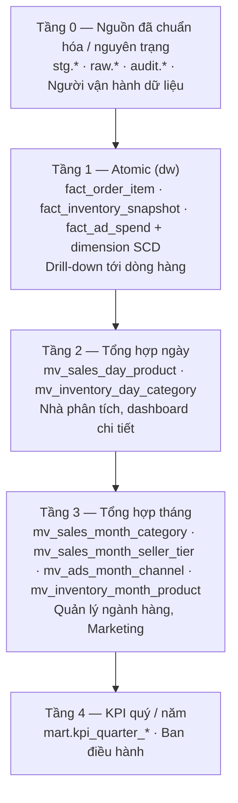

# Milestone 2 — Mức hạt (Granularity) và tháp phân tầng dữ liệu

Sản phẩm của Milestone 2 (lộ trình, Inmon chương 3; Kimball – grain): **2.1** bản đặc tả mức hạt atomic, **2.2** tháp phân tầng Atomic → Summary.

Số liệu đo trên `mock_oltp` lúc 22:30 ngày 07/11/2026 (dữ liệu mô phỏng 01/01–12/01/2026). Script: [dw/sql/05_profiling/m2_grain_check.sql](../../../dw/sql/05_profiling/m2_grain_check.sql); output: [evidence/04_m2_grain_check.txt](../../implementation/evidence/04_m2_grain_check.txt). Nguồn và quy tắc tích hợp xem [M1](M1_KHAO_SAT_NGUON_CHU_DE_TICH_HOP.md).

---

## 2.1. Đặc tả mức hạt atomic

Nguyên tắc chung: **lưu ở mức chi tiết nhất mà nguồn cung cấp và câu hỏi nghiệp vụ cần**. Mọi tổng hợp (ngày, tháng, quý, danh mục cha) đều tính được từ tầng đáy; điều ngược lại thì không. Kimball gọi đây là "atomic grain", Inmon gọi là "tầng chi tiết thấp nhất".

### 2.1.1. `Fact_Order_Item` — quy trình Bán hàng

| Mục | Đặc tả |
|---|---|
| **Câu grain** | *Một dòng của fact là **một dòng sản phẩm trong một đơn hàng đã giao thành công** (đơn `Completed`), ghi nhận vào ngày đơn hoàn tất.* |
| Nguồn | `order_items` ⋈ `orders` (+ `payments` gộp 1 dòng/đơn, + `order_item_promotions` qua bridge) |
| Khóa grain (nghiệp vụ) | `(source_system, order_id, line_number)`: **duy nhất ở 1.687/1.687 dòng** |
| Điều kiện đưa vào | `orders.order_status = 'Completed'` **và** `order_items.item_status ∈ {Fulfilled, Returned}`. Hiện có 1.195 dòng `Completed/Fulfilled`, tất cả đều có `completed_at` |
| Không đưa vào | `Cancelled` (78 dòng), `Pending`/`Processing` (414 dòng, đang xử lý → vào fact khi hoàn tất) |
| Ngày của fact | `date_key` = ngày `orders.completed_at` (ngày giao thành công). `order_date_key` = ngày `created_at` (vai trò thứ hai của `Dim_Date`) |
| Dữ liệu đến muộn | Đơn hoàn tất sau khi đặt **2–6 ngày** (2 ngày: 83, 3: 649, 4: 266, 5: 37, 6: 2). Batch của ngày D nạp mọi dòng có `completed_at` trong ngày D, kể cả đơn đặt từ D−6 |
| Thuộc tính cấp đơn ở dòng | Mỗi đơn có đúng **1 seller, 1 kênh** (1.467/1.467), nên `seller_key`, `channel_key` gắn vào dòng không làm sai grain. 149 checkout bị tách thành nhiều đơn theo seller (sàn đa người bán) |
| Measure cấp đơn | `shipping_fee`, `shipping_discount_amount`, `final_amount` **không** đưa xuống dòng, vì chia sẽ gây sai số. Để ở `mart.order_summary` (grain đơn) |
| Vì sao không lưu tổng đơn | 11,6% đơn có từ 2–4 dòng (167 đơn 2 dòng, 19 đơn 3 dòng, 5 đơn 4 dòng). Lưu tổng đơn thì mất phân tích theo sản phẩm, danh mục và voucher của từng dòng |
| Khối lượng | ~110 dòng/ngày → **~40.000 dòng/năm** |

### 2.1.2. `Fact_Inventory_Snapshot` — quy trình Tồn kho

| Mục | Đặc tả |
|---|---|
| **Câu grain** | *Một dòng là **tồn kho của một sản phẩm tại một kho vào cuối một ngày**.* |
| Nguồn | `inventory_daily_balance` (engine chốt sau `AUT-WH-04`), cộng `inventory_movements` để có lượng nhập/bán/điều chỉnh trong ngày |
| Khóa grain | `(balance_date, warehouse_id, sku → product_id)`: **duy nhất ở 219.067/219.067 dòng** |
| Thưa hay dày | **Thưa (sparse)**: mỗi ngày chỉ có các cặp kho–SKU thực sự kinh doanh: **18.257/21.192 cặp (86%)**. Quyết định giữ thưa: cặp không có dòng nghĩa là "không kinh doanh tại kho này", **khác** với tồn = 0 (hết hàng, có dòng và `stockout_flag = 1`). Không sinh dòng 0 giả cho 2.935 cặp còn lại |
| Ngày của fact | `date_key = balance_date` |
| Tính cộng | `quantity_on_hand`, `reserved`, `available`, `inventory_value_est` là **semi-additive** (không cộng theo ngày). Nhập/bán/điều chỉnh trong ngày là additive |
| Vì sao lưu theo ngày, không theo tháng | Câu hỏi "hết hàng ngày nào", "số ngày hết hàng", "tồn bình quân" cần mức ngày; tồn cuối tháng và trung bình tháng tính được từ mức ngày |
| Khối lượng | ~18.256 dòng/ngày → **~6,7 triệu dòng/năm**. Đây là fact lớn nhất, dùng cho thí nghiệm partition (BM02) |

### 2.1.3. `Fact_Ad_Spend` — quy trình Marketing

| Mục | Đặc tả |
|---|---|
| **Câu grain** | *Một dòng là **chi phí quảng cáo của một chiến dịch trên một kênh trong một tháng**.* (theo đề xuất Bảng 6) |
| Nguồn | `ad_spend_logs` (theo ngày) ⋈ `marketing_campaigns` |
| Khóa nguồn | `(campaign_id, channel_code, log_date)`: **duy nhất 8/8**, ràng buộc unique ở OLTP |
| Atomic thật sự | Nguồn chi tiết tới **ngày**, chi tiết hơn grain tháng của fact. Quyết định: **giữ bản ngày ở `stg.ad_spend_daily`** (atomic, cho kiểm tra và đối soát) và **fact ở grain tháng** đúng như đề xuất, vì doanh thu được so với quảng cáo ở mức tháng–kênh (đề xuất mục 6). Ghi rõ đây là grain **tổng hợp có chủ đích**, không phải mất dữ liệu |
| Ngày của fact | `month_key` = tháng của `log_date`. Tháng chưa kết thúc được nạp lại (upsert) ở batch sau |
| Khối lượng | Từ 30/01: ~3–6 chiến dịch đang chạy mỗi tháng × 1 kênh → ~50–70 dòng fact/năm (~1.200 dòng ngày ở `stg`) |

### 2.1.4. Dimension liên quan grain

| Dimension | Grain | Ghi chú |
|---|---|---|
| `Dim_Date` | 1 ngày | 2025–2027, có cờ ngày đôi; `Dim_Month` = 1 tháng (conformed với Date) |
| `Dim_Product` | 1 **phiên bản** sản phẩm (SCD2) | Fact tra phiên bản theo `completed_at` / `balance_date` |
| `Dim_Category` | 1 nút cây | 77 nút, sâu 2–4 cấp (M1, IR-04); closure table để cộng theo cây con |
| `Dim_Seller`, `Dim_Customer` | 1 phiên bản (SCD2) | Khách vãng lai = `-1` (53% đơn) |
| `Dim_Customer_Profile` | 1 tổ hợp bucket | Mini-dimension |

---

## 2.2. Tháp phân tầng dữ liệu

| Tầng | Đối tượng | Grain | Nguồn | Làm mới | Kích thước ước tính / năm | Người dùng (đề xuất Bảng 3) |
|---|---|---|---|---|---|---|
| 0 | `raw.*`, `stg.*`, `audit.*` | Như nguồn | OLTP, crawler | Mỗi batch | Tương đương nguồn | Người vận hành dữ liệu |
| 1 | `dw.fact_order_item` | Dòng hàng | `stg.order_item_sales` | Mỗi batch (incremental) | ~40.000 | Nhà phân tích (drill tới dòng) |
| 1 | `dw.fact_inventory_snapshot` | SKU × kho × ngày | `stg.inventory_daily` | Mỗi batch | **~6,7 triệu** | Nhà phân tích |
| 1 | `dw.fact_ad_spend` | Chiến dịch × kênh × tháng | `stg.ad_spend_monthly` | Mỗi batch (upsert tháng) | ~60 | Marketing |
| 2 | `mart.mv_sales_day_product` | Ngày × sản phẩm × kênh | Fact 1 | Sau batch | ~31.000 (đo: 1.021 nhóm / 12 ngày) | Dashboard Tổng quan bán hàng |
| 2 | `mart.mv_inventory_day_category` | Ngày × danh mục lá × kho | Fact 2 | Sau batch | **~96.000** (đo: 3.168 nhóm / 12 ngày; giảm ~70 lần so với atomic) | Đối soát vận hành |
| 3 | `mart.mv_sales_month_category` | Tháng × danh mục × kênh | Fact 1 (hoặc tầng 2) | Sau batch | ≤ 77 nút × 3 kênh × 12 ≈ 2.800 | Quản lý ngành hàng; **BM01** |
| 3 | `mart.mv_sales_month_seller_tier` | Tháng × hạng seller (phiên bản tại lúc bán) × kênh | Fact 1 + Dim_Seller SCD2 | Sau batch | ~108 | Câu hỏi "doanh thu theo hạng seller tại thời điểm bán" |
| 3 | `mart.mv_inventory_month_product` | Tháng × sản phẩm × kho (tồn cuối kỳ, tồn bình quân, số ngày hết hàng) | Fact 2 | Sau batch | ~220.000 | Quản lý ngành hàng |
| 3 | `mart.mv_ads_month_channel` | Tháng × kênh | Fact 3 | Sau batch | 36 | Marketing, drill-across |
| 4 | `mart.kpi_quarter_*` (view) | Quý / năm | Tầng 3 | Theo tầng 3 | Vài chục dòng | Ban điều hành |

### 2.2.1. Quy tắc tổng hợp giữa các tầng

| Loại measure | Ví dụ | Cách lên tầng |
|---|---|---|
| Additive | `net_revenue`, `quantity`, `discount_amount`, `cost_amount`, `clicks`, `qty_sold` | `SUM` qua mọi chiều |
| Semi-additive | `quantity_on_hand`, `inventory_value_est` | `SUM` theo kho/sản phẩm/danh mục **trong cùng một ngày**; qua thời gian dùng **giá trị ngày cuối kỳ** hoặc **trung bình ngày**, không bao giờ `SUM` |
| Non-additive | AOV, CTR, tỷ lệ giảm giá, giá bán bình quân, tỷ lệ hoa hồng | Lưu **tử và mẫu** ở mỗi tầng, tính tỷ số khi đọc |
| Đếm phân biệt | Số đơn, số khách | **Không** cộng số đơn của tầng dưới (một đơn có nhiều sản phẩm sẽ bị đếm lặp). Tầng 2/3 lưu `COUNT(DISTINCT order_id)` đúng tại grain của tầng, hoặc tính lại từ atomic |
| Theo cây danh mục | Doanh thu danh mục cha | Cộng qua closure table `bridge_category_hierarchy`; không cộng subtotal của cha với dòng con |

### 2.2.2. Lựa chọn tầng cho thí nghiệm hiệu năng

- **BM01 (Materialized View):** `mv_sales_month_category` so với tổng hợp trực tiếp từ `fact_order_item`. Fact 1 nhỏ (~40.000 dòng/năm) nên chênh lệch thời gian sẽ thấp. Thí nghiệm dùng thêm bản nhân `bench.fact_order_item_x50` (~2 triệu dòng), theo PLAN 7.1. Có thể chạy thêm cặp `mv_inventory_day_category` so với `fact_inventory_snapshot` trên dữ liệu thật (giảm ~70 lần).
- **BM02 (Partition):** `fact_inventory_snapshot`, partition theo tháng của `date_key`. Đây là bảng thật lớn nhất.
- **BM03 (Index):** lọc theo seller và khoảng ngày trên Fact 1 (bản `bench` x50).

### 2.2.3. Ranh giới giữa các tầng

- Dashboard chỉ đọc `mart`. Muốn drill-down tới dòng hàng thì đọc `dw` qua role `dw_analyst`.
- `mart` chỉ được refresh khi batch qua đối soát (RC-01..07). Nếu refresh lỗi, dashboard giữ bản cũ và hiển thị thời điểm cập nhật gần nhất (đề xuất mục 3).
- Tầng 2 và 3 không bao giờ được sửa tay. Mọi số liệu đều phải tái tạo được từ tầng 1.
