# Milestone 3 — Thiết kế vật lý: Galaxy schema, bus matrix, metadata

Sản phẩm của Milestone 3 (lộ trình; Kimball – Dimensional Modeling):
- **3.1** quy trình nghiệp vụ trọng tâm;
- **3.2** Fact và Dimension kèm PK/FK, sơ đồ star/galaxy schema;
- **3.3** từ điển dữ liệu: [M3_TU_DIEN_DU_LIEU.md](M3_TU_DIEN_DU_LIEU.md), sinh tự động, gồm 19 bảng và 199 cột.

Cấu trúc đã được **tạo thật** trong database `dwh`, schema `dw`. DDL nằm trong [dw/sql/30_dw/](../../../dw/sql/30_dw/) và [dw/sql/50_audit/](../../../dw/sql/50_audit/); chạy bằng `bash dw/sql/run_ddl.sh` (idempotent). Grain theo [M2](M2_GRAIN_PHAN_TANG.md); quy tắc tích hợp theo [M1](M1_KHAO_SAT_NGUON_CHU_DE_TICH_HOP.md).

---

## 3.1. Quy trình nghiệp vụ trọng tâm

| Mục | Nội dung |
|---|---|
| Quy trình | **Bán hàng**: khách đặt hàng → thanh toán → sàn/seller xử lý → giao thành công |
| Vì sao chọn | Doanh thu là câu hỏi số 1 của đề xuất (mục 2); có dữ liệu chi tiết nhất (dòng hàng); dùng hầu hết các dimension dùng chung |
| Sự kiện đo | Một dòng hàng được giao thành công (đơn `Completed`) |
| Câu hỏi trả lời | Doanh thu theo tháng/danh mục/seller/kênh; top sản phẩm/seller; ảnh hưởng của voucher tới giá trị đơn; doanh thu theo hạng seller và giá niêm yết **tại thời điểm bán** |
| Fact | `dw.fact_order_item` |
| Hai quy trình đi kèm (galaxy) | Tồn kho → `dw.fact_inventory_snapshot`; Marketing → `dw.fact_ad_spend` |

## 3.2. Galaxy schema

### 3.2.1. Sơ đồ tổng thể

```mermaid
erDiagram
  dim_date ||--o{ fact_order_item : "date_key (hoàn tất)"
  dim_date ||--o{ fact_order_item : "order_date_key (đặt)"
  dim_product ||--o{ fact_order_item : product_key
  dim_category ||--o{ fact_order_item : category_key
  dim_seller ||--o{ fact_order_item : seller_key
  dim_customer ||--o{ fact_order_item : customer_key
  dim_customer_profile ||--o{ fact_order_item : customer_profile_key
  dim_channel ||--o{ fact_order_item : channel_key
  dim_payment_method ||--o{ fact_order_item : payment_method_key
  dim_campaign ||--o{ fact_order_item : campaign_key
  dim_promotion_group ||--o{ fact_order_item : promotion_group_key
  dim_promotion_group ||--|{ bridge_promotion_group : ""
  dim_promotion ||--o{ bridge_promotion_group : ""

  dim_date ||--o{ fact_inventory_snapshot : date_key
  dim_product ||--o{ fact_inventory_snapshot : product_key
  dim_warehouse ||--o{ fact_inventory_snapshot : warehouse_key
  dim_category ||--o{ fact_inventory_snapshot : category_key

  dim_month ||--o{ fact_ad_spend : month_key
  dim_campaign ||--o{ fact_ad_spend : campaign_key
  dim_channel ||--o{ fact_ad_spend : channel_key

  dim_month ||--o{ dim_date : month_key
  dim_category ||--o{ dim_category : parent_category_key
  dim_category ||--o{ bridge_category_hierarchy : ancestor_key
  dim_category ||--o{ bridge_category_hierarchy : descendant_key
  dim_category ||--o{ dim_product : category_key
  dim_channel ||--o{ dim_campaign : target_channel_key
```

### 3.2.2. Fact và khóa

| Fact | Loại | PK | FK (số lượng) | Partition | Measure (chi tiết ở PLAN 4.8) |
|---|---|---|---|---|---|
| `fact_order_item` | Transaction | `(date_key, source_system, order_id, line_number)` | 11: 2 vai trò `dim_date`, product, category, seller, customer, customer_profile, channel, payment_method, campaign, promotion_group | RANGE `date_key` theo tháng: 36 partition (2025-01..2027-12) + `default` | quantity, list/unit price, list/gross amount, list_discount, discount, **net_revenue**, commission_rate/amount, seller_net, cost_est, margin_est, is_returned, line_count |
| `fact_inventory_snapshot` | Periodic snapshot (thưa) | `(date_key, product_key, warehouse_key)` | 4: date, product, warehouse, category | RANGE `date_key` theo tháng: 36 + `default` | on_hand, reserved, available (**semi-additive**), imported, sold, adjusted, stockout_flag, inventory_value_est |
| `fact_ad_spend` | Periodic (tháng) | `(month_key, campaign_key, channel_key)` | 3: month, campaign, channel | Không (rất nhỏ) | cost_amount, impressions, clicks, active_days |

Ràng buộc CHECK bảo vệ measure ngay trong DB:
- `gross_amount = quantity × unit_price`;
- `net_revenue = gross_amount − discount_amount`;
- `0 ≤ commission_rate ≤ 1`;
- `reserved ≤ on_hand`, `available = on_hand − reserved`;
- `impressions ≥ clicks`.

### 3.2.3. Dimension

| Dimension | Khóa | Lịch sử | Điểm thiết kế |
|---|---|---|---|
| `dim_date` | `date_key` yyyymmdd | Tĩnh | 1.095 ngày (2025–2027); cờ cuối tuần, ngày lễ (2026 có Tết 16–19/02, Giỗ Tổ 26/04), **ngày đôi**, cuối tháng |
| `dim_month` | `month_key` yyyymm | Tĩnh | Conformed với `dim_date` (FK `dim_date.month_key`); grain của Fact_Ad_Spend |
| `dim_product` | `product_key` (serial) + `product_id` | SCD2 (giá, danh mục, `is_active`) + SCD1 | Index unique một phần: đúng 1 bản `is_current` cho mỗi `product_id`; `CHECK valid_from < valid_to` |
| `dim_category` + `bridge_category_hierarchy` | `category_key` = mã Tiki | Phân cấp | Một cha (`parent_category_key`), closure table để cộng theo cây con |
| `dim_seller` | `seller_key` + `seller_id` | SCD2 (hạng, tỉnh, trạng thái) + SCD1 | Chỉ lưu tên miền email và SĐT đã che |
| `dim_seller_tier_t3` | `seller_id` | **SCD3** | `current_tier`, `previous_tier`, `tier_changed_on` (bảng riêng, theo đề xuất Bảng 9) |
| `dim_customer` | `customer_key` + `customer_id` | SCD2 (tỉnh) + SCD1 | `-1` = khách vãng lai (53% đơn) |
| `dim_customer_profile` | `customer_profile_key` | **Mini-dimension** | Sinh sẵn 125 tổ hợp: 5 hạng × 5 nhóm chi tiêu 12 tháng × 5 nhóm tần suất |
| `dim_channel`, `dim_payment_method`, `dim_warehouse`, `dim_campaign`, `dim_promotion` | khóa = mã nguồn | SCD1 | `dim_channel.marketing_code` phục vụ IR-03 |
| `dim_promotion_group` + `bridge_promotion_group` | `promotion_group_key` | — | Nhóm = toàn bộ voucher trên 1 dòng hàng |

Thành viên đặc biệt có sẵn trong **mọi** dimension (đề xuất mục 5):
- `-1` = Không áp dụng, ví dụ khách vãng lai, không có chiến dịch, không dùng voucher;
- `0` = Chưa xác định; được đếm và hiển thị trên báo cáo.

### 3.2.4. Bus matrix (đã hiện thực bằng FK)

| Dimension | fact_order_item | fact_inventory_snapshot | fact_ad_spend |
|---|---|---|---|
| Date | ✔ (2 vai trò) | ✔ | — |
| Month | ✔ (qua Date) | ✔ (qua Date) | ✔ |
| Product | ✔ | ✔ | — |
| Category (cây) | ✔ | ✔ | — |
| Seller | ✔ | (qua Product.seller_id) | — |
| Customer + Profile | ✔ | — | — |
| Channel | ✔ | — | ✔ |
| Payment_Method | ✔ | — | — |
| Campaign | ✔ | — | ✔ |
| Promotion (bridge) | ✔ | — | — |
| Warehouse | — | ✔ | — |

So với đề xuất Bảng 7, có thêm Campaign ở Fact_Order_Item (nguồn có `orders.campaign_id`) và Category ở hai fact đầu (cây danh mục để drill-down). Các fact không nối trực tiếp với nhau. Drill-across ghép theo mã nghiệp vụ (`product_id`, `month_key`, `channel_key`) sau khi đã tổng hợp từng phía.

### 3.2.5. Quyết định thiết kế vật lý

| # | Quyết định | Lý do / bằng chứng |
|---|---|---|
| D1 | Tiền dùng `numeric(18,2)` | Engine đã làm tròn 2 chữ số: kiểm tra `quantity × unit_price − round(discount,2) = round(net,2)` → 0 dòng lệch, nên không mất chính xác so với nguồn |
| D2 | PK của fact partition = khóa nghiệp vụ + `date_key` | PostgreSQL yêu cầu khóa partition nằm trong PK/UNIQUE. `completed_at` của một đơn không đổi, nên khóa vẫn duy nhất theo nghiệp vụ. ETL upsert theo PK này (idempotent, T3) |
| D3 | Partition tháng cho 2 fact lớn, kèm `default` | `fact_inventory_snapshot` ~6,7 triệu dòng/năm (BM02); dữ liệu ngoài khoảng vẫn vào `default`, không lỗi |
| D4 | **Bridge chỉ giữ `weighting_factor`**, bỏ `allocated_discount` có trong bản nháp PLAN 4.3 | Một nhóm voucher dùng chung cho nhiều dòng hàng có số tiền giảm khác nhau, nên số tiền không thuộc grain của nhóm. Tiền phân bổ = `fact.discount_amount × weighting_factor`; RC-03 kiểm tra Σ weight = 1 |
| D5 | Mini-dimension sinh trước toàn bộ tổ hợp | Khóa ổn định, không phụ thuộc thứ tự nạp; fact tra theo bucket |
| D6 | Khóa danh mục = mã Tiki | Cây cố định, mã nguồn ổn định, dễ đối chiếu với crawler; danh mục không có SCD2 |
| D7 | SĐT che, email chỉ giữ tên miền | Giảm dữ liệu cá nhân trong kho; phân tích không cần dữ liệu đầy đủ |
| D8 | Index FK cơ bản trên fact (`product_key`, `seller_key`, `customer_key`, `order_id`) | Phục vụ drill-down. Index ghép cho BM03 thử riêng ở schema `bench` để so sánh công bằng |

## 3.3. Metadata

- Mô tả bảng và cột lưu ngay trong catalog bằng `COMMENT ON`.
- Lineage (nguồn OLTP, quy tắc, tính cộng, loại SCD) lưu ở `audit.column_lineage`.
- View `audit.data_dictionary` ghép hai phần trên với kiểu dữ liệu và NULL.
- [M3_TU_DIEN_DU_LIEU.md](M3_TU_DIEN_DU_LIEU.md) xuất từ view này bằng `python dw/tools/export_dictionary.py`. Hiện phủ **199/199 cột** của 19 bảng.
