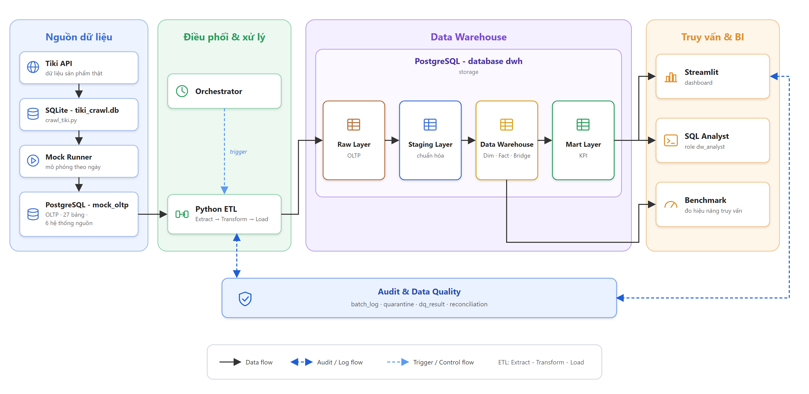
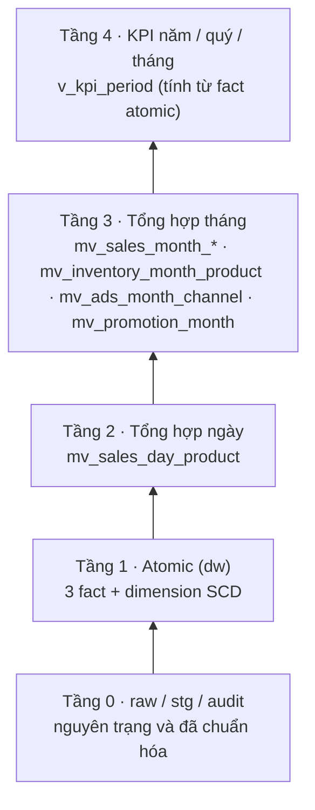
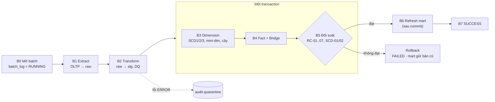

# Master Blueprint — Kho dữ liệu sàn thương mại điện tử đa người bán

| | |
|---|---|
| Nhóm / môn | Nhóm 5 — Kho dữ liệu, PTIT |
| Sản phẩm | Milestone 5.2 (nộp 17/11/2026) — tổng hợp thiết kế, triển khai, kết quả đo và kiểm thử của toàn dự án |
| Trạng thái dữ liệu khi viết | Ngày 09/11/2026; kho đã nạp **4 batch SUCCESS** (batch 4–7), dữ liệu nghiệp vụ từ **03/01 đến 31/01/2026** (mô phỏng vẫn đang chạy tiếp) |
| Mã nguồn | Repo `e-commerce` — cách tái lập ở [README.md](../README.md) |
| Tài liệu gốc | [DW_BUILD_PLAN.md](DW_BUILD_PLAN.md) (kế hoạch) · [M1](M1_KHAO_SAT_NGUON_CHU_DE_TICH_HOP.md) · [M2](M2_GRAIN_PHAN_TANG.md) · [M3](M3_THIET_KE_VAT_LY_STAR_SCHEMA.md) · [Từ điển](M3_TU_DIEN_DU_LIEU.md) · [Báo cáo kiểm thử](BAO_CAO_KIEM_THU_T1_T7.md) · [Nhật ký triển khai](implementation/README.md) |

Tài liệu này là bản **tổng hợp có tham chiếu**: mỗi mục tóm tắt quyết định và số liệu, rồi chỉ tới tài liệu chi tiết và bằng chứng chạy thật. Mọi số liệu là số **đo trên kho ở thời điểm trên**, không phải số dự kiến.

---

## 1. Bối cảnh, mục tiêu, phạm vi

### 1.1. Bối cảnh

Một sàn thương mại điện tử đa người bán (nhiều seller, nhiều kênh bán, kho, khuyến mãi, quảng cáo) vận hành trên một cơ sở dữ liệu giao dịch (OLTP). OLTP chỉ lưu **trạng thái hiện tại**: khi một seller đổi hạng từ `Normal` sang `Mall`, giá trị cũ bị ghi đè, nên câu hỏi "doanh thu theo hạng seller **tại thời điểm bán**" không trả lời được trên OLTP. Cùng với thiếu lịch sử là bốn lý do nữa khiến báo cáo không nên chạy trực tiếp trên OLTP: khóa và mã không thống nhất giữa các hệ thống, grain khác nhau (ghép trực tiếp làm nhân đôi số liệu), truy vấn phân tích tranh tài nguyên với giao dịch, và dữ liệu của ngày đang chạy chưa chốt (chi tiết và số đo ở [M1 §1.1.3](M1_KHAO_SAT_NGUON_CHU_DE_TICH_HOP.md)).

### 1.2. Mục tiêu theo milestone

| Milestone | Mục tiêu | Sản phẩm | Trạng thái |
|---|---|---|---|
| Bước 1.0–1.1 | Dữ liệu nguồn có thay đổi dimension để kiểm chứng SCD; dựng database `dwh`, role, schema | Cấu hình mock `dw-scd-2026`, `dw/sql/00_init` | ✅ 07/11 |
| M1 | Bản đồ nguồn, chủ đề, quy tắc tích hợp, quy tắc lưu vết | [M1](M1_KHAO_SAT_NGUON_CHU_DE_TICH_HOP.md) | ✅ 07/11 |
| M2 | Mức hạt atomic, tháp phân tầng | [M2](M2_GRAIN_PHAN_TANG.md) | ✅ 07/11 |
| M3 | Galaxy schema, bus matrix, từ điển dữ liệu | [M3](M3_THIET_KE_VAT_LY_STAR_SCHEMA.md), [từ điển](M3_TU_DIEN_DU_LIEU.md) | ✅ 07/11 |
| M4 | ETL: extract, transform/DQ, SCD, fact, đối soát | `dw/etl/*`, mart, dashboard | ✅ 07–08/11 |
| 5.1 | Thí nghiệm hiệu năng MV / partition / index | `bench/`, [bước 10](implementation/10_buoc-7_thi-nghiem-hieu-nang.md) | ✅ 08/11 |
| Kiểm thử | T1–T7 | `dw/tests/run_tests.py`, [báo cáo](BAO_CAO_KIEM_THU_T1_T7.md) | ✅ 09/11 |
| 5.2 | Master Blueprint (tài liệu này), slide, demo | — | Tài liệu này ✅; slide, demo còn lại |

### 1.3. Phạm vi

| Trong phạm vi | Ngoài phạm vi (đưa vào lộ trình, mục 11) |
|---|---|
| 3 quy trình nghiệp vụ: **Bán hàng**, **Tồn kho**, **Marketing** → `Fact_Order_Item`, `Fact_Inventory_Snapshot`, `Fact_Ad_Spend` | Vận chuyển / giao hàng (Fact_Order_Fulfillment), hoàn trả (Fact_Return), đối soát tài chính seller (Fact_Seller_Settlement), hành vi người dùng (clickstream) |
| Dữ liệu sản phẩm **thật** (3.532 sản phẩm crawl từ Tiki) + dữ liệu giao dịch **mô phỏng** (seed 42) | Dữ liệu giao dịch thật |
| Lịch sử thuộc tính: SCD1/2/3, mini-dimension, cây danh mục, bridge khuyến mãi | Streaming, CDC thời gian thực |

---

## 2. Kiến trúc tổng thể



Luồng đi một chiều từ trái sang phải: **nguồn → ETL → kho → mart → dashboard**, kèm một dải *Audit & Data Quality* ghi lại mọi batch, dòng lỗi và đối soát.

### 2.1. Các lớp trong database `dwh`

| Schema | Nội dung | Quy tắc |
|---|---|---|
| `raw` | Bản trích nguyên trạng từng batch (19 bảng) + `batch_id`, `extracted_at`, `row_hash` | **Bất biến**: trigger chặn UPDATE/DELETE; nạp lại tạo batch mới |
| `stg` | Dữ liệu đã chuẩn hóa kiểu, ánh xạ mã, gắn cờ DQ (13 bảng nghiệp vụ + bảng `map_*`) | Làm mới theo batch |
| `dw` | 3 fact, 14 dimension, 2 bridge | Chỉ nạp dữ liệu đạt kiểm tra; fact không bao giờ bị DELETE |
| `mart` | 8 materialized view, view KPI và drill-across | Refresh sau batch SUCCESS |
| `audit` | `batch_log`, `batch_table_log`, `dq_result`, `quarantine`, `reconciliation`, `column_lineage` | Lịch sử nạp, lỗi, đối soát |
| `bench` | Bản nhân bản và biến thể cho thí nghiệm hiệu năng | Không ảnh hưởng `mart` |

Quyền truy cập là một phần của kiến trúc: ETL đọc OLTP bằng role **`dw_reader` chỉ có SELECT** (phiên `read_only`, snapshot `REPEATABLE READ`); ghi kho bằng **`dw_etl`**; người phân tích và dashboard dùng **`dw_analyst`** chỉ đọc `dw`, `mart` (và `bench`).

### 2.2. Môi trường và công nghệ

PostgreSQL 15 trong Docker (3 database: `mock_oltp`, `mock_control`, `dwh`); Python 3.12 (`psycopg`) cho ETL; SQL thuần, set-based cho biến đổi; Streamlit + Plotly cho dashboard; Mock Studio (engine mô phỏng, chạy trong WSL2) sinh dữ liệu. Toàn bộ dữ liệu nằm ở ổ D.

### 2.3. Vì sao thiết kế như vậy

- **raw bất biến + stg tách rời:** dòng gốc không bao giờ mất; lỗi được cách ly kèm lý do thay vì xóa âm thầm; có thể dựng lại stg từ raw.
- **Batch theo ngày đã hoàn tất (watermark):** engine chỉ chốt một ngày sau khi tồn kho cuối ngày xong, nên kho chỉ nạp `last_day`, không đọc ngày đang chạy.
- **B3–B5 trong một transaction, B6 sau commit:** lỗi giữa chừng → rollback toàn bộ, `mart` giữ bản cũ và dashboard hiển thị cảnh báo "dữ liệu cũ".

---

## 3. Nguồn dữ liệu, chủ đề và quy tắc tích hợp

### 3.1. Bản đồ nguồn

Sáu hệ thống vận hành dùng chung database `mock_oltp` (33 bảng) và một nguồn ngoài (crawler Tiki, SQLite). Số dòng là số đo ở M1 (12 ngày đầu); xem bảng đầy đủ ở [M1 §1.1.1](M1_KHAO_SAT_NGUON_CHU_DE_TICH_HOP.md).

| # | Hệ thống | Bảng chính | Dùng cho |
|---|---|---|---|
| S1 | Catalog & Người bán | `products`, `categories`, `sellers`, `seller_commission_rates` | Dim_Product, Dim_Category, Dim_Seller |
| S2 | Đơn hàng | `orders`, `order_items`, `payments`, `customers`, `channels`, `payment_methods` | **Fact_Order_Item**, Dim_Customer, Dim_Channel |
| S3 | Kho & Vận chuyển | `inventory_daily_balance`, `inventory_movements`, `warehouses` | **Fact_Inventory_Snapshot**, Dim_Warehouse |
| S4 | Marketing & Khuyến mãi | `ad_spend_logs`, `marketing_campaigns`, `promotions`, `order_item_promotions` | **Fact_Ad_Spend**, Dim_Campaign, Dim_Promotion + bridge |
| S5 | Clickstream | `sessions`, `page_events`, `cart_items` | Ngoài phạm vi |
| S6 | Tài chính | `seller_payouts`, `seller_payout_items` | Vòng mở rộng 4 |
| S7 | Crawler Tiki (SQLite) | `products`, `product_raw`, `product_categories` | Sản phẩm thật; cây danh mục nhiều cấp |

### 3.2. Chủ đề cốt lõi

**C1 Bán hàng** (trọng tâm) · **C2 Sản phẩm & Người bán** · **C3 Tồn kho** · **C4 Marketing**, cùng dimension dùng chung **Khách hàng**. Ba quy trình ứng với ba fact: C1 → Fact_Order_Item, C3 → Fact_Inventory_Snapshot, C4 → Fact_Ad_Spend.

### 3.3. Quy tắc tích hợp (Integrated)

Mười xung đột thực tế giữa các hệ thống, mỗi xung đột có bằng chứng đo ở M1 §1.3:

| Mã | Xung đột | Quy tắc chuẩn hóa |
|---|---|---|
| IR-01 | Kho dùng `sku`, đơn hàng dùng `product_id` | Khóa chuẩn = `product_id`, ánh xạ `sku → product_id`; SKU lạ → cách ly (DQ-04) |
| IR-02 | Vận chuyển dùng `order_code`, nơi khác dùng `order_id` | Chuẩn về `order_id` qua `orders.order_code` |
| IR-03 | Mã kênh: marketing `WEB`, bảng kênh `Web`, tài liệu `MOBILE_APP`/`LIVE` | `map_channel` nhận mọi biến thể → `Web`/`App`/`Livestream`; mã lạ → cách ly |
| IR-04 | Danh mục ở 3 nơi, độ sâu khác nhau | Danh mục chuẩn = `products.category_id`; cây = `primary_category_path` của crawler cắt tại danh mục OLTP → **77 nút**, sâu 2–4 cấp |
| IR-05 | 53% đơn là khách vãng lai (không có `customer_id`) | `customer_key = -1`; không tra được = `0` |
| IR-06 | Tiền `numeric(24,6)`, có phần lẻ do phân bổ giảm giá | `numeric(18,2)`, không làm tròn trước khi đối soát |
| IR-07 | Thời gian không múi giờ | Giữ nguyên, quy ước UTC+7; `TimeZone = Asia/Ho_Chi_Minh` |
| IR-08 | Tỉnh/thành là tên tự do ở 4 bảng | `map_province`: tên → `province_code` + vùng (mô hình 34 tỉnh) |
| IR-09 | Thuộc tính khách thiếu (giới tính 15%, ngày sinh 26%) | `gender = 'U'`, `age_band = 'Không rõ'`; không loại khách |
| IR-10 | `discount_rate` là phần trăm, `commission_rate` là tỷ lệ | Chuẩn mọi tỷ lệ về 0–1 |

### 3.4. Quy tắc lưu vết (Nonvolatile & Time-variant)

`raw` bất biến (NV-01) · fact không DELETE, upsert theo khóa nghiệp vụ (NV-02) · dòng lỗi giữ vĩnh viễn trong `audit.quarantine` (NV-03) · dimension SCD2 lưu khoảng hiệu lực `[valid_from, valid_to)` (TV-01) · lịch sử **tạo ra bằng so sánh snapshot mỗi batch** vì OLTP không có lịch sử (TV-02) · ngày hiệu lực = đầu ngày của `updated_at` (TV-03) · khóa thời gian của fact theo thời điểm nghiệp vụ, không theo lúc nạp (TV-04) · chỉ nạp ngày đã hoàn tất (TV-05) · thay đổi đến muộn không sửa hồi tố, được cách ly (TV-06).

---

## 4. Mức hạt (grain) và tháp phân tầng

### 4.1. Ba grain atomic

| Fact | Câu grain | Khóa nghiệp vụ | Quyết định đáng chú ý |
|---|---|---|---|
| `Fact_Order_Item` | Một **dòng sản phẩm** trong một đơn đã hoàn tất, ghi nhận vào **ngày hoàn tất** | `(source_system, order_id, line_number)` | `date_key` = ngày hoàn tất (không phải ngày đặt; ngày đặt là vai trò thứ hai của `Dim_Date`); đơn hoàn tất 2–6 ngày sau khi đặt nên batch nạp cả đơn đặt từ vài ngày trước; không đưa tổng đơn xuống dòng vì chia sẻ gây sai số |
| `Fact_Inventory_Snapshot` | Tồn của một sản phẩm tại một kho **cuối một ngày** | `(date_key, product_key, warehouse_key)` | Snapshot **thưa** (86% cặp kho–SKU có dòng): "không có dòng" nghĩa là không kinh doanh, **khác** với tồn = 0 (hết hàng, `stockout_flag = 1`) |
| `Fact_Ad_Spend` | Chi phí quảng cáo của một chiến dịch trên một kênh trong **một tháng** | `(month_key, campaign_key, channel_key)` | Nguồn chi tiết tới ngày: giữ bản ngày ở `stg.ad_spend_daily`, fact ở grain tháng có chủ đích (doanh thu được so với quảng cáo ở mức tháng–kênh) |

### 4.2. Tháp phân tầng



Quy tắc đi lên tầng theo loại measure (additive, semi-additive, non-additive, đếm phân biệt, theo cây) ở [M2 §2.2.1](M2_GRAIN_PHAN_TANG.md). Điểm then chốt: số đơn và số khách **không cộng** qua grain (một đơn có nhiều dòng), nên MV đặt hậu tố `_na` và KPI theo kỳ tính trực tiếp từ fact atomic bằng `GROUPING SETS`.

---

## 5. Mô hình chiều: Galaxy schema

### 5.1. Sơ đồ

```mermaid
erDiagram
  dim_date ||--o{ fact_order_item : "date_key (hoàn tất) / order_date_key (đặt)"
  dim_product ||--o{ fact_order_item : product_key
  dim_category ||--o{ fact_order_item : category_key
  dim_seller ||--o{ fact_order_item : seller_key
  dim_customer ||--o{ fact_order_item : customer_key
  dim_customer_profile ||--o{ fact_order_item : customer_profile_key
  dim_channel ||--o{ fact_order_item : channel_key
  dim_payment_method ||--o{ fact_order_item : payment_method_key
  dim_campaign ||--o{ fact_order_item : campaign_key
  dim_promotion_group ||--o{ fact_order_item : promotion_group_key
  dim_promotion_group ||--|{ bridge_promotion_group : ""
  dim_promotion ||--o{ bridge_promotion_group : ""
  dim_date ||--o{ fact_inventory_snapshot : date_key
  dim_product ||--o{ fact_inventory_snapshot : product_key
  dim_warehouse ||--o{ fact_inventory_snapshot : warehouse_key
  dim_category ||--o{ fact_inventory_snapshot : category_key
  dim_month ||--o{ fact_ad_spend : month_key
  dim_campaign ||--o{ fact_ad_spend : campaign_key
  dim_channel ||--o{ fact_ad_spend : channel_key
  dim_category ||--o{ bridge_category_hierarchy : "ancestor / descendant"
```



Ba fact là ba **galaxy** dùng chung các dimension đã được chuẩn hóa (conformed): `Dim_Date`/`Dim_Month`, `Dim_Product`, `Dim_Category`, `Dim_Channel`, `Dim_Campaign`. Các fact không nối trực tiếp với nhau; **drill-across** ghép theo mã nghiệp vụ (`product_id`, `month_key`, `channel_key`) sau khi đã tổng hợp từng phía.

### 5.2. Bus matrix

| Dimension | fact_order_item | fact_inventory_snapshot | fact_ad_spend |
|---|---|---|---|
| Date (2 vai trò: hoàn tất, đặt) / Month | ✔ | ✔ | ✔ (Month) |
| Product (SCD2) | ✔ | ✔ | — |
| Category (cây + closure) | ✔ | ✔ | — |
| Seller (SCD2 + SCD3) | ✔ | — | — |
| Customer (SCD2) + Customer_Profile (mini-dimension) | ✔ | — | — |
| Channel | ✔ | — | ✔ |
| Payment_Method / Promotion (bridge) | ✔ | — | — |
| Campaign | ✔ | — | ✔ |
| Warehouse | — | ✔ | — |

### 5.3. Dimension và chiến lược lịch sử

| Dimension | Lịch sử | Lý do |
|---|---|---|
| `dim_date`, `dim_month` | SCD0 | Thuộc tính lịch không đổi; có cờ ngày lễ, **ngày đôi**, cuối tháng |
| `dim_product` | **SCD2** (giá, danh mục, `is_active`, giá vốn ước tính) + SCD1 (tên, thương hiệu…) | Giá/danh mục thay đổi cách diễn giải doanh thu quá khứ |
| `dim_seller` | **SCD2** (hạng, tỉnh, trạng thái) + SCD1 (tên shop, liên hệ) | Doanh thu theo hạng/vùng **tại thời điểm bán** |
| `dim_seller_tier_t3` | **SCD3** (`current_tier`, `previous_tier`, `tier_changed_on`) | Câu hỏi "vừa đổi từ đâu sang đâu"; bảng riêng để không làm rối `dim_seller` |
| `dim_customer` | **SCD2** (tỉnh) + SCD1 (nhận diện) | Doanh thu theo nơi ở lúc mua |
| `dim_customer_profile` | **Mini-dimension**: 5 hạng × 5 nhóm chi tiêu 12 tháng × 5 nhóm tần suất (125 tổ hợp) | Hạng khách đổi nhiều (~25 lượt/ngày), chi tiêu/tần suất đổi theo từng lần mua; SCD2 sẽ làm bảng khách phình nhanh |
| `dim_category` + `bridge_category_hierarchy` | Phân cấp, SCD1 | Closure table để cộng doanh thu theo cây con không cộng lặp |
| `dim_promotion_group` + `bridge_promotion_group` | — | Nhóm = toàn bộ voucher trên một dòng hàng; `weighting_factor` có Σ = 1 |
| `dim_channel`, `dim_payment_method`, `dim_warehouse`, `dim_campaign`, `dim_promotion` | SCD1 | Danh mục nhỏ, ít đổi |

Mọi dimension có sẵn hai thành viên đặc biệt: **`-1` = Không áp dụng** (khách vãng lai, không chiến dịch, không voucher) và **`0` = Chưa xác định** (được đếm và hiển thị trên dashboard).

### 5.4. Quyết định thiết kế vật lý

| # | Quyết định | Lý do |
|---|---|---|
| D1 | Tiền `numeric(18,2)` | Kiểm tra `quantity × unit_price − round(discount) = round(net)` → 0 dòng lệch, không mất độ chính xác |
| D2 | PK fact partition = khóa nghiệp vụ + `date_key` | PostgreSQL yêu cầu khóa partition nằm trong PK; `completed_at` không đổi nên khóa vẫn duy nhất theo nghiệp vụ; ETL upsert theo PK này (idempotent) |
| D3 | Partition tháng cho 2 fact lớn (36 partition + `default`) | `fact_inventory_snapshot` ~6,7 triệu dòng/năm (BM02) |
| D4 | Bridge chỉ giữ `weighting_factor`, bỏ `allocated_discount` của bản nháp | Số tiền thuộc dòng hàng, không thuộc nhóm voucher dùng chung; tiền phân bổ = `discount_amount × weighting_factor` |
| D5 | Mini-dimension sinh sẵn mọi tổ hợp | Khóa ổn định, không phụ thuộc thứ tự nạp |
| D6 | Khóa danh mục = mã Tiki | Cây cố định, dễ đối chiếu crawler |
| D7 | SĐT che, email chỉ giữ tên miền | Giảm dữ liệu cá nhân trong kho |
| D8 | Giá vốn là **ước tính** (xem mục 10) | `products.cost_price` rỗng toàn bộ ở nguồn |

### 5.5. Từ điển dữ liệu và measure

Từ điển được sinh từ một nguồn duy nhất: mô tả lưu bằng `COMMENT ON`, lineage ở `audit.column_lineage`, view `audit.data_dictionary` ghép với kiểu dữ liệu và NULL. Phủ **200/200 cột** của schema `dw` (xuất ra [M3_TU_DIEN_DU_LIEU.md](M3_TU_DIEN_DU_LIEU.md)). Mỗi measure gắn nhãn **A** (additive) / **SA** (semi-additive) / **NA** (non-additive); ràng buộc `CHECK` bảo vệ công thức ngay trong database (`gross = quantity × unit_price`, `net = gross − discount`, `0 ≤ commission_rate ≤ 1`, `available = on_hand − reserved`, `impressions ≥ clicks`).

---

## 6. ETL, chất lượng dữ liệu và SCD

### 6.1. Luồng một batch



Chạy: `extract` → `transform --batch N` → `load` (`bash dw/etl/run.sh <bước>`); mỗi lần chỉ nạp batch **nối tiếp** mốc SUCCESS gần nhất; `load --reload` nạp lại batch mới nhất (kiểm tra idempotent).

### 6.2. Extract (B1) — [ghi chép](implementation/06_buoc-5.2_extract.md)

- Đọc mọi bảng trong **một snapshot** `REPEATABLE READ READ ONLY` bằng `dw_reader`.
- **Incremental theo watermark** = `last_day` của mock (đọc API), cho bảng giao dịch theo `created_at`/`updated_at`/`completed_at`/`log_date`; bảng con không có cột thời gian trích **theo khóa cha**; dimension trích **full snapshot** mỗi batch (để so sánh SCD); đơn có payment đến muộn được trích thêm.
- Mỗi dòng `raw` có `batch_id`, `extracted_at`, `row_hash`; `audit.batch_table_log` ghi số dòng và **checksum** từng bảng. Nạp lại cùng mốc cho checksum trùng 19/19 bảng.

### 6.3. Transform (B2) — [ghi chép](implementation/07_buoc-5.3_transform.md)

Mười bước T1–T10 (profiling → ép kiểu/làm sạch → chuẩn hóa giá trị bằng `stg.map_*` → tích hợp khóa IR → dẫn xuất measure → kiểm tra DQ → cách ly → khử trùng → chuẩn bị hash SCD → kiểm đếm). Toàn bộ là SQL set-based; Python chỉ điều phối và ghi audit.

- **22 quy tắc DQ** (DQ-01..DQ-22; DQ-06 "ngoài cửa sổ" được xử lý bằng cách **hoãn sang batch sau**, nên `audit.dq_result` ghi kết quả của 21 quy tắc) chia hai mức: **ERROR → cách ly** vào `audit.quarantine` (kèm `rule_code`, `reason`, `payload jsonb`), **WARN → giữ**, gắn `dq_status = 'WARN'`. Thêm **DQ-23** ở bước Load cho thay đổi dimension đến muộn.
- Kiểm đếm RC-07 theo từng bảng: *đọc = hợp lệ + cảnh báo + cách ly + trùng bị loại*. Tỷ lệ cách ly vượt ngưỡng (5%, cấu hình được) → batch `FAILED`.
- **Chứng minh cơ chế cách ly:** OLTP rất sạch, nên `inject_test_errors.py` chèn 7 ca lỗi có chủ đích (số lượng âm, `net_amount` lệch, kênh lạ `TIKTOK`, SKU không tồn tại, thiếu `completed_at`, khách trùng, email sai) **chỉ vào `raw` của batch kiểm thử riêng** (batch 3); batch này bị cách ly 67 dòng so với 37 của batch 1 cùng dữ liệu. Báo cáo luôn ghi rõ đây là lỗi **chèn**, không phải lỗi phát sinh từ nguồn.

### 6.4. Load (B3–B5) — [ghi chép](implementation/08_buoc-5.4-5.6_load.md), [SCD](implementation/08a_tong-hop-scd.md), [mini-dim/bridge/cây](implementation/08b_mini-dimension_bridge_cay-danh-muc.md)

**Thuật toán snapshot-diff cho SCD2** (Product, Seller, Customer), chạy trên `stg.<dim>` của batch so với phiên bản `is_current` của `dw`:

1. Thay đổi cột **SCD1** → `UPDATE` tại chỗ **mọi phiên bản** (sửa sai lan toàn lịch sử), không tạo phiên bản.
2. Thay đổi cột **SCD2** → đóng phiên bản cũ `valid_to = effective_date`, mở phiên bản mới `valid_from = effective_date` (đầu ngày của `updated_at` nguồn).
3. Bản ghi mới → phiên bản đầu `valid_from = 1900-01-01`.
4. Thay đổi cùng ngày hiệu lực → sửa tại chỗ (không thêm phiên bản).
5. Thay đổi đến muộn (hiệu lực < `valid_from` hiện hành) → **cách ly DQ-23**, không sửa hồi tố.
6. **SCD3** `dim_seller_tier_t3`: khi hạng đổi → `previous_tier ← current_tier`, ghi `tier_changed_on`.

**Fact:** `Fact_Order_Item` chỉ nhận dòng của đơn `Completed` có `completed_at` trong cửa sổ batch (`item_status ∈ {Fulfilled, Returned}`); tra khóa dimension **theo thời điểm hoàn tất** (SCD2); khách NULL → `-1`, không tra được → `0`; **upsert** theo khóa nghiệp vụ nên chạy lại không nhân đôi; dòng chuyển trạng thái sau (ví dụ trả hàng) được cập nhật ở batch sau. `Fact_Inventory_Snapshot` ghép `inventory_daily_balance` với tổng biến động theo loại (nhập/bán/trả/điều chỉnh), giá trị tồn theo giá vốn đúng phiên bản. `Fact_Ad_Spend` gộp theo tháng và **upsert** tháng chưa kết thúc.

**Bridge khuyến mãi:** nhóm voucher của một dòng hàng = `promotion_group_key`, mỗi voucher có `weighting_factor = applied_discount / Σ applied_discount` (Σ = 1 trong từng nhóm); tiền phân bổ = `fact.discount_amount × weight`.

**Mini-dimension:** hồ sơ khách (hạng × nhóm chi tiêu 12 tháng × nhóm tần suất) tính từ lịch sử mua **trước** ngày giao dịch; đơn đầu tiên của khách luôn thuộc "Chưa mua / 0 đơn".

**Cây danh mục:** closure table `bridge_category_hierarchy` dựng lại mỗi batch từ `primary_category_path` của crawler; cộng doanh thu theo cây con qua bridge không bị cộng lặp.

### 6.5. Đối soát (B5) và tính idempotent

| Mã | Kiểm tra | Điều kiện đạt |
|---|---|---|
| RC-01 | Σ `net_amount` dòng hợp lệ (stg) = Σ `net_revenue` fact | Bằng tuyệt đối |
| RC-02 | Số dòng hợp lệ = số dòng fact mới/cập nhật | Bằng |
| RC-03a/b | Σ `weighting_factor` = 1; Σ giảm giá nguồn = Σ `discount × weight` | Bằng (sai số ≤ 0,01) |
| RC-04 | Tồn kho fact khớp từng (sku, kho, ngày) của stg | Bằng |
| RC-05 | Σ chi phí quảng cáo fact = Σ nguồn | Bằng |
| RC-06 | Không có FK mồ côi (RC-06i đếm dòng dùng khóa 0, chỉ thông tin) | 0 dòng |
| RC-07 | Đọc = hợp lệ + cảnh báo + cách ly + trùng | Bằng |
| SCD-01/02 | Không chồng lấn hiệu lực; mỗi khóa đúng 1 phiên bản hiện hành | 0 vi phạm |

Một kiểm tra không đạt → `RuntimeError` → **rollback toàn bộ**, batch `FAILED`, `mart` không đổi. Mỗi batch SUCCESS có 15 kiểm tra đạt; trạng thái, thời gian từng bước và checksum nằm ở `audit.batch_log` / `batch_table_log`.

### 6.6. Dữ liệu thay đổi thật dùng để kiểm chứng SCD

Cấu hình mock `dw-scd-2026` (áp dụng từ **25/01/2026**; tạo bằng `make_dw_scd_config.py`, không sửa code engine) bật các hành động tạo thay đổi: xét hạng seller (`MGR-01`, 1/ngày → SCD2 + SCD3), đổi tỉnh seller (`SEL-03`) và khách (`CUS-02`, 3/ngày) → SCD2, khóa seller (`MGR-02` → SCD2 seller + sản phẩm ngừng bán), đổi tên shop (`SEL-01`) → SCD1, xét hạng khách (`SYS-03`, 25/ngày) → mini-dimension, cùng quảng cáo đa kênh (`MKT-01`). Đến batch 7: 8 seller, 14 khách, 8 sản phẩm đã có phiên bản SCD2; 5 seller có SCD3. Ca đáng chú ý: seller **9455** (`Normal` → `Mall` ngày 25/01) có 13 dòng bán ở phiên bản cũ (03–24/01) và 3 dòng ở phiên bản mới (từ 29/01); seller **332670** (28/01) có 33 dòng cũ và 2 dòng mới.

---

## 7. Mart, KPI và dashboard

### 7.1. Mart — [ghi chép](implementation/09_buoc-6_mart-dashboard.md)

- **8 materialized view** theo tháp phân tầng (ngày × sản phẩm; tháng × danh mục / kênh / hạng seller / tỉnh khách / voucher; tồn kho tháng; quảng cáo tháng), mỗi MV có unique index để `REFRESH … CONCURRENTLY` — dashboard vẫn đọc được trong lúc refresh.
- **24 KPI** định nghĩa ở một nơi (`mart.kpi_definitions`: công thức, nguồn, A/SA/NA, lỗi thường gặp): 6 additive, 2 semi-additive, 16 non-additive. KPI theo kỳ (năm/quý/tháng) tính từ fact atomic.
- **Drill-across** dùng `FULL OUTER JOIN` trên dimension dùng chung để **giữ nhóm chỉ có một phía**: `v_drill_sales_ads` (doanh thu × chi phí quảng cáo theo tháng–kênh; hiện có kênh **App có doanh thu nhưng chưa có chi phí quảng cáo**, một `INNER JOIN` sẽ làm mất doanh thu đó) và `v_drill_sales_inventory` (theo `product_id`, không theo `product_key`).
- Refresh chỉ sau batch SUCCESS; lỗi refresh không hủy batch, `v_data_freshness.mart_stale` báo "dữ liệu cũ".

### 7.2. Dashboard (Streamlit + Plotly, role `dw_analyst`)

| Màn hình | Nội dung | Kỹ năng thể hiện |
|---|---|---|
| Tổng quan bán hàng | 8 KPI, xu hướng, theo danh mục (cây), kênh, top sản phẩm/seller, khuyến mãi | Drill-down năm→quý→tháng→ngày, gốc→lá; non-additive tính lại mỗi kỳ; bridge |
| Lịch sử thuộc tính (SCD) | Hạng lúc bán vs hiện tại, tỉnh khách lúc mua vs hiện tại, tra phiên bản SCD2, SCD3, mini-dimension | SCD2 vs SCD1, SCD3 |
| Đối soát vận hành | Doanh thu × quảng cáo; doanh thu × tồn kho | Drill-across, semi-additive |
| Chất lượng dữ liệu | Batch, số dòng đọc/hợp lệ/WARN/cách ly, lý do cách ly, đối soát, khóa 0/−1 | Audit, quarantine, reconciliation |
| Hiệu năng | Kết quả BM01–BM03, thời gian refresh MV, dung lượng | Bench |

Mọi bảng có nút xuất CSV (UTF-8 BOM); đầu mỗi màn hình luôn hiển thị *dữ liệu đến hết ngày*, *batch nạp gần nhất*, *thời điểm refresh mart*, đơn vị VND (UTC+7).

---

## 8. Thí nghiệm hiệu năng (BM01–BM03) — [ghi chép](implementation/10_buoc-7_thi-nghiem-hieu-nang.md)

Quy trình: kiểm tra **kết quả tương đương** (md5 toàn bộ kết quả) trước khi đo; 3 lượt warm-up + 15 lượt đo, xáo thứ tự biến thể (seed 42), concurrency 1; `EXPLAIN (ANALYZE, BUFFERS, FORMAT JSON)` lưu lại; tạm dừng mock khi đo. Dữ liệu nhân bản có seed trong schema `bench`: ~2 triệu dòng bán hàng và 6,6 triệu dòng tồn kho (fact thật còn nhỏ). **390 lượt đo, 100% kết quả trùng hash.** Máy: PostgreSQL 15, 16 CPU, 7,8 GB RAM, `shared_buffers` 128 MB (kết quả ở trạng thái ấm).

| Thí nghiệm | Kết quả chính (median) | Kết luận thiết kế |
|---|---|---|
| **BM01 MV** | Doanh thu tháng × danh mục trên 2 triệu dòng: 6.170 ms → **2,5 ms (×2.481)**; tồn cuối tháng trên 6,6 triệu dòng: 2.012 ms → 2,5 ms (×793). Trên dữ liệu thật (1.195 dòng) chỉ ×4,2 (lợi ~3 ms). Chi phí: refresh 10 s / 2,7 s; hòa vốn ~2 lần đọc mỗi lần refresh | Giữ MV ở mart, refresh ở B6 |
| **BM02 Partition tháng** | Doanh thu 1 tháng khi **không có index**: ×2,96 (chỉ quét 1 partition, ~1/12 số buffer); tồn kho 1 tháng ×1,35; truy vấn đã có index chọn lọc ×0,95 (không lợi); **quét cả năm ×0,84 (chậm hơn)** do Append nhiều partition | Partition có lợi khi điều kiện theo khóa partition và không có index tốt; ghi trung thực các ca không lợi |
| **BM03 Index** | Lọc 1 seller + 1 tháng: không index 286 ms → `(seller_key, date_key)` **1,5 ms (×189)**; `(seller_key)` ×35; cột so sánh bằng đứng trước cột khoảng cho phạm vi quét hẹp nhất. Lọc theo ngày toàn sàn: chỉ `(date_key, seller_key)` giúp (×6,4); hai index kia ×0,94–0,96 | Dùng `(seller_key, date_key)` nếu lọc seller + ngày; lọc ngày đã có partition pruning |

Chi phí index: 13,5–16,9 MB mỗi index (3–4% bảng 431 MB), dựng 6–17 s. p95 ≤ 3 s trên ~2 triệu dòng đạt ở phương án tối ưu của mọi truy vấn (baseline Q1a 6,9 s vượt ngưỡng và được MV xử lý).

---

## 9. Kết quả kiểm thử T1–T7

Bộ kiểm thử [dw/tests/run_tests.py](../dw/tests/run_tests.py) chạy bằng một lệnh (`bash dw/tests/run_tests.sh`, ~2,5 phút) và tổng hợp các kiểm thử rời của từng bước. Mỗi kiểm thử **tự tính lại kết quả bằng truy vấn độc lập với mã ETL** rồi so với kho/mart. Kết quả trên kho ở batch 7: **58/58 PASS** (chi tiết, số đo và giới hạn ở [Báo cáo kiểm thử](BAO_CAO_KIEM_THU_T1_T7.md); bằng chứng chạy thật ở [evidence/11_kiem_thu_T1-T7.txt](implementation/evidence/11_kiem_thu_T1-T7.txt)).

| Tiêu chí | Nội dung kiểm thử | Kết quả | Số liệu tiêu biểu |
|---|---|---|---|
| **T1 Mô hình** | Fact có PK, mọi cột `*_key` có FK tới dimension; grain = khóa nghiệp vụ; từ điển phủ 100% cột; bridge Σ weight = 1 | 14/14 | Grain 3.419 = 3.419 dòng bán hàng; từ điển 200/200 cột |
| **T2 Dữ liệu** | RC-01..07 ở mọi batch; dòng cách ly có lý do; 0 FK mồ côi; khóa 0 được đếm; tỷ lệ cách ly ≤ 5%; lỗi chèn bị bắt | 10/10 | 4 batch × 15 đối soát đạt; 224 dòng cách ly, 0 thiếu lý do; batch 3 (lỗi chèn) 67 dòng vs 37 |
| **T3 Cập nhật** | `--reload` hai lần không đổi dữ liệu (băm từng dòng); lỗi giữa batch → rollback, mart không đổi | 5/5 | Fact 3.419 dòng, Σ net 2.590.938.257, md5 trùng trước/sau cả hai lần |
| **T4 Lịch sử** | Không chồng lấn/hở, 1 current/khóa; fact gắn đúng phiên bản; ca seller đổi hạng thật; SCD3 khớp SCD2; kịch bản có kiểm soát | 10/10 | Seller 9455: 13 dòng ở hạng Normal (đến 24/01), 3 dòng ở Mall (từ 29/01); test có kiểm soát 10/10 |
| **T5 Báo cáo** | Mart = truy vấn độc lập; drill-across giữ nhóm một phía; semi-/non-additive; cây không cộng lặp; mini-dimension trước giao dịch; dashboard; CSV = bảng | 9/9 | Tồn cuối kỳ 5.669.223 ≠ SUM qua ngày 175.754.845; AOV từ tổng = atomic = 864.799; 24/24 nút CSV khớp |
| **T6 Hiệu năng** | BM01–03 tương đương hash, có plan, số đo thô, kích thước; p95 ≤ 3 s ở ~2 triệu dòng | 5/5 | 26/26 hash trùng; 390 lượt đo; p95 tối ưu ≤ 801 ms |
| **T7 Tái lập** | README đủ seed, cấu hình, lệnh, log; đường dẫn tồn tại; Extract cùng mốc cho checksum trùng | 5/5 | 19/19 bảng trùng checksum |

**Điều bộ kiểm thử đã phát hiện:** một kiểm tra mart cũ (đạt 21/21 ở batch 4) báo lệch 11.688 đơn vị tồn kho ngay khi dữ liệu có phiên bản SCD2 thật, vì công thức độc lập gom theo `product_key` thay vì `product_id`. Đây là lỗi của **bài kiểm thử**, mart đúng; đã sửa. Ngoài ra 5 dòng `payment_method_key = 0` là payment đến muộn, được đánh dấu thông tin, không phải lỗi.

---

## 10. Giới hạn và giả định

**Nguồn dữ liệu**

- **Giao dịch là dữ liệu mô phỏng** (Mock Studio, seed 42); chỉ sản phẩm là dữ liệu thật của Tiki. Hạng khách do mock đổi ngẫu nhiên, không dựa trên chi tiêu; phân phối thời gian/seller đều hơn thực tế.
- **Giá vốn là giả định**: `products.cost_price` rỗng toàn bộ nên `unit_cost_est = round_1000(giá × cost_ratio theo nhóm danh mục)` (quy tắc R-PRD-05). Mọi measure phụ thuộc giá vốn (`cost_amount_est`, `gross_margin_est`, `inventory_value_est`, biên lãi) mang hậu tố `_est` và được ghi rõ trên dashboard.
- **Clickstream rút gọn** (kịch bản `dw-lite`: bắt đầu phiên ×0,5, tìm kiếm/xem sản phẩm ×0,3) vì 95% hành động của engine là clickstream và nằm ngoài phạm vi; luồng đơn, kho, vận chuyển, tài chính, marketing giữ nguyên.
- **Lỗi kiểm thử là lỗi chèn** vào `raw` của batch 3 để chứng minh cơ chế cách ly; OLTP không tự sinh lỗi.
- **Khối lượng dữ liệu**: kho mới nạp đến 31/01/2026 (4 batch); fact_order_item 3.419 dòng, fact_ad_spend 1 dòng. Các thí nghiệm hiệu năng dùng dữ liệu **nhân bản** (ghi rõ, không phục vụ báo cáo).

**SCD và lịch sử** (chi tiết ở [08a §8](implementation/08a_tong-hop-scd.md))

- Snapshot-diff chỉ thấy **trạng thái cuối mỗi batch**; nhiều thay đổi trong một batch bị gộp. `effective_date` lấy từ `updated_at` của cả dòng; batch càng nhỏ, rủi ro lệch ngày càng thấp.
- Hạng khách trong mini-dimension lấy theo trạng thái tại batch, không tại ngày giao dịch; điều kiện lịch sử là *ngày nhỏ hơn* ngày giao dịch (đơn cùng ngày không tính); chi tiêu không loại dòng trả hàng; kho chỉ có lịch sử từ 01/01/2026 nên khách cũ vẫn xếp "Chưa mua" ở đơn đầu tiên trong kho.
- **Không có đổi giá / đổi danh mục thật** (engine không có hành động đổi giá; bật `CAT-01` không thực tế): SCD2 giá và danh mục chỉ được chứng minh bằng **ca có kiểm soát** (`test_scd_load`), SCD2 sản phẩm thật chỉ là `is_active` khi seller bị khóa.
- Thay đổi dimension **đến muộn không sửa hồi tố** (cách ly DQ-23, cần xử lý thủ công); SCD3 chưa có quy tắc đến muộn riêng; `scd1_hash` không phủ mọi cột SCD1 (mock không tạo các thay đổi đó).
- SCD1 làm mất lịch sử `original_price`, `discount_rate`.

**Mô hình và vận hành**

- **Payment đến muộn → khóa 0 tạm thời**: đơn hoàn tất cuối ngày nhưng giao dịch thanh toán ghi sang ngày sau (5 dòng ngày 31/01 ở batch 7) được gán `payment_method_key = 0` (cảnh báo DQ-15); fact được cập nhật ở batch sau theo thiết kế late-arriving. Dòng "Khóa 0" trên dashboard và kiểm thử là **thông tin**, không phải lỗi.
- Bridge khuyến mãi: engine chỉ áp 1 voucher hàng hóa mỗi đơn nên weight thực tế luôn bằng 1; voucher freeship chưa có dòng nguồn. Ca 2 voucher chưa kiểm chứng bằng ca có kiểm soát.
- Cây danh mục: 28 nút trung gian dùng tên tạm `Danh mục <id>`; chỉ 5 trong 26 danh mục gốc của crawler có dữ liệu; closure dựng lại toàn bộ mỗi batch (đủ cho 77 nút).
- Điều phối bằng shell (`run.sh`, từng module); chưa có scheduler tự chạy khi `last_day` tăng. Kiểm tra idempotent T3 chạy trên batch mới nhất bằng `--reload`.
- Thí nghiệm hiệu năng: chạy trên một máy, trạng thái ấm (phần lớn "read" từ cache hệ điều hành); chưa đo chi phí **ghi** của index và partition khi nạp.

---

## 11. Lộ trình mở rộng

### 11.1. Vòng xoắn ốc (Spiral + Bus)

Mỗi vòng thêm **một quy trình nghiệp vụ**, tái dùng dimension dùng chung, không phá fact cũ (mở rộng theo bus matrix):

| Vòng | Fact mới | Nguồn OLTP | Dimension mới | Kỹ năng thể hiện |
|---|---|---|---|---|
| 2 | `Fact_Order_Fulfillment` | `orders`, `payments`, `shipments`, `delivery_attempts` | `dim_carrier` | **Accumulating snapshot**: lead time đặt → thanh toán → xuất kho → giao; dùng lại Dim_Date (nhiều vai trò), Dim_Seller, Dim_Channel |
| 3 | `Fact_Return` | `returns`, `refunds`, `order_items` | `dim_return_reason` | Doanh thu thuần sau hoàn (drill-across với Fact_Order_Item); `is_returned` đã có sẵn ở fact bán hàng |
| 4 | `Fact_Seller_Settlement` | `seller_payouts`, `seller_payout_items`, `seller_commission_rates` | — | Đối soát tài chính sàn đa người bán (hoa hồng đã có ở `commission_amount`) |
| 5 | `Fact_Customer_Activity` | `sessions`, `page_events`, `cart_items` | `dim_device`, `dim_traffic_source` | Phễu chuyển đổi (factless/event fact); cần bỏ rút gọn clickstream |

Mỗi vòng đi theo cùng quy trình đã làm: khảo sát nguồn → chốt grain → thêm `stg` + DQ → nạp fact + đối soát RC → mở rộng mart/dashboard → kiểm thử T1–T7 → ghi chép.

### 11.2. Cải tiến kỹ thuật

- **Điều phối:** `run_etl` một lệnh (`--until`, `--rerun`) và lập lịch chạy khi `last_day` tăng; thay shell bằng scheduler nếu triển khai thật.
- **Hiệu năng:** lattice MV (tháng × danh mục × hạng seller × kênh, chọn 3 MV theo lợi ích/chi phí); đo lại bench trên dữ liệu thật khi mô phỏng đủ năm; đo chi phí ghi của index/partition; tăng `shm_size` của container để bảo trì song song.
- **Dữ liệu:** bổ sung kiểm thử 2 voucher trên một dòng; cập nhật tên đầy đủ cho 28 nút danh mục; quy trình xử lý thủ công cho dòng đến muộn trong quarantine; SCD2 cho cây danh mục nếu cần lịch sử cấu trúc.
- **Phạm vi chủ đề:** các vòng 2–5 ở trên; giá vốn thật thay giá vốn ước tính khi nguồn cung cấp.

---

## 12. Kỹ năng nâng cao và nơi thể hiện

| Kỹ năng | Nơi thể hiện trong dự án | Bằng chứng |
|---|---|---|
| Galaxy schema, 3 loại grain (transaction / periodic snapshot / tháng) | Mục 4, 5 | Sơ đồ, DDL `dw/sql/30_dw`, T1.1–T1.3 |
| Conformed dimension, bus matrix, drill-across | Mục 5.2, 7.1 | `v_drill_sales_ads`, T5.2 |
| Role-playing date, degenerate dimension | `date_key` / `order_date_key`, `order_code` | DDL, từ điển |
| Additive / semi-additive / non-additive | Mục 4.2, 7.1 | KPI tồn cuối kỳ, AOV tính lại; T5.3, T5.4 |
| Tích hợp, xung đột mã | Mục 3.3 (IR-01..10) | `stg.map_*`, `dw/etl/mappings/*.csv` |
| Khóa −1 / 0 | Mục 5.3, 10 | Dashboard Chất lượng dữ liệu, T2.4 |
| SCD1, SCD2 (snapshot-diff), SCD3 | Mục 6.4, 6.6 | T4.1–T4.5, màn hình Lịch sử thuộc tính |
| Mini-dimension | Mục 5.3, 6.4 | `customer_profile_key`, T5.7 |
| Bridge khuyến mãi có weight | Mục 6.4 | RC-03, T1.7 |
| Cây danh mục (closure table) | Mục 6.4 | T5.5, T5.6 |
| Incremental load, watermark, late-arriving | Mục 6.2, 10 | Log 4 batch, DQ-23 |
| Idempotent reload, rollback khi lỗi | Mục 6.5 | T3.1–T3.4 |
| Audit, DQ, cách ly có lý do | Mục 6.3 | `audit.*`, T2.2, T2.6 |
| Đối soát tổng tiền | Mục 6.5 | RC-01..07, T2.1 |
| Materialized view, partition, index | Mục 8 | BM01–BM03, T6 |
| Lattice MV, thứ tự cột index ghép | Mục 8, 11.2 | Q3a–Q3c (thứ tự cột); lattice là việc còn lại |
| Accumulating snapshot | Mục 11.1 (vòng 2) | Blueprint |

---

## Phụ lục A. Cấu trúc kho mã

| Thư mục | Nội dung |
|---|---|
| `scripts/` | Crawler Tiki, Mock Studio (`mock_platform/`), runner (`mock_runner/`) |
| `dw/sql/` | DDL theo thứ tự `00_init`, `05_profiling`, `20_stg`, `30_dw`, `40_mart`, `50_audit` |
| `dw/etl/` | `extract.py`, `transform.py`, `load.py`, `config.py`, `mappings/*.csv`, `inject_test_errors.py` |
| `dw/tests/` | `run_tests.py` (T1–T7), `test_scd_load.py`, `test_mart.sql`, `measure_*.sql` |
| `dashboard/`, `bench/` | Dashboard Streamlit; thí nghiệm hiệu năng |
| `docs/` | Thiết kế M1–M3, kế hoạch, Blueprint, báo cáo kiểm thử, `implementation/` (nhật ký + bằng chứng) |

## Phụ lục B. Lệnh tái lập nhanh

```bash
bash dw/sql/00_init/run_init.sh && bash dw/sql/run_ddl.sh      # khởi tạo kho
bash dw/etl/run.sh extract && bash dw/etl/run.sh transform --batch N && bash dw/etl/run.sh load   # một batch ETL
bash dashboard/run.sh                                           # http://localhost:8501
bash dw/tests/run_tests.sh                                      # kiểm thử T1–T7
```

Chi tiết môi trường, seed 42, phiên bản cấu hình mock và mẫu log batch: [README.md](../README.md).
