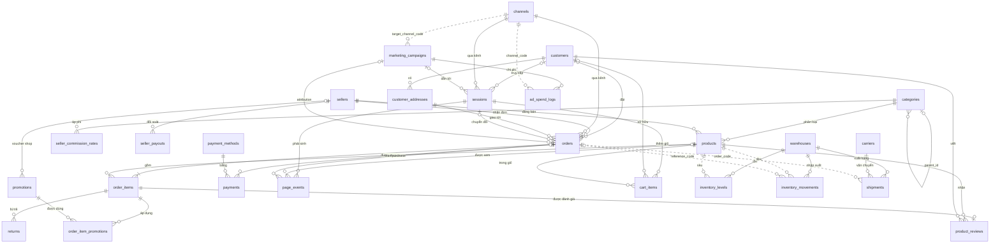

# ERD — Mô hình OLTP sàn thương mại điện tử

Sơ đồ khớp với [OLTP_SCHEMA.md](OLTP_SCHEMA.md): 26 bảng nghiệp vụ, không gồm 3
bảng hạ tầng crawler.

Quy ước:

- **Nét liền**: khóa ngoại thật trong cùng hệ thống nguồn.
- **Nét đứt**: liên kết logic qua mã nghiệp vụ giữa các hệ thống khác nhau
  (`sku`, `order_code`, `channel_code`). Không có FK ở nguồn; tầng staging của
  DW phải ánh xạ.
- `|o` ở một đầu quan hệ: khóa ngoại cho phép NULL.

---

## 1. Sơ đồ tổng quan (chỉ quan hệ)

---

## 2. Sơ đồ chi tiết (đủ cột)

```mermaid
erDiagram
    %% ===== Danh mục sản phẩm & người bán =====
    categories {
        int id PK
        varchar category_name
        int parent_id FK "nullable, tự tham chiếu"
        int level
        varchar slug
    }
    products {
        bigint id PK "Tiki product ID"
        varchar sku UK "mã của hệ thống kho"
        varchar name
        varchar url_key
        decimal price
        decimal original_price "giá niêm yết"
        decimal discount
        decimal discount_rate
        varchar brand_name
        decimal rating_average
        int review_count
        varchar thumbnail_url
        int category_id FK
        varchar category_name
        int quantity_sold "lũy kế"
        date crawl_date
        boolean is_active
        bigint seller_id FK
        varchar seller_product_id
        varchar url_path
        varchar inventory_status
        text stock_item "JSON"
        text short_description
        varchar type
        decimal cost_price "mô phỏng"
    }
    sellers {
        bigint id PK
        varchar seller_name
        varchar shop_name
        varchar tier "Mall, Preferred, Normal"
        varchar province
        varchar city
        varchar email
        varchar phone
        varchar status "Active, Suspended"
        timestamp created_at
        timestamp updated_at
    }

    %% ===== Khách hàng =====
    customers {
        bigint id PK
        varchar full_name
        varchar email
        varchar phone_number
        varchar gender
        date date_of_birth
        varchar province
        varchar city
        varchar membership_tier "Member, Silver, Gold, Platinum"
        timestamp registration_date
        timestamp updated_at
    }
    customer_addresses {
        bigint id PK
        bigint customer_id FK
        varchar recipient_name
        varchar phone
        varchar address_detail
        varchar ward
        varchar district
        varchar province
        boolean is_default
    }

    %% ===== Đơn hàng & thanh toán =====
    channels {
        int id PK
        varchar channel_name "Web, App, Livestream"
        varchar channel_type
    }
    payment_methods {
        int id PK
        varchar method_name
        varchar method_group "COD, E-Wallet, Card, Bank Transfer"
    }
    orders {
        bigint id PK
        varchar order_code UK
        bigint customer_id FK "nullable = khách vãng lai"
        bigint seller_id FK
        int channel_id FK
        bigint session_id FK "nullable"
        int campaign_id FK "nullable"
        varchar order_status "Pending, Processing, Completed, Cancelled"
        decimal total_gross_amount
        decimal total_discount_amount
        decimal shipping_fee
        decimal final_amount
        bigint shipping_address_id FK
        timestamp created_at
        timestamp completed_at "nullable"
        timestamp cancelled_at "nullable"
        timestamp updated_at
    }
    order_items {
        bigint id PK
        bigint order_id FK
        int line_number
        bigint product_id FK
        int quantity
        decimal unit_price
        decimal discount_amount
        decimal net_amount
        varchar item_status "Fulfilled, Cancelled, Returned"
    }
    payments {
        bigint id PK
        bigint order_id FK
        int payment_method_id FK
        varchar payment_status "Pending, Success, Failed, Refunded"
        decimal paid_amount
        timestamp transaction_time
    }
    returns {
        bigint id PK
        bigint order_item_id FK
        int quantity
        varchar return_reason
        decimal refund_amount
        varchar status "Requested, Approved, Rejected, Refunded"
        timestamp requested_at
        timestamp refunded_at "nullable"
    }
    product_reviews {
        bigint id PK
        bigint order_item_id FK
        bigint product_id FK
        bigint customer_id FK
        int rating "1-5"
        text comment
        timestamp created_at
    }

    %% ===== Khuyến mại =====
    promotions {
        bigint id PK
        varchar promo_code
        varchar promo_name
        varchar promo_type "Platform Voucher, Seller Voucher"
        bigint seller_id FK "nullable = voucher sàn"
        varchar apply_level "Order, Item"
        varchar discount_type "Fixed Amount, Percentage"
        decimal discount_value
        decimal min_order_value
        timestamp start_date
        timestamp end_date
    }
    order_item_promotions {
        bigint id PK
        bigint order_item_id FK
        bigint promotion_id FK
        decimal applied_discount_amount
    }

    %% ===== Kho vận =====
    warehouses {
        int id PK
        varchar warehouse_code
        varchar warehouse_name
        varchar province
        varchar city
        text address
    }
    inventory_levels {
        bigint id PK
        int warehouse_id FK
        varchar sku "map sang products.sku"
        int quantity_on_hand
        int quantity_reserved
        timestamp updated_at
    }
    inventory_movements {
        bigint id PK
        int warehouse_id FK
        varchar sku
        varchar movement_type "Import, Sale, Return, Adjustment"
        int quantity_change
        varchar reference_code "order_code, nullable"
        timestamp movement_date
    }
    carriers {
        int id PK
        varchar carrier_code
        varchar carrier_name
    }
    shipments {
        bigint id PK
        varchar order_code "map sang orders.order_code"
        int warehouse_id FK
        int carrier_id FK
        varchar tracking_code UK
        varchar shipment_status "Created, Picked, In Transit, Delivered, Failed"
        decimal shipping_cost
        timestamp created_at
        timestamp picked_at "nullable"
        timestamp delivered_at "nullable"
        timestamp failed_at "nullable"
    }

    %% ===== Marketing =====
    marketing_campaigns {
        int id PK
        varchar campaign_code
        varchar campaign_name
        varchar campaign_type
        varchar target_channel_code "WEB, MOBILE_APP, LIVE"
        decimal budget_amount
        date start_date
        date end_date
    }
    ad_spend_logs {
        bigint id PK
        int campaign_id FK
        varchar channel_code "WEB, MOBILE_APP, LIVE"
        date log_date
        decimal cost_amount
        bigint impressions
        bigint clicks
    }

    %% ===== Clickstream =====
    sessions {
        bigint id PK
        bigint customer_id FK "nullable"
        int channel_id FK
        int campaign_id FK "nullable"
        varchar traffic_source
        varchar device_type
        timestamp started_at
        timestamp ended_at
    }
    page_events {
        bigint id PK
        bigint session_id FK
        varchar event_type
        bigint product_id FK "nullable"
        bigint order_id FK "nullable"
        timestamp event_time
    }
    cart_items {
        bigint id PK
        bigint session_id FK
        bigint customer_id FK "nullable"
        bigint product_id FK
        int quantity
        varchar cart_status "Active, Ordered, Abandoned, Removed"
        timestamp added_at
        timestamp closed_at "nullable"
    }

    %% ===== Tài chính =====
    seller_commission_rates {
        int id PK
        int category_id FK
        varchar seller_tier
        decimal commission_rate
        date effective_from
        date effective_to "nullable"
    }
    seller_payouts {
        bigint id PK
        bigint seller_id FK
        date period_start
        date period_end
        decimal gross_sales
        decimal refund_amount
        decimal commission_amount
        decimal payout_amount
        varchar payout_status "Pending, Paid"
        timestamp paid_at "nullable"
    }

    %% ===== Quan hệ: khóa ngoại thật =====
    categories |o--o{ categories : "parent_id"
    categories ||--o{ products : "category_id"
    sellers ||--o{ products : "seller_id"
    categories ||--o{ seller_commission_rates : "category_id"
    sellers ||--o{ seller_payouts : "seller_id"
    sellers |o--o{ promotions : "seller_id"

    customers ||--o{ customer_addresses : "customer_id"
    customers |o--o{ orders : "customer_id"
    sellers ||--o{ orders : "seller_id"
    channels ||--o{ orders : "channel_id"
    customer_addresses ||--o{ orders : "shipping_address_id"
    sessions |o--o{ orders : "session_id"
    marketing_campaigns |o--o{ orders : "campaign_id"
    orders ||--|{ order_items : "order_id"
    products ||--o{ order_items : "product_id"
    orders ||--o{ payments : "order_id"
    payment_methods ||--o{ payments : "payment_method_id"
    order_items ||--o{ order_item_promotions : "order_item_id"
    promotions ||--o{ order_item_promotions : "promotion_id"
    order_items ||--o{ returns : "order_item_id"
    order_items ||--o| product_reviews : "order_item_id"
    products ||--o{ product_reviews : "product_id"
    customers ||--o{ product_reviews : "customer_id"

    customers |o--o{ sessions : "customer_id"
    channels ||--o{ sessions : "channel_id"
    marketing_campaigns |o--o{ sessions : "campaign_id"
    sessions ||--o{ page_events : "session_id"
    products |o--o{ page_events : "product_id"
    orders |o--o{ page_events : "order_id"
    sessions ||--o{ cart_items : "session_id"
    customers |o--o{ cart_items : "customer_id"
    products ||--o{ cart_items : "product_id"

    marketing_campaigns ||--o{ ad_spend_logs : "campaign_id"

    warehouses ||--o{ inventory_levels : "warehouse_id"
    warehouses ||--o{ inventory_movements : "warehouse_id"
    warehouses ||--o{ shipments : "warehouse_id"
    carriers ||--o{ shipments : "carrier_id"

    %% ===== Quan hệ logic qua mã nghiệp vụ (staging ánh xạ) =====
    products ||..o{ inventory_levels : "sku"
    products ||..o{ inventory_movements : "sku"
    orders ||..o{ shipments : "order_code"
    orders |o..o{ inventory_movements : "reference_code"
    channels ||..o{ marketing_campaigns : "target_channel_code"
    channels ||..o{ ad_spend_logs : "channel_code"
```

