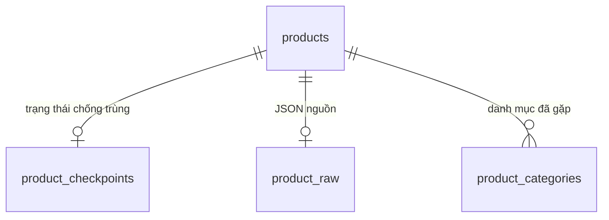

# Cấu trúc SQLite của Tiki crawler

Database mặc định: `data/tiki_crawl.db`. Schema được tạo trong hàm
`open_database()` của `scripts/crawl_tiki.py`.

## 1. Tổng quan các bảng

| Bảng | Vai trò | Khóa chính |
| --- | --- | --- |
| `products` | Trạng thái sản phẩm mới nhất, gồm 24 cột | `id` |
| `product_checkpoints` | Hash và thời điểm theo dõi để chống trùng | `product_id` |
| `product_raw` | Toàn bộ JSON API gần nhất của sản phẩm | `product_id` |
| `product_categories` | Các quan hệ sản phẩm – danh mục đã quan sát | Bộ 3 ID |

`product_id` của ba bảng phụ tham chiếu `products.id`. Một sản phẩm có tối đa
một dòng checkpoint, một dòng JSON và có thể có nhiều dòng danh mục.
Đó là các phần thông tin khác nhau của sản phẩm, không phải sản phẩm trùng.



## 2. Bảng `products` — 24 trường

17 trường đầu tương ứng schema SQLite của repo tham khảo
[tiki_lakehouse](https://github.com/AnhTaizz/tiki_lakehouse/blob/main/simulators/init_sqlite.py).
7 trường cuối là các trường bổ sung từ listing API. Repo tham khảo không có
schema SQLite cố định gồm 24 trường.

Ngoài `id`, các cột cho phép `NULL`. Có cột không đồng nghĩa API luôn cung cấp
giá trị cho mọi sản phẩm; crawler giữ `NULL` khi thiếu dữ liệu.

| Trường | Kiểu | Ý nghĩa và cách lưu |
| --- | --- | --- |
| `id` | INTEGER | ID sản phẩm Tiki, khóa chính chống trùng. Crawler chỉ nhận số nguyên dương. |
| `sku` | TEXT | Mã SKU do API trả về; không dùng làm khóa chống trùng. |
| `name` | TEXT | Tên sản phẩm. |
| `url_key` | TEXT | Phần tên đường dẫn sản phẩm; có thể dùng để dựng link dự phòng. |
| `price` | INTEGER | Giá hiện tại API trả về, thông thường theo VND. |
| `original_price` | INTEGER | Giá gốc; nếu thiếu hoặc NULL thì lấy `list_price`. |
| `discount` | INTEGER | Số tiền giảm giá do API trả về; crawler không tự tính lại. |
| `discount_rate` | INTEGER | Tỷ lệ giảm giá theo phần trăm do API trả về. |
| `brand_name` | TEXT | Tên thương hiệu. |
| `rating_average` | REAL | Điểm đánh giá trung bình. |
| `review_count` | INTEGER | Số lượt đánh giá. |
| `thumbnail_url` | TEXT | URL ảnh đại diện. |
| `category_id` | INTEGER | ID danh mục gốc đang cào, được crawler gán. |
| `quantity_sold` | INTEGER | Số lượng đã bán tích lũy API báo; nếu nguồn là object thì lấy `quantity_sold.value`. Không phải số bán riêng trong ngày. |
| `category_name` | TEXT | Tên danh mục gốc từ hằng `CATEGORIES`; ID tự nhập chưa có trong danh sách sẽ có tên NULL. |
| `crawl_date` | TEXT | Ngày gần nhất quan sát sản phẩm, dạng `YYYY-MM-DD`, theo múi giờ máy chạy crawler. |
| `is_active` | INTEGER | Lấy từ `is_active`, hoặc `is_visible` nếu khóa `is_active` không có. Lưu 1/0; NULL nếu không có giá trị. Không phải số tồn kho. |
| `seller_id` | INTEGER | ID người bán do listing API trả về. |
| `seller_product_id` | INTEGER | ID sản phẩm/offer phía người bán, khác với ID sản phẩm chung. |
| `url_path` | TEXT | Đường dẫn API trả về, có thể chứa `.html` và query string; ưu tiên dùng khi tạo link. |
| `inventory_status` | TEXT | Mã trạng thái tồn kho từ API; giữ nguyên giá trị nguồn. |
| `stock_item` | TEXT | Thông tin tồn kho; object hoặc array được mã hóa thành chuỗi JSON. Các khóa bên trong tùy phản hồi API. |
| `short_description` | TEXT | Mô tả ngắn nếu API cung cấp. |
| `type` | TEXT | Mã loại sản phẩm do API trả về; giữ nguyên giá trị nguồn. |

### `url_key` và `url_path`

Ví dụ minh họa:

- `url_key`: `sach-kyoto-garadens-p496238`.
- `url_path`: `sach-kyoto-garadens-p496238.html?spid=123456`.

Với đường dẫn tương đối, ghép `https://tiki.vn/` với `url_path`.
Không thêm `.html` lần nữa nếu đường dẫn đã có. Khi chỉ có `url_key`, có thể
dựng link bằng tên miền + `url_key` + `.html`. Link có thể ngừng hoạt động nếu
Tiki gỡ sản phẩm. Không nối các trường này vào endpoint API listing.

## 3. Bảng `product_checkpoints` — trạng thái chống trùng

| Trường | Kiểu | Ý nghĩa |
| --- | --- | --- |
| `product_id` | INTEGER | Khóa chính và khóa ngoại tới `products.id`. |
| `content_hash` | TEXT NOT NULL | SHA-256 của toàn bộ JSON sản phẩm sau khi sắp xếp khóa, dùng để phát hiện thay đổi. |
| `first_seen_at` | TEXT NOT NULL | Thời điểm đầu tiên lưu sản phẩm; không đổi khi cập nhật. |
| `last_seen_at` | TEXT NOT NULL | Thời điểm gần nhất crawler gặp sản phẩm, kể cả khi nội dung không đổi. |
| `last_changed_at` | TEXT NOT NULL | Thời điểm đầu tiên lưu hoặc lần gần nhất hash nguồn thay đổi. |

Các timestamp có dạng ISO 8601 theo UTC, có hậu tố `+00:00`.
Hash được tính trước khi crawler thêm metadata như `crawl_date`.
Hash bao gồm cả các trường nguồn ngoài 24 cột, nên thay đổi ở thông tin phụ
hoặc trường động của API cũng có thể khiến sản phẩm được tính là `updated`.

Tên checkpoint ở đây nghĩa là trạng thái chống trùng theo sản phẩm.
**Chưa có checkpoint số trang hoặc cursor để tiếp tục lần cào bị gián đoạn.**
Mỗi lần chạy vẫn đọc từ trang 1; dữ liệu đã lưu được nhận diện bằng ID/hash.

## 4. Bảng `product_raw` — JSON nguồn

| Trường | Kiểu | Ý nghĩa |
| --- | --- | --- |
| `product_id` | INTEGER | Khóa chính và khóa ngoại tới `products.id`. |
| `raw_json` | TEXT NOT NULL | Toàn bộ JSON sản phẩm API trả về, không chỉ giới hạn 24 trường đã tách. |

Bảng này giúp tra cứu thêm thông tin chưa có cột, đối chiếu dữ liệu và mở rộng
schema sau này. Chỉ giữ phiên bản mới nhất, không phải lịch sử các lần cào.

## 5. Bảng `product_categories` — quan hệ danh mục

| Trường | Kiểu | Ý nghĩa |
| --- | --- | --- |
| `product_id` | INTEGER NOT NULL | ID sản phẩm, khóa ngoại tới `products.id`. |
| `root_category_id` | INTEGER NOT NULL | Danh mục gốc được chọn để cào, ví dụ 8322. |
| `leaf_category_id` | INTEGER NOT NULL | Danh mục lá được gọi API để lấy sản phẩm. Nếu không có danh mục con, có thể trùng ID gốc. |

Khóa chính gồm cả ba cột, nên không thể lưu trùng cùng một quan hệ.
Các quan hệ được thêm khi quan sát thấy, chưa tự xóa khi sản phẩm biến mất.

`products.category_id` chỉ là một danh mục đại diện: được gán khi thêm hoặc
cập nhật nội dung sản phẩm. Nó không thể biểu diễn đầy đủ nhiều danh mục;
hãy dùng `product_categories` nếu cần toàn bộ các quan hệ đã gặp.

## 6. Quy trình ghi dữ liệu

1. Kiểm tra ID hợp lệ và tạo hash từ JSON nguồn.
2. Chưa có checkpoint: thêm sản phẩm, JSON nguồn và checkpoint.
3. Có checkpoint, hash khác: upsert sản phẩm theo ID, thay JSON và cập nhật checkpoint.
4. Hash giống: giữ nội dung, cập nhật `products.crawl_date` và `last_seen_at`.
5. Thêm quan hệ danh mục nếu chưa tồn tại.

Mỗi trang được ghi trong **một transaction chung cho cả bốn bảng**.
Nếu lỗi giữa trang, rollback mọi thay đổi của trang đó. Các trang đã commit
trước đó vẫn còn. Chạy lại an toàn nhờ khóa chính và upsert.

Các khóa ngoại có `ON DELETE CASCADE`: xóa sản phẩm sẽ xóa các dòng phụ liên
quan khi connection bật `PRAGMA foreign_keys=ON` (crawler đã bật).

DB giữ trạng thái mới nhất, **chưa có bảng lịch sử giá**. Sản phẩm không xuất
hiện trong lần cào sau chưa tự bị xóa hay đổi `is_active`.

## 7. SQL tra cứu trong DBeaver

```sql
-- Số dòng trong từng bảng
SELECT 'products' AS table_name, COUNT(*) AS row_count FROM products
UNION ALL SELECT 'product_checkpoints', COUNT(*) FROM product_checkpoints
UNION ALL SELECT 'product_raw', COUNT(*) FROM product_raw
UNION ALL SELECT 'product_categories', COUNT(*) FROM product_categories;

-- Sản phẩm thay đổi gần đây
SELECT p.id, p.name, p.price, c.last_seen_at, c.last_changed_at
FROM products AS p
JOIN product_checkpoints AS c ON c.product_id = p.id
ORDER BY c.last_changed_at DESC
LIMIT 20;

-- Xem JSON đầy đủ
SELECT product_id, raw_json FROM product_raw LIMIT 10;

-- Các danh mục từng ghi nhận sản phẩm
SELECT p.id, p.name, pc.root_category_id, pc.leaf_category_id
FROM products AS p
JOIN product_categories AS pc ON pc.product_id = p.id
LIMIT 20;

-- Kiểm tra schema
PRAGMA table_info(products);
PRAGMA foreign_key_list(product_categories);
```

`tiki_crawl.db-wal` và `tiki_crawl.db-shm` là file phụ của chế độ SQLite WAL,
không phải bảng. Không xóa chúng khi database đang được mở hoặc ghi.
