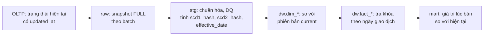
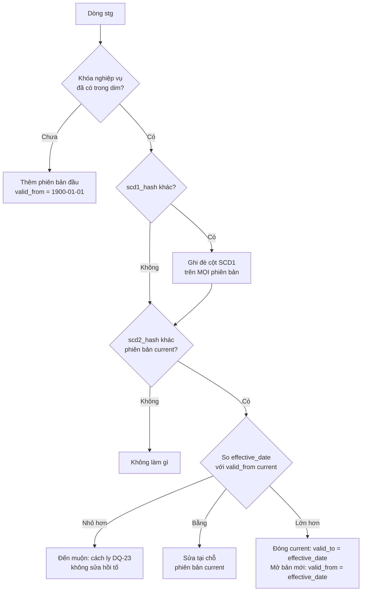

# 08a — Tổng hợp SCD trong dự án: mục đích, lý do và cách triển khai

| | |
|---|---|
| Cập nhật | 08/11/2026 |
| Phạm vi | Chỉ mô tả phần đã cài đặt trong dự án; không trình bày lý thuyết SCD |
| Dùng cho | Mục 3.2 của tiểu luận |
| Trạng thái | Logic đã cài và đạt kiểm thử có kiểm soát (10/10). **Chưa có phiên bản SCD2 từ dữ liệu Mock thật** (xem mục 7) |
| Mã nguồn | [load.py](../../dw/etl/load.py), [transform.py](../../dw/etl/transform.py), [302_dimensions.sql](../../dw/sql/30_dw/302_dimensions.sql), [test_scd_load.py](../../dw/tests/test_scd_load.py) |

## 1. Tóm tắt

Dự án dùng **SCD0, SCD1, SCD2 và SCD3**, kèm **mini-dimension** theo tinh thần SCD4. Dự án **không dùng SCD6**.

| Kỹ thuật | Áp dụng ở đâu | Câu hỏi được giải quyết |
|---|---|---|
| SCD0 | `dim_date`, `dim_month` | Thuộc tính lịch không thay đổi |
| SCD1 | Thông tin mô tả và liên hệ của sản phẩm, seller, khách; các dimension nhỏ | Giá trị đúng nhất hiện tại là gì? |
| SCD2 | `dim_product`, `dim_seller`, `dim_customer` | Lúc giao dịch xảy ra, thuộc tính là gì? |
| SCD3 | `dim_seller_tier_t3` | Hạng hiện tại và hạng liền trước của seller là gì? |
| Mini-dimension | `dim_customer_profile` | Khách thuộc nhóm hạng, chi tiêu, tần suất nào khi mua? |

## 2. Mục đích và lý do

### 2.1. Vì sao kho phải tự quản lý lịch sử

OLTP chỉ lưu **trạng thái hiện tại**. Khi seller đổi từ `Normal` sang `Mall`, `sellers.tier` bị ghi đè và giá trị cũ không còn ở nguồn. Nếu kho chỉ nối fact với giá trị hiện tại, toàn bộ doanh thu trong quá khứ sẽ bị tính cho hạng `Mall`, làm sai báo cáo theo hạng.

Đề xuất của nhóm đặt yêu cầu này ở mục tiêu M2 "Lịch sử chính xác" và tiêu chí kiểm thử T4.

### 2.2. Câu hỏi nghiệp vụ mà SCD phục vụ

| Câu hỏi | Kỹ thuật | Nơi trả lời |
|---|---|---|
| Doanh thu theo hạng seller **tại thời điểm bán** so với hạng **hiện tại** | SCD2 | `mart.mv_sales_month_seller_tier` (`tier_at_sale`, `tier_current`) |
| Doanh thu theo tỉnh của khách **lúc mua** so với tỉnh **hiện tại** | SCD2 | `mart.mv_sales_month_customer_region` (`province_at_sale`, `province_current`) |
| Giá trị tồn kho ước tính theo giá vốn của đúng thời điểm | SCD2 sản phẩm | `fact_inventory_snapshot` tra `dim_product` theo `balance_date` |
| Seller vừa đổi hạng từ đâu sang đâu, vào ngày nào | SCD3 | `dim_seller_tier_t3` |
| Doanh thu theo nhóm khách (hạng, chi tiêu, tần suất) | Mini-dimension | `customer_profile_key` trên `fact_order_item` |

### 2.3. Vì sao chọn loại SCD cho từng nhóm thuộc tính

Nguyên tắc: thuộc tính **làm thay đổi cách diễn giải số liệu quá khứ** thì giữ lịch sử; thuộc tính chỉ để hiển thị hoặc liên hệ thì lấy giá trị mới nhất.

| Dimension | SCD2: tạo phiên bản mới | Lý do | SCD1: ghi đè | Lý do |
|---|---|---|---|---|
| `dim_seller` | `tier`, `province_code`, `province_name`, `region`, `status` | Dùng để phân tích doanh thu theo hạng, vùng, trạng thái tại thời điểm bán | `shop_name`, `seller_name`, `email_domain`, `phone_masked` | Tên và liên hệ chỉ để nhận diện, cần hiển thị thống nhất giá trị mới nhất |
| `dim_customer` | `province_code`, `province_name`, `region` | Phân tích doanh thu theo nơi ở lúc mua | `full_name`, `phone_masked`, `email_domain`, `gender`, `birth_year`, `age_band`, `registration_date` | Thông tin nhận diện; sửa sai thì nên áp dụng cho toàn bộ lịch sử |
| `dim_product` | `list_price`, `category_key`, `is_active`, `unit_cost_est` | Giá và danh mục ảnh hưởng phân tích theo thời gian; giá vốn ước tính phụ thuộc giá | `sku`, `product_name`, `brand_name`, `seller_id`, `original_price`, `discount_rate` | Thuộc tính mô tả, không dùng làm mốc lịch sử |

**Vì sao SCD1 ghi đè mọi phiên bản, không chỉ phiên bản hiện hành:** để việc sửa lỗi nhập liệu có hiệu lực trên toàn bộ lịch sử. Báo cáo không hiển thị hai tên khác nhau cho cùng một khách hoặc seller.

**Vì sao SCD3 đặt ở bảng riêng và theo hạng seller:**
- Kế hoạch ban đầu định dùng SCD3 cho giá trước đó, nhưng engine Mock không có hành động đổi giá (khoảng trống G7), nên chuyển sang hạng seller để có dữ liệu thật.
- SCD3 ở đây mang tính minh họa. Bảng riêng giúp không làm rối `dim_seller`, trong khi lịch sử đầy đủ vẫn nằm ở SCD2.

**Vì sao hạng khách dùng mini-dimension thay vì SCD2:**
- Cấu hình `SYS-03` cho tối đa khoảng 8.500 lượt đổi hạng từ 25/01 đến 31/12, trong khi `dim_customer` chỉ có khoảng 10.500 khách. Dùng SCD2 sẽ làm bảng tăng nhanh.
- Nhóm chi tiêu và tần suất thay đổi theo từng lần mua, nên càng không phù hợp với SCD2.
- Mini-dimension chỉ cần 125 tổ hợp cố định (5 hạng × 5 nhóm chi tiêu × 5 nhóm tần suất), sinh sẵn một lần.

## 3. Cách triển khai

### 3.1. Luồng dữ liệu



Dự án dùng phương pháp **snapshot-diff**: mỗi batch trích toàn bộ bảng dimension nguồn rồi so với phiên bản hiện hành trong kho. Bảng dimension đủ nhỏ để làm vậy (481 seller, 3.532 sản phẩm, khoảng 10.500 khách).

### 3.2. Transform: chuẩn bị so sánh

[transform.py](../../dw/etl/transform.py) tính cho mỗi dòng:

| Cột | Seller | Khách | Sản phẩm |
|---|---|---|---|
| `scd1_hash` | md5 của `shop_name`, `seller_name`, `email`, `phone` | md5 của `full_name`, `phone_number`, `email` | md5 của tên, thương hiệu, `original_price`, `discount_rate` |
| `scd2_hash` | md5 của `tier`, `province_code`, `status` | md5 của `province_code` | md5 của `price`, `category_id`, `is_active` |
| `effective_date` | Ngày của `updated_at` (nếu rỗng thì `created_at`) | Ngày của `updated_at` (nếu rỗng thì `registration_date`) | Ngày của `updated_at` (nếu rỗng thì `created_at`) |

Lý do dùng hash: phát hiện thay đổi bằng một phép so sánh thay vì so từng cột, và tách rõ thay đổi SCD1 với SCD2.

### 3.3. Load: thuật toán `load_scd`

Hàm [`load_scd`](../../dw/etl/load.py#L95) dùng chung cho cả 3 dimension. Cấu hình cột SCD1 và SCD2 nằm ở [`SCD_DIMS`](../../dw/etl/load.py#L34).



Lý do của từng quy tắc:

| Quy tắc | Lý do |
|---|---|
| Phiên bản đầu có `valid_from = 1900-01-01` | Mọi giao dịch đều tra được khóa, kể cả khi giao dịch cũ hơn ngày kho bắt đầu theo dõi |
| Phiên bản hiện hành có `valid_to = 9999-12-31` | Dùng một điều kiện duy nhất để tra khóa, không phải xử lý NULL |
| Khoảng hiệu lực `[valid_from, valid_to)` | Ngày đổi thuộc về phiên bản mới; hai phiên bản liền nhau không chồng và không hở |
| Đổi trong cùng ngày thì sửa tại chỗ | Mức chi tiết của khoảng hiệu lực là ngày, nên một ngày chỉ có một phiên bản |
| Đến muộn thì cách ly | Sửa hồi tố buộc phải gán lại khóa cho fact đã nạp; dự án ưu tiên giữ ổn định số liệu đã báo cáo và để lại dấu vết kiểm tra |
| Khóa thay thế `serial` | Mỗi phiên bản cần khóa riêng để fact trỏ đúng phiên bản; `seller_id` không còn đủ để định danh |

### 3.4. Fact: gắn đúng phiên bản

Khi nạp fact, ETL tra khóa theo ngày xảy ra giao dịch ([load.py](../../dw/etl/load.py#L263)):

```sql
s.completed_at::date >= ds.valid_from AND s.completed_at::date < ds.valid_to
```

| Fact | Ngày dùng để tra | Khóa SCD2 |
|---|---|---|
| `fact_order_item` | `completed_at` | `product_key`, `seller_key`, `customer_key` |
| `fact_inventory_snapshot` | `balance_date` | `product_key` |

Đây là bước làm SCD2 có ý nghĩa: **đơn cũ vẫn trỏ phiên bản cũ, đơn mới trỏ phiên bản mới**, và fact đã nạp không cần cập nhật khi dimension đổi.

### 3.5. SCD3

Hàm [`load_seller_t3`](../../dw/etl/load.py#L143) giữ mỗi seller đúng một dòng:

- seller mới: `current_tier = tier`, `previous_tier` rỗng;
- hạng đổi: `previous_tier ← current_tier`, `current_tier ← tier`, `tier_changed_on ← effective_date`.

### 3.6. Mini-dimension

- `dim_customer_profile` sinh sẵn 125 tổ hợp.
- Khi nạp fact, `PROFILE_SQL` tính `spend_band_12m` và `frequency_band` từ các dòng fact **trước ngày giao dịch**, trong 365 ngày gần nhất, rồi kết hợp với `membership_tier` để gán `customer_profile_key`.
- Nhờ đó hạng hoặc mức chi tiêu thay đổi không tạo dòng mới trong `dim_customer`.

### 3.7. Bảo vệ tính đúng đắn

| Cơ chế | Tác dụng |
|---|---|
| `UNIQUE INDEX ... (seller_id) WHERE is_current` (và tương tự cho khách, sản phẩm) | Database không cho một khóa có 2 phiên bản hiện hành |
| `UNIQUE (seller_id, valid_from)` | Không trùng phiên bản cùng ngày hiệu lực |
| `CHECK (valid_from < valid_to)` | Không có khoảng hiệu lực sai |
| Số phiên bản đóng phải bằng số phiên bản mở | Sai thì báo lỗi ngay trong `load_scd` |
| Đối soát SCD-01 | Không có khoảng hiệu lực chồng lấn |
| Đối soát SCD-02 | Mỗi khóa có đúng 1 phiên bản hiện hành |
| B3, B4, B5 trong **một transaction** | Đối soát sai thì rollback, batch chuyển `FAILED` |
| `load --reload` | Chạy lại batch không sinh thêm phiên bản (idempotent, T3) |

## 4. Nguồn tạo thay đổi trong dữ liệu Mock

Các thay đổi do `dw-scd-2026.json` sinh ra, áp dụng từ ngày mô phỏng 25/01 (kịch bản được chuyển khi lượt sinh đang chạy, xem [bước 01 §10](01_buoc-1.0_cau-hinh-mock-scd.md)). Số lượt là theo cấu hình; một lượt có thể bị từ chối, hoặc giữ nguyên giá trị (ví dụ seller đang `Preferred` lại được xét `Preferred`), khi đó không có phiên bản mới.

| Hành động | Thay đổi ở nguồn | Kết quả trong kho | Từ ngày | Tần suất |
|---|---|---|---|---|
| `SEL-02` | Email seller | SCD1 | 01/01 | 12 lượt/năm |
| `SEL-01` | Tên shop | SCD1 | 26/01 | Mỗi 10 ngày |
| `MGR-01` | Hạng seller | SCD2 + SCD3 | 25/01 | 1 lượt/ngày |
| `SEL-03` | Tỉnh seller | SCD2 | 25/01 | Mỗi 4 ngày |
| `MGR-02` | Khóa seller, sản phẩm ngừng bán | SCD2 seller và sản phẩm | 27/01 | 5 lượt/năm (27/01 được thêm cho demo) |
| `CUS-02` | Tỉnh khách | SCD2 | 25/01 | 3 lượt/ngày |
| `SYS-03` | Hạng khách | Mini-dimension | 25/01 | 25 lượt/ngày |

**Không có trong dữ liệu Mock, chỉ kiểm chứng bằng ca có kiểm soát:**

| Thay đổi | Vì sao không có |
|---|---|
| Đổi giá sản phẩm | Engine không có hành động này |
| Đổi danh mục | `CAT-01` cần `SEL-08`, mà `SEL-08` gán mọi sản phẩm vào một danh mục cố định, không thực tế nên không bật |
| Đổi tên khách, tên sản phẩm | `CUS-01`, `SEL-04` để trống thì không đổi gì, điền giá trị thì mọi đối tượng cùng một tên, nên không bật |

## 5. Kiểm thử có kiểm soát

Chạy bằng `.venv/bin/python -m dw.tests.test_scd_load`. Script tạo 2 batch giả trong một transaction rồi **rollback**, nên kho không thay đổi. Kết quả **10/10 PASS** ([bằng chứng](evidence/08_scd_test.txt)):

| # | Ca kiểm thử | Kết quả |
|---|---|---|
| 1 | SCD2 khách: đổi tỉnh ngày 01/02 | 2 phiên bản, 1 current, bản cũ đóng ngày 01/02 |
| 2 | SCD1 khách: đổi tên | Vẫn 1 phiên bản, tên mới |
| 3 | SCD2 seller: `Normal → Mall` | 2 phiên bản |
| 4 | SCD3 seller | `current = Mall`, `previous = Normal`, ngày đổi 01/02 |
| 5 | SCD2 + SCD1 sản phẩm: giá +10% và đổi tên | 2 phiên bản giá; tên mới ghi đè cả 2 phiên bản |
| 6 | Tra theo thời điểm | 15/01 ra giá 135.000 đ, 05/02 ra giá 148.500 đ, hai khóa khác nhau |
| 7 | Số phiên bản | Mỗi dimension chỉ tăng đúng 1 |
| 8 | Đổi hạng lần 2 cùng ngày | Sửa tại chỗ, vẫn 2 phiên bản |
| 9 | Đổi tỉnh đến muộn (20/01 < 01/02) | Cách ly DQ-23, không sửa hồi tố |
| 10 | SCD-01 và SCD-02 | Không chồng lấn, đúng 1 current |

Ngoài ra, `load --reload` trên batch 4 không thêm dòng hay phiên bản nào, đối soát đạt 15/15 ([bước 08](08_buoc-5.4-5.6_load.md)).

## 6. Cách kiểm tra trên database

```sql
-- SCD2: các phiên bản của seller
SELECT seller_id, seller_key, tier, province_code, status, valid_from, valid_to, is_current, batch_id
FROM dw.dim_seller
WHERE seller_id IN (SELECT seller_id FROM dw.dim_seller WHERE NOT is_current)
ORDER BY seller_id, valid_from;

-- SCD3
SELECT seller_id, current_tier, previous_tier, tier_changed_on
FROM dw.dim_seller_tier_t3 WHERE previous_tier IS NOT NULL;

-- Giá trị lúc bán so với hiện tại
SELECT month_key, seller_id, tier_at_sale, tier_current, net_revenue
FROM mart.mv_sales_month_seller_tier
WHERE tier_at_sale <> tier_current ORDER BY seller_id, month_key;

-- Thay đổi đến muộn bị cách ly
SELECT batch_id, source_table, source_pk, reason
FROM audit.quarantine WHERE rule_code = 'DQ-23';
```

Với SCD1 của seller nên xem `shop_name` và `scd1_hash`. `SEL-02` chỉ đổi email và giữ nguyên số điện thoại; kho chỉ lưu `email_domain`, nên nếu tên miền không đổi thì cột hiển thị trông như chưa thay đổi.

## 7. Trạng thái hiện tại

Số liệu đo ngày 08/11/2026 trên `dwh`, batch 4 (dữ liệu đến 12/01/2026):

| Bảng | Số dòng | Phiên bản current | Ghi chú |
|---|---|---:|---|
| `dim_seller` | 483 | 483 | 481 seller + 2 thành viên đặc biệt (−1, 0) |
| `dim_customer` | 10.363 | 10.363 | Gồm 2 thành viên đặc biệt |
| `dim_product` | 3.534 | 3.534 | Gồm 2 thành viên đặc biệt |
| `dim_seller_tier_t3` | 481 | | 0 dòng có `previous_tier` |
| `dim_customer_profile` | 125 + 2 | | Sinh sẵn |

Số dòng bằng số phiên bản current, tức **chưa có phiên bản SCD2 nào từ dữ liệu thật**. Điều này đúng như dự kiến, vì các thay đổi chỉ bắt đầu từ ngày mô phỏng 25/01. Khi viết tiểu luận, cần cập nhật mục này sau khi nạp batch qua mốc đó.

### 7.1. Kết quả thật đầu tiên: batch 5 (08/11/2026)

Batch 5 nạp dữ liệu 13/01–25/01, trạng thái `SUCCESS`, đối soát 15/15, SCD-01 và SCD-02 đạt. Cột "Phiên bản cũ" là số dòng đã đóng `valid_to`.

| Bảng | Số dòng | Current | Phiên bản cũ |
|---|---:|---:|---:|
| `dim_seller` | 485 | 483 | 2 |
| `dim_customer` | 10.683 | 10.680 | 3 |
| `dim_product` | 3.534 | 3.534 | 0 |

| Seller | Thay đổi ngày 25/01 | Kỹ thuật |
|---|---|---|
| 9455 | Hạng `Normal` → `Mall`; `dim_seller_tier_t3`: `current = Mall`, `previous = Normal` | SCD2 + SCD3 |
| 344633 | Tỉnh Đà Nẵng → TP. Hồ Chí Minh | SCD2 |

3 khách có phiên bản đổi tỉnh, ví dụ khách 1940: Đà Nẵng → TP. Hồ Chí Minh. `mv_sales_month_seller_tier` đã phân biệt được hạng lúc bán và hạng hiện tại của seller 9455 (`Normal`, `Mall`; 3.108.000 đ).

Chưa có trên dữ liệu thật ở batch này: SCD1 tên shop (từ 26/01), khóa seller và `is_active` (từ 27/01). Cần batch sau để xem đơn hoàn tất từ 25/01 trỏ khóa mới. Mục 7 ở trên là số liệu batch 4 trước khi có thay đổi.

### 7.2. Batch 6 (dữ liệu đến 29/01, 08/11/2026)

Batch 6 nạp 26/01–29/01, trạng thái `SUCCESS`, đối soát 15/15. Mọi dòng fact đều trỏ phiên bản seller và khách có khoảng hiệu lực chứa ngày giao dịch (0 dòng sai).

| Bảng | Số dòng | Current | Phiên bản cũ |
|---|---:|---:|---:|
| `dim_seller` | 490 | 483 | 7 |
| `dim_customer` | 10.787 | 10.776 | 11 |
| `dim_product` | 3.542 | 3.534 | 8 |

**Đơn trước và sau ngày đổi trên dữ liệu thật:**

| Seller | Thay đổi | Phiên bản cũ | Phiên bản mới |
|---|---|---|---|
| 332670 | `Normal` → `Mall`, 28/01 | 33 dòng, 20.425.209 đ, 04/01–26/01 | 2 dòng, 1.224.000 đ, 29/01 |
| 9455 | `Normal` → `Mall`, 25/01 | 13 dòng, 3.108.000 đ, 03/01–24/01 | 2 dòng, 344.000 đ, 29/01 |

**Các ca khác đã có:** SCD3 cho 4 seller; SCD1 đổi tên shop (seller 110726, vẫn 1 phiên bản); khóa seller 288448 ngày 27/01 kèm 8 sản phẩm có phiên bản `is_active = false`.

**Chưa có tính đến batch 6:** khách có đơn ở cả 2 phiên bản tỉnh; khách có đơn ở 2 hạng thành viên (mini-dimension); hạng `Platinum` trên fact.

## 8. Hạn chế cần nêu trong tiểu luận

Các hạn chế dưới đây được rút ra từ việc đọc code. Những điểm chưa được kiểm thử riêng đã ghi rõ.

| # | Hạn chế | Hệ quả |
|---|---|---|
| 1 | **Chỉ thấy trạng thái cuối mỗi batch** (đặc tính của snapshot-diff) | Nếu một thuộc tính đổi nhiều lần trong cùng batch thì các trạng thái trung gian bị mất |
| 2 | **`effective_date` lấy từ `updated_at` của cả dòng** | Nếu hạng đổi ngày D, rồi một thay đổi khác cùng dòng ở ngày D+3 trong cùng batch, phiên bản mới bắt đầu từ D+3. Đơn của D đến D+2 bị gắn phiên bản cũ. Batch càng nhỏ, rủi ro càng thấp |
| 3 | **Hạng trong mini-dimension lấy theo trạng thái tại batch** | Mọi đơn trong cùng batch mang hạng cuối batch, kể cả đơn trước lúc đổi hạng |
| 4 | **SCD3 không áp dụng quy tắc đến muộn và cùng ngày** (chưa kiểm thử riêng) | Thay đổi hạng đến muộn bị cách ly ở `dim_seller` nhưng vẫn cập nhật `dim_seller_tier_t3`; đổi 2 lần cùng ngày thì `previous_tier` là hạng trung gian |
| 5 | **`scd1_hash` không bao gồm mọi cột SCD1** | Chỉ đổi `sku`, `seller_id`, `gender`, `birth_year`, `registration_date` thì không kích hoạt ghi đè. Mock hiện không tạo các thay đổi này |
| 6 | **SCD1 làm mất lịch sử của `original_price`, `discount_rate`** | Không phân tích được biến động giá gốc và tỷ lệ giảm theo thời gian |
| 7 | **Không có dữ liệu thật cho đổi giá, đổi danh mục** | SCD2 giá và danh mục chỉ được chứng minh bằng ca kiểm soát |
| 8 | **Hạng khách do Mock đổi ngẫu nhiên** | Không dựa trên chi tiêu, nên đây không phải quy tắc xét hạng thực tế |
| 9 | **Đến muộn không được sửa hồi tố** | Đổi lại tính ổn định của số liệu là các thay đổi này chỉ nằm trong quarantine, cần xử lý thủ công nếu muốn đưa vào lịch sử |

## 9. Việc còn lại

- [ ] Chạy batch ETL sau khi Mock qua 25/01, kiểm tra các phiên bản SCD2 và SCD3 thật, rồi cập nhật mục 7.
- [ ] Lưu kết quả query ở mục 6 vào `evidence/` để trích dẫn.
- [ ] Sau 27/01 (ngày mô phỏng): kiểm tra `status` seller và `is_active` sản phẩm.
- [ ] Quyết định có xử lý hạn chế số 4 không.
