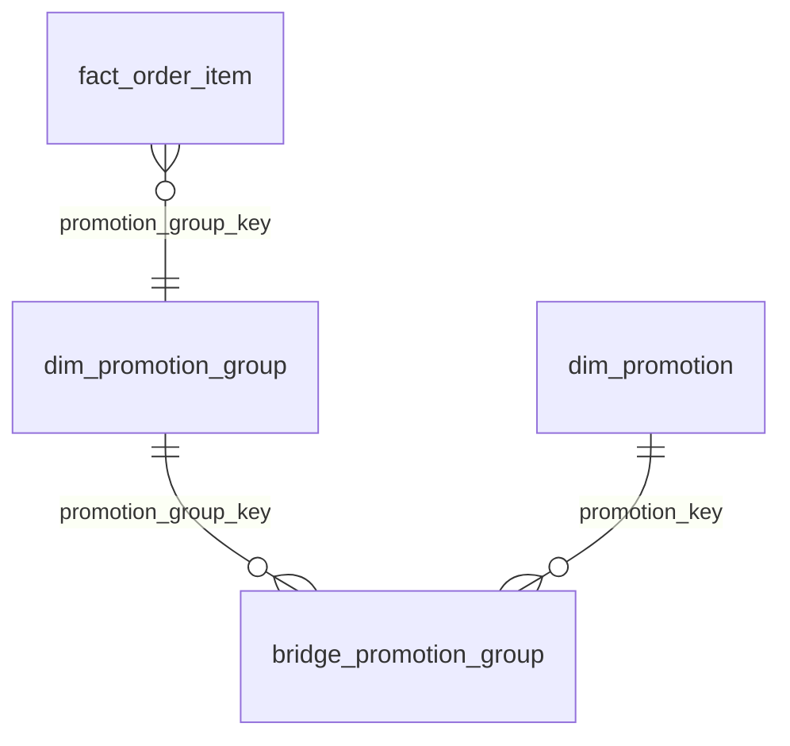

# 08b — Mini-dimension, bridge khuyến mãi và cây danh mục

| | |
|---|---|
| Cập nhật | 08/11/2026 |
| Phạm vi | Mô tả phần đã cài đặt trong dự án, dùng cho mục 3.3 của báo cáo |
| Số liệu | Đo trên `dwh`, batch 4, dữ liệu đến 12/01/2026 |
| Mã nguồn | [302_dimensions.sql](../../dw/sql/30_dw/302_dimensions.sql), [transform.py](../../dw/etl/transform.py), [load.py](../../dw/etl/load.py), [401_mart.sql](../../dw/sql/40_mart/401_mart.sql), [app.py](../../dashboard/app.py) |

## 1. Tóm tắt

| Kỹ thuật | Bài toán | Cấu trúc | Trạng thái trên dữ liệu thật |
|---|---|---|---|
| Mini-dimension | Hồ sơ khách đổi thường xuyên, không nên tạo phiên bản SCD2 | `dim_customer_profile`, 125 tổ hợp sinh sẵn | Hoạt động; đa số dòng còn ở nhóm "Chưa mua" vì lịch sử ngắn |
| Bridge khuyến mãi | Một dòng hàng có thể có nhiều voucher, nhưng không được tính trùng | `dim_promotion_group` + `bridge_promotion_group` có `weighting_factor` | Hoạt động; **mới chỉ có nhóm 1 voucher, weight = 1** |
| Cây danh mục | Cộng doanh thu theo danh mục cha với cây sâu không đều | `dim_category` + closure table `bridge_category_hierarchy` | Hoạt động; đối soát khớp tuyệt đối với tổng fact |

## 2. Mini-dimension hồ sơ khách

### 2.1. Mục đích và lý do

**Mục đích:** phân tích doanh thu theo nhóm khách, gồm hạng thành viên, mức chi tiêu và tần suất mua, **theo trạng thái trước lúc giao dịch**.

**Vì sao không đưa vào `dim_customer` dạng SCD2:**
- **Đổi quá thường xuyên:** cấu hình `SYS-03` có tới 25 lượt đổi hạng/ngày, tức tối đa khoảng 8.500 lượt từ 25/01 đến 31/12, so với khoảng 10.500 khách. Mức chi tiêu và tần suất còn đổi sau từng đơn.
- **Làm phình bảng:** mỗi thay đổi sẽ tạo một dòng `dim_customer` và một khóa mới, làm truy vấn theo khách nặng hơn mà không cần thiết.
- **Tách phần ít đổi và phần hay đổi:** tỉnh của khách vẫn dùng SCD2, còn thuộc tính hay đổi được rời sang bảng nhỏ.

**Vì sao chia nhóm (bucket):** giá trị chi tiêu là số liên tục. Chia nhóm giúp bảng có số dòng cố định và kết quả dễ đọc.

### 2.2. Cấu trúc

```sql
CREATE TABLE dw.dim_customer_profile (
  customer_profile_key smallint PRIMARY KEY,
  membership_tier      text NOT NULL,
  spend_band_12m       text NOT NULL,
  frequency_band       text NOT NULL,
  UNIQUE (membership_tier, spend_band_12m, frequency_band)
);
```

Bảng được **sinh sẵn 125 tổ hợp** bằng `CROSS JOIN`, cộng 2 thành viên đặc biệt: `-1` (khách vãng lai) và `0` (chưa xác định).

| Thuộc tính | Giá trị | Nguồn |
|---|---|---|
| `membership_tier` | Member, Silver, Gold, Platinum, Không rõ | `customers.membership_tier` |
| `spend_band_12m` | Chưa mua, < 1 triệu, 1–5 triệu, 5–20 triệu, > 20 triệu | Σ `net_revenue` trong 365 ngày trước |
| `frequency_band` | 0 đơn, 1 đơn, 2–3 đơn, 4–9 đơn, ≥ 10 đơn | Số đơn phân biệt trong 365 ngày trước |

`fact_order_item` trỏ thẳng đến bảng này qua `customer_profile_key`, nên không cần đi qua `dim_customer`.

### 2.3. Cách nạp

Thực hiện ở [`PROFILE_SQL`](../../dw/etl/load.py#L192), ngay sau khi upsert fact:

1. Dòng mới được nạp với khóa tạm: `-1` nếu là khách vãng lai, `0` nếu là khách có tài khoản.
2. Với mỗi dòng của batch, lấy lịch sử của khách theo `customer_id`, gồm **mọi phiên bản SCD2**, với điều kiện `date_key` nhỏ hơn ngày giao dịch và trong 365 ngày.
3. Tính `spend` và `freq`, đổi thành nhóm bằng `CASE`.
4. Lấy hạng từ `stg.customer` của batch.
5. Tra `dim_customer_profile` và cập nhật `customer_profile_key` trên fact.

Điều kiện `h.date_key < l.date_key` bảo đảm **đơn hiện tại không tự tính vào hồ sơ của chính nó**, nên đơn đầu tiên của khách thuộc nhóm "Chưa mua".

### 2.4. Kết quả hiện tại

Tổng 1.195 dòng fact, dùng 12 trên 127 khóa, không có dòng nào ở khóa `0`:

| Hạng | Chi tiêu | Tần suất | Số dòng |
|---|---|---|---:|
| NA (khách vãng lai) | NA | NA | 645 |
| Member | Chưa mua | 0 đơn | 218 |
| Silver | Chưa mua | 0 đơn | 201 |
| Gold | Chưa mua | 0 đơn | 96 |
| Gold | < 1 triệu | 1 đơn | 10 |
| Silver | < 1 triệu | 1 đơn | 10 |
| Member | < 1 triệu | 1 đơn | 6 |
| Các nhóm còn lại | | | 9 |

515 trong 550 dòng của khách có tài khoản đang ở nhóm "Chưa mua". Đây là hệ quả của việc kho mới có 12 ngày lịch sử, chưa phản ánh hành vi thật của khách. Tỷ lệ này sẽ giảm khi có thêm dữ liệu.

### 2.5. Truy vấn và nơi sử dụng

Dashboard dùng ở [app.py](../../dashboard/app.py#L266). Hiện chưa có materialized view riêng cho mini-dimension, nên truy vấn đọc trực tiếp từ fact.

```sql
SELECT p.membership_tier, p.spend_band_12m, p.frequency_band,
       count(*) AS so_dong, sum(f.net_revenue) AS doanh_thu
FROM dw.fact_order_item f
JOIN dw.dim_customer_profile p USING (customer_profile_key)
WHERE f.customer_profile_key > 0
GROUP BY 1, 2, 3 ORDER BY doanh_thu DESC;
```

## 3. Bridge khuyến mãi

### 3.1. Mục đích và lý do

**Vấn đề:** quan hệ giữa dòng hàng và voucher là nhiều-nhiều. Nếu fact nối thẳng với voucher, mỗi dòng hàng dùng 2 voucher sẽ nhân đôi thành 2 dòng và doanh thu bị tính 2 lần.

**Vì sao dùng nhóm và weight:**
- Fact vẫn giữ đúng grain "1 dòng hàng" và chỉ có một khóa `promotion_group_key`.
- `weighting_factor` cho phép phân bổ số tiền về từng voucher mà tổng vẫn khớp.
- Các tổ hợp voucher giống nhau dùng chung một nhóm, giảm số dòng bridge.

Yêu cầu này đến từ Bảng 9 của đề xuất và được làm rõ ở [FACT_REVIEW.md](../FACT_REVIEW.md) §4: tổng weight mỗi nhóm bằng 1, và weight là tỷ lệ theo số tiền giảm thực tế.

### 3.2. Cấu trúc



| Bảng | Cột chính | Vai trò |
|---|---|---|
| `dim_promotion` | `promotion_key`, `promo_code`, `promo_type`, `funded_by`, `apply_level` | Thông tin voucher (SCD1) |
| `dim_promotion_group` | `promotion_group_key`, `group_signature` (UNIQUE), `promotion_count` | Một tổ hợp voucher + tỷ lệ |
| `bridge_promotion_group` | `promotion_group_key`, `promotion_key`, `weighting_factor` | Nối nhóm với từng voucher, `CHECK (0 < weight ≤ 1)` |

Thành viên đặc biệt: nhóm `-1` (`NONE`, không dùng voucher) và `0` (`UNKNOWN`). Hai nhóm này không có dòng bridge.

### 3.3. Cách tính

**Transform** ([transform.py](../../dw/etl/transform.py#L178)), với mỗi dòng hàng:

```text
weighting_factor = round(applied_discount_amount / Σ applied_discount_amount của dòng, 6)
group_signature  = 'promotion_id:weight' của các voucher, sắp theo promotion_id, nối bằng dấu phẩy
```

Rule **DQ-16** cách ly dòng có tổng giảm giá voucher lệch `discount_amount` của dòng hàng quá 0,01 đ.

**Load** ([load.py](../../dw/etl/load.py#L243)):
1. Lấy `group_signature` của từng dòng hàng.
2. Chỉ thêm vào `dim_promotion_group` các chữ ký chưa có, nên nhóm được tái sử dụng giữa các batch.
3. Thêm dòng vào bridge với `ON CONFLICT DO NOTHING`, nên chạy lại không nhân đôi.
4. Fact nhận `promotion_group_key`; dòng không có voucher nhận `-1`.

**Ví dụ** (minh họa theo FACT_REVIEW): dòng hàng giảm 30.000 đ gồm voucher A 20.000 đ và voucher B 10.000 đ.

| Voucher | Giảm thực tế | Weight | Phân bổ = 30.000 × weight |
|---|---:|---:|---:|
| A | 20.000 | 0,666667 | 20.000,01 |
| B | 10.000 | 0,333333 | 9.999,99 |
| **Tổng** | **30.000** | **1** | **30.000** |

Chữ ký của nhóm: `A:0.666667,B:0.333333`. Fact vẫn chỉ có 1 dòng, với `discount_amount` là 30.000.

### 3.4. Cách truy vấn đúng

```sql
-- Đúng: nhân weight khi phân bổ về từng voucher
SELECT p.promo_code, sum(f.discount_amount * b.weighting_factor) AS giam_gia_phan_bo
FROM dw.fact_order_item f
JOIN dw.bridge_promotion_group b USING (promotion_group_key)
JOIN dw.dim_promotion p USING (promotion_key)
GROUP BY 1;
```

Nếu `sum(f.discount_amount)` mà **không nhân weight**, dòng có 2 voucher sẽ bị tính 2 lần: 60.000 đ thay vì 30.000 đ. Kết quả sẵn có nằm ở `mart.mv_promotion_month` (`allocated_discount`, `allocated_net_revenue`) và được dashboard đọc tại [app.py](../../dashboard/app.py#L194).

### 3.5. Kiểm tra và kết quả

| Mã | Kiểm tra | Kết quả batch 4 |
|---|---|---|
| RC-03a | Số nhóm có Σ weight ≠ 1 | 0 |
| RC-03b | Σ `applied_discount_amount` nguồn = Σ `discount_amount × weight` | 3.040.000 = 3.040.000 |
| [measure_rules.sql](../../dw/tests/measure_rules.sql) | Dòng không có voucher thì không có giảm giá | Tổng giảm giá của các dòng này = 0 ([bằng chứng](evidence/08_measure_test.txt)) |

Số liệu hiện tại:

| Chỉ số | Giá trị |
|---|---:|
| Dòng fact có voucher / tổng | 180 / 1.195 |
| Nhóm voucher thật | 1 (`1:1.000000`) |
| Dòng bridge | 1 |
| Số voucher tối đa trong một nhóm | 1 |
| Weight | 1,000000 |

**Giới hạn cần nói rõ trong báo cáo:** engine Mock chỉ áp 1 voucher hàng hóa cho mỗi đơn. Trong `mock_oltp` hiện có 188 dòng `order_item_promotions`, tối đa 1 voucher trên một dòng hàng. Vì vậy logic nhóm nhiều voucher **chưa được kiểm chứng bằng dữ liệu thật**, và hiện cũng **chưa có ca kiểm thử có kiểm soát** cho 2 voucher. Không nên viết rằng đã kiểm thử phân bổ nhiều voucher cho đến khi có ca này.

## 4. Cây danh mục

### 4.1. Mục đích và lý do

**Mục đích:** drill-down và roll-up doanh thu, tồn kho theo cây danh mục, ở bất kỳ nút nào.

**Vì sao cần xử lý riêng:** cây **không cân bằng** (nhánh sâu, nhánh nông), nên không thể dùng các cột cố định `level_1`, `level_2`, `level_3`. Dữ liệu danh mục cũng nằm ở nhiều nơi với độ sâu khác nhau (quy tắc **IR-04**):
- OLTP `categories` chỉ có 2 cấp: 5 gốc và 44 lá.
- Crawler Tiki có `primary_category_path` chi tiết hơn, bắt đầu bằng `1/2` là gốc hệ thống của Tiki.

**Vì sao dùng closure table, thay vì đệ quy lúc truy vấn:** tính đường đi một lần khi nạp, sau đó mọi truy vấn cây con chỉ là một phép `JOIN` thông thường. Nhờ đó người viết báo cáo và dashboard không cần viết CTE đệ quy.

### 4.2. Cấu trúc

| Bảng | Cột | Vai trò |
|---|---|---|
| `dim_category` | `category_key`, `category_id`, `category_name`, `is_named`, `parent_category_key`, `level`, `is_leaf`, `root_category_key`, `path_ids`, `path_names` | Mỗi nút một dòng, có khóa cha tự tham chiếu |
| `bridge_category_hierarchy` | `ancestor_key`, `descendant_key`, `depth` | Mỗi cặp tổ tiên – hậu duệ một dòng, gồm cả cặp tự thân `depth = 0` |

Index `ix_bch_desc (descendant_key)` phục vụ chiều từ lá đi lên tổ tiên. Khóa chính `(ancestor_key, descendant_key)` phục vụ chiều từ cha đi xuống cây con.

**Ví dụ** với đường đi `Làm Đẹp - Sức Khỏe > Danh mục 1584 > Danh mục 1585 > Phấn phủ`, closure table của nút lá "Phấn phủ" có 4 dòng:

| `ancestor_key` | `descendant_key` | `depth` |
|---|---|---:|
| Phấn phủ | Phấn phủ | 0 |
| Danh mục 1585 | Phấn phủ | 1 |
| Danh mục 1584 | Phấn phủ | 2 |
| Làm Đẹp - Sức Khỏe | Phấn phủ | 3 |

### 4.3. Cách xây dựng

**Transform** ([transform.py](../../dw/etl/transform.py#L41)):
1. Tách `primary_category_path` của từng sản phẩm thành mảng, bỏ 2 nút đầu `1/2`, và cắt tại danh mục lá của OLTP.
2. Tạo các cạnh cha – con. Danh mục OLTP không có trong path thì lấy cạnh từ `categories` làm dự phòng.
3. Tên nút lấy từ `categories`, sau đó từ tên nút cuối của crawler; không có thì dùng tên tạm `Danh mục <id>`.
4. Hàm [`post_category`](../../dw/etl/transform.py#L357) dùng CTE đệ quy để điền `root_id`, `path_ids`, `path_names`, `is_leaf`.

Các rule chất lượng:

| Rule | Mức | Kiểm tra | Kết quả batch 4 |
|---|---|---|---|
| DQ-01 | ERROR | Thiếu mã danh mục | Không ghi nhận vi phạm |
| DQ-13 | ERROR | Một nút có nhiều cha | 0 nút |
| DQ-12 | WARN | Nút trung gian chưa có tên | 28 nút |
| DQ-14 | ERROR, dừng ETL | Có chu trình hoặc nút không về được gốc | Không xảy ra |

**Load** ([`load_category`](../../dw/etl/load.py#L59)):
1. Upsert `dim_category` theo SCD1, chỉ ghi khi giá trị thực sự đổi.
2. Gán `parent_category_key`, `root_category_key` **sau khi** mọi nút đã có, vì khóa ngoại tự tham chiếu.
3. Xóa và **dựng lại toàn bộ closure** bằng CTE đệ quy, trong cùng transaction của batch.

### 4.4. Cách truy vấn

```sql
-- Doanh thu theo mọi danh mục gốc
SELECT r.category_name, sum(f.net_revenue) AS doanh_thu
FROM dw.fact_order_item f
JOIN dw.bridge_category_hierarchy h ON h.descendant_key = f.category_key
JOIN dw.dim_category r ON r.category_key = h.ancestor_key
WHERE r.parent_category_key IS NULL AND r.category_key > 0
GROUP BY 1 ORDER BY 2 DESC;

-- Lọc theo một nút bất kỳ, gồm toàn bộ cây con
SELECT sum(f.net_revenue)
FROM dw.fact_order_item f
WHERE f.category_key IN (SELECT descendant_key FROM dw.bridge_category_hierarchy
                         WHERE ancestor_key = :category_key);
```

**Lưu ý tránh tính trùng:** closure table có một dòng cho mỗi tổ tiên, nên phải chọn **một cấp** (ví dụ chỉ gốc, hoặc chỉ một `ancestor_key`). Nếu cộng tất cả tổ tiên trong cùng một tổng, một dòng doanh thu sẽ bị tính nhiều lần.

Nơi sử dụng: `mart.v_category_tree`, và bộ lọc, drill-down trên dashboard ([app.py:104](../../dashboard/app.py#L104), [app.py:162](../../dashboard/app.py#L162)).

### 4.5. Kết quả hiện tại

| Chỉ số | Giá trị |
|---|---:|
| Số nút thật (trừ −1, 0) | 77 |
| Gốc / nút lá | 5 / 44 |
| Theo cấp 1 / 2 / 3 / 4 | 5 / 22 / 32 / 18 nút |
| Dòng closure | 219 (gồm 79 cặp tự thân) |
| Theo `depth` 0 / 1 / 2 / 3 | 79 / 72 / 50 / 18 |
| Sản phẩm gắn vào nút lá / không phải lá | 3.534 / 0 (kể cả 2 thành viên đặc biệt) |

**Doanh thu theo gốc, kiểm chứng không tính trùng:**

| Danh mục gốc | Doanh thu (đ) |
|---|---:|
| Điện Thoại - Máy Tính Bảng | 462.053.000 |
| Làm Đẹp - Sức Khỏe | 135.046.940 |
| Thời trang nữ | 133.614.408 |
| Bách Hóa Online | 105.961.280 |
| Chăm sóc nhà cửa | 21.994.617 |
| **Tổng qua 5 gốc** | **858.670.245** |
| **Tổng trực tiếp trên fact** | **858.670.245** |

Bằng chứng tương tự trong [08_load_check.txt](evidence/08_load_check.txt).

## 5. Hạn chế cần nêu trong báo cáo

| Kỹ thuật | Hạn chế | Hệ quả |
|---|---|---|
| Mini-dimension | Kho chỉ có lịch sử từ 01/01/2026 | Khách đăng ký từ trước vẫn bị xếp "Chưa mua" ở đơn đầu tiên trong kho |
| Mini-dimension | Hạng lấy theo trạng thái khách tại batch, không phải tại ngày giao dịch | Mọi đơn trong batch mang hạng cuối batch; khác với chi tiêu và tần suất là tính trước giao dịch |
| Mini-dimension | Điều kiện là ngày nhỏ hơn ngày giao dịch | Đơn khác trong cùng ngày không tính vào lịch sử |
| Mini-dimension | Chi tiêu không loại dòng `is_returned` | Khách trả hàng vẫn được tính số tiền đó |
| Mini-dimension | Chưa có materialized view riêng | Phân tích theo hồ sơ phải đọc từ fact |
| Bridge | Engine chỉ áp 1 voucher hàng hóa mỗi đơn | Weight trên dữ liệu thật luôn bằng 1 |
| Bridge | Chữ ký gồm cả tỷ lệ | Cùng tổ hợp voucher nhưng khác tỷ lệ sẽ tạo nhóm mới; khi có nhiều voucher, số nhóm có thể tăng nhiều |
| Bridge | Weight làm tròn 6 chữ số | Phân bổ từng voucher có thể lệch nhỏ; đối soát cho phép sai số 0,01 đ |
| Bridge | Voucher freeship hiện không có dòng trong `order_item_promotions` (0 dòng tính đến ngày đo) | Phân bổ theo voucher hiện chưa phản ánh giảm phí vận chuyển |
| Cây danh mục | 28 nút trung gian dùng tên tạm | Báo cáo hiện `Danh mục 1584`; nên dùng dữ liệu tên đầy đủ nếu muốn trình bày đẹp hơn |
| Cây danh mục | Cấu trúc cây dùng SCD1, closure dựng lại toàn bộ | Không giữ lịch sử thay đổi cây; đổi cha thì số liệu cũ cũng được tổng hợp theo cây mới |
| Cây danh mục | Dựng lại closure mỗi batch | Chấp nhận được vì chỉ có 77 nút; với cây rất lớn cần cập nhật tăng dần |
| Cây danh mục | Dữ liệu chỉ có 5 danh mục gốc | Chưa phủ hết 26 danh mục gốc của crawler |

## 6. Việc còn lại

- [ ] Tạo ca có kiểm soát cho dòng hàng 2 voucher, lưu kết quả vào `evidence/`, rồi cập nhật mục 3.5.
- [ ] Cập nhật số liệu ở mục 2.4, 3.5, 4.5 sau khi nạp batch mới.
- [ ] Kiểm tra phân bố mini-dimension sau mốc 25/01, khi hạng khách bắt đầu đổi.
