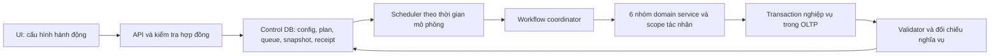

# Kế hoạch nâng cấp engine sau lượt thử cấu hình vận hành 2026

**Trạng thái:** Kế hoạch đề xuất để triển khai tiếp; chưa phải xác nhận những chính sách nghiệp vụ còn thiếu, chưa thay đổi engine/schema hoặc dữ liệu đang chạy.

## 1. Mục tiêu và cách đọc kết quả thử

Lượt chạy **“Vận hành có lịch biến thiên 2026 · trong phạm vi engine hiện tại”** là bài thử để tìm lỗi và khoảng cách với các hành vi e-commerce. Mục tiêu nâng cấp là dữ liệu sinh ra có **nguyên nhân, tác nhân, quan hệ, thời gian và hệ quả đúng**, rồi mới tăng mức đa dạng thống kê.

Không đặt mục tiêu “thực tế” bằng cách tăng số bảng có dữ liệu, thêm ngẫu nhiên hoặc ép mọi job đều không có từ chối. Thiếu hàng, thanh toán lỗi, giỏ không mua hoặc giao thất bại là các kết quả hợp lệ nếu có nguyên nhân và được xử lý đúng nghĩa vụ.

Phải tách ba loại:

| Loại | Ví dụ | Cách xử lý |
|---|---|---|
| Lỗi code / sai invariant | Guest tác động giỏ của khách đăng nhập; xuất kho lặp; sai tiền | Sửa engine, thêm test và validator, yêu cầu không tái diễn trên dữ liệu mới. |
| Khoảng trống nghiệp vụ | Đơn chưa nối với giỏ/phiên, chưa có hoàn tiền hoặc đối soát | Thiết kế quy tắc và hợp đồng dữ liệu, triển khai cả chuỗi phụ thuộc rồi mới mở tính năng. |
| Đơn giản hóa có chủ đích của cấu hình | Lượt đầu chọn 100% giao thành công, một sản phẩm, một phương thức | Không coi bản thân lựa chọn đó là lỗi. Nâng khả năng cấu hình và tạo bài thử khác để kiểm tra các nhánh còn thiếu. |

**Lưu ý về bằng chứng:** 53 sự kiện sai nhóm actor trong audit nằm ở dữ liệu tháng Một do cấu hình cũ sinh ra. Bộ lịch mới đã tắt WEB-05/06 nên chưa kiểm tra được lỗi này bằng cách chỉ chạy nguyên bộ mới. Đây vẫn là lỗi chung của engine cần sửa và phải có bài thử bật lại các nhánh đó. Không quy mọi bất thường của database dùng chung cho riêng cấu hình mới.

Nguồn: [rule đã chốt](../MOCK_SYSTEM_RULES.md), [audit thực tế](../reviews/OLTP_DATA_AUDIT_2026-11-05.md), [cấu hình vận hành và giới hạn](../guides/REALISTIC_CONFIG_CURRENT_ENGINE.md). Những mô tả cũ còn ghi “đề xuất/chưa chốt” không tự trở thành chính sách đã duyệt.

## 2. Các rule giữ nguyên khi nâng cấp

1. Crawler, sync và mock là ba thao tác riêng. Sync chỉ thêm product/seller/category mới; không cập nhật giá cũ, không ghi ngược SQLite, không tự bootstrap hoặc chạy nghiệp vụ.
2. Giữ ID sản phẩm Tiki. Thiếu/trùng SKU hoặc nhiều chào bán cùng ID thì bỏ qua/báo lỗi theo rule, không cấp mã khác để ép nhập.
3. Cấu hình vẫn theo **hệ thống → nhóm tác động → hành động**, có số ngày thường, số riêng từng ngày và tham số rõ ràng.
4. Số riêng của một ngày **thay thế** số thường. Không tự nhân tất cả hành động vì đó là ngày sale. Những chế độ dao động/phân phối bổ sung phải được chọn rõ, hiển thị kết quả hiệu lực trước chạy.
5. Hành động tạo nhu cầu và hành động xử lý hệ quả tách biệt. Hỗ trợ quota hoặc xử lý toàn bộ đầu vào đủ điều kiện; không tạo đơn/giỏ/thanh toán giả để bù thiếu đầu vào.
6. Chạy liên tục theo ngày và lưu checkpoint; không nhảy ngày hoặc chạy lặp ngày đã hoàn tất.
7. Sửa cấu hình trực tiếp vẫn được; kế hoạch/job đang có giữ snapshot. Thay đổi sau này không âm thầm đổi sự kiện đã xếp.
8. Control DB lưu điều khiển; OLTP lưu dữ liệu nghiệp vụ. Metadata điều khiển không lẫn vào 27 bảng chỉ để phục vụ UI.
9. Reset giữ hành vi đã chốt: xem trước/xác nhận, xóa toàn bộ OLTP và đặt lại checkpoint; giữ SQLite và cấu hình. Việc người dùng gọi dữ liệu là “test” không tự là yêu cầu xóa hoặc dừng lượt đang chạy.
10. Python tiếp tục theo OOP, code trong `scripts/`. Triển khai mô-đun nội bộ trong ứng dụng hiện có; chưa cần tách thành sáu dịch vụ triển khai riêng.

## 3. Đích kiến trúc

Tách trách nhiệm dự kiến:

| Thành phần | Trách nhiệm |
|---|---|
| `RunContext` / `ActorContext` | Job, generation, seed, actor/đối tượng, mã cấu hình/engine/schema và thời điểm mô phỏng. |
| `ActionRegistry` / `ConfigurationValidator` | Định nghĩa hành động, schema tham số, đơn vị đếm, chế độ và phụ thuộc. |
| Các `...Service` cho sáu hệ thống | Luật nghiệp vụ và chuyển trạng thái; không tự chọn đối tượng ngoài phạm vi để đủ quota. |
| `EligibleTargetSelector` / `ActorScopePolicy` | Lọc quyền, trạng thái, quan hệ sở hữu trước khi chọn mục tiêu. |
| `WorkflowCoordinator` | Gọi đúng module cho hệ quả, cùng correlation/causation ID; tránh hai nguồn tạo cùng nghiệp vụ. |
| `SimulationClock` / `Scheduler` | Lịch giờ/ngày, due time, sự kiện qua ngày, xử lý quota/backlog. |
| `Repositories` / `UnitOfWork` | Truy vấn có phạm vi và transaction; giữ cơ chế journal/recovery hiện có khi refactor. |
| `InvariantValidator` / `AuditReporter` | Kiểm tra theo trạng thái và mốc đã chốt; báo phạm vi chưa kiểm chứng. |

Không refactor toàn bộ trước khi sửa bug. Tách dần khi từng thay đổi có test bảo vệ.

Một người mua chỉ gửi hành động đặt hàng vào hệ thống Đơn hàng. Khi đặt hàng cần giữ tồn, module Kho vận thực hiện phần giữ với tác nhân hệ thống và liên kết nguyên nhân từ checkout. Có thể dùng chung transaction local cho đặt đơn–giữ tồn để bảo đảm nhất quán, nhưng quyền và nhật ký trách nhiệm vẫn thuộc module xử lý tương ứng. Không coi khách có quyền trực tiếp sửa tồn kho.

## 4. Lộ trình và điều kiện hoàn thành

| Đợt | Kết quả chính | Phụ thuộc | Điều kiện qua đợt |
|---|---|---|---|
| 0 | Baseline và bộ bài thử có truy vết | Không | Tách dữ liệu cũ/mới, tái hiện được lỗi đã biết và giữ được đầu vào chạy lại. |
| 1 | Sửa lỗi actor, lựa chọn đối tượng và validator | Đợt 0 | Không sinh sự kiện sai nhóm trong bài thử cố ý bật WEB-05/06; lỗi tương tự bị phát hiện. |
| 2 | Hợp đồng schema, snapshot/version và recovery | Có thể làm sau phần sửa nhỏ của đợt 1 | Ràng buộc đúng ngữ nghĩa, không sửa lịch sử phỏng đoán, resume không ghi trùng. |
| 3 | Liên kết phiên–giỏ–checkout–đơn và giỏ nhiều dòng | Đợt 1–2 | Có hành trình kiểm chứng được; direct mode và linked mode không sinh đơn trùng. |
| 4 | Thời gian mô phỏng, due queue và nghiệp vụ qua ngày | Đợt 2–3 | Mốc thời gian, tồn giữ, backlog và checkpoint khớp khi chạy nhiều ngày/pause/resume. |
| 5A | Áp voucher và ledger lượt dùng | Đợt 3–4, chốt chính sách voucher | Tính và phân bổ giảm giá có thể đối chiếu tới từng dòng. |
| 5B | Hủy/hoàn/trả/giao thất bại có đầy đủ hệ quả | Đợt 4–5A, chốt chính sách sau bán | Không mất/thu trùng tiền, không tái nhập lặp, không hoàn quá nghĩa vụ. |
| 5C | Hoa hồng và đối soát seller | Đợt 5A–5B, chốt chính sách tài chính | Tính theo giao dịch và chính sách lịch sử, không hồi tố theo catalog hiện tại. |
| 6 | Cấu hình/UI quan sát đầy đủ và kiểm thử quy mô | Thực hiện dần, nghiệm thu cuối | Người dùng thấy cấu hình hiệu lực, backlog, độ phủ nghiệp vụ và báo cáo audit rõ ràng. |

**Mốc hữu ích đầu tiên:** hoàn tất đợt 1–2 để có engine ít lỗi hơn và kiểm tra đáng tin hơn. **Mốc mô phỏng hành vi có liên kết:** đến hết đợt 4. Không phải chờ chốt mọi chính sách tài chính mới sửa được lỗi hiện tại.

## 5. Đợt 0 — Chuẩn hóa bài thử và bằng chứng

### Công việc

- Giữ lại snapshot audit và cấu hình nguồn đã dùng. Ghi rõ ngày mô phỏng, generation, config hash, seed, engine/schema version và nguồn catalog.
- Dùng cặp Control/Business DB thử nghiệm riêng; chuẩn bị baseline từ snapshot SQLite thật đọc-only, không sửa file crawler.
- Có bốn bộ bài thử: tối thiểu COD; vận hành có lịch biến thiên; các trường hợp lỗi/thiếu đầu vào; các hành động actor và nghiệp vụ hiếm.
- Bài thử lịch biến thiên không thay thế bài thử các hành động nó đang tắt. Tạo riêng trường hợp guest/cust cùng có giỏ và chọn chéo ID để tái hiện lỗi.
- Sau một bài thử có báo cáo tự động: input → hành động → đối tượng → thay đổi → kết quả kiểm tra. Phân biệt dữ liệu từ cấu hình cũ và mới khi dùng chung DB.

### Tiêu chí nghiệm thu

- Tái hiện được lỗi chọn giỏ sai nhóm trên phiên bản cũ bằng fixture nhỏ, không phụ thuộc số lượng traffic.
- Cùng baseline và bộ quyết định tái lập được hành vi nghiệp vụ. Không hứa hai DB giống từng byte nếu các ID job/thông tin khởi tạo còn ngẫu nhiên; xác định rõ phần nào cần ổn định theo seed.
- Không reset hoặc cào thêm trên môi trường người dùng chỉ để chuẩn bị test.

## 6. Đợt 1 — Sửa lỗi thật và đưa vào kiểm tra thường xuyên

### 6.1. Actor và phạm vi đối tượng

- Sửa WEB-05/06: chỉ chọn giỏ có session đúng nhóm guest/registered, chưa đóng và trạng thái hợp lệ.
- Kiểm tra cả trường hợp tự chọn và người dùng chỉ định ID. Chỉ định sai không được bỏ qua scope.
- Kiểm tra tiếp các thao tác customer/address/review, seller/product/order và quản trị: phạm vi được truyền rõ qua `ActorContext`.
- Rà lại chọn mục tiêu trước khi kiểm điều kiện ở các handler khác. Ví dụ mở bán lại phải chọn từ sản phẩm **đủ điều kiện mở lại**, không chọn sản phẩm bất kỳ rồi thất bại dù có đối tượng hợp lệ khác.
- Khi actor không được chỉ định, engine chọn một actor hợp lệ rồi chọn đối tượng thuộc actor đó; ghi lại quyết định. Không gọi lựa chọn ngẫu nhiên toàn bảng là kiểm chứng phân quyền.
- Các hành động chỉ định để kiểm thử hạng seller/thành viên được gắn nhãn rõ, không coi là tính hạng theo hiệu suất.

### 6.2. Validator và thông báo

- Đưa kiểm tra actor, chủ sở hữu, giỏ–session, dòng đơn–seller, COD sau giao và nghĩa vụ từng đơn vào validator chung.
- Kiểm tra ở cả trước khi ghi và cuối ngày. Các CHECK/FK của DB là lớp bảo vệ bổ sung, không thay cho luật liên bảng.
- Phân loại kết quả: lỗi invariant; hành động bị từ chối hợp lệ; thiếu đầu vào; chưa đến hạn; hết đầu vào; chưa hỗ trợ; nhánh chưa được kiểm tra.
- Nút “Kiểm tra dữ liệu” hiển thị phạm vi và ngày chốt, số rule đã kiểm tra và danh sách lỗi; không chỉ có một `ok=true` chung dễ hiểu nhầm.
- Với một lượt chạy chưa hết ngày, không báo lỗi chỉ vì chưa có thu COD sau một bước giao vừa hoàn tất hoặc session chưa đến giờ đóng.

### Nghiệm thu

- Cả guest và customer đều không chọn được giỏ của nhóm còn lại; các thử chọn chéo bị từ chối và không ghi dở.
- Test cố tình đưa sự kiện sai nhóm vào DB thử: validator phát hiện đúng event/action/session và nguyên nhân.
- Một đơn thiếu đầu vào báo thiếu đúng, không sinh thêm customer/stock/session để bù.
- Audit dữ liệu mới của bài thử này có 0 vi phạm actor; 53 sự kiện cũ vẫn được ghi nhận là dữ liệu lỗi lịch sử nếu chưa xử lý riêng.

## 7. Đợt 2 — Hợp đồng dữ liệu, ID và tính tái lập

### 7.1. Rà từng trường trước khi migration

Lập ma trận cột → nguồn → đơn vị → điều kiện có giá trị → điều kiện NULL → công thức → quan hệ → thời điểm được sửa.

- Bắt buộc ở các nghiệp vụ phù hợp: SKU, tên/giá bán/quan hệ sản phẩm, mã/quan hệ/trạng thái/tiền đơn, số lượng dòng, kho/SKU/số lượng, quan hệ và thời gian giao dịch.
- Cho NULL có nghĩa: parent_id của gốc; customer_id của guest; completed/cancelled/failed timestamps khi chưa có mốc tương ứng; dữ liệu nguồn chưa cung cấp như stock_item; giá vốn chưa có cơ sở.
- Không điền DOB, gender, cost_price, quantity_sold hoặc số điện thoại seller giả chỉ để đạt metadata NOT NULL cũ.
- Rà lại `nullable` trong `storage.py`; chỉ áp danh sách đã được xác nhận, không máy móc bật toàn bộ 178 cột từng được metadata cũ đánh dấu bắt buộc.
- CHECK theo dòng: miền số lượng/tiền, tỷ lệ, tồn giữ không âm/không vượt tồn thực, khoảng ngày và trạng thái–timestamp phù hợp. Quan hệ nhiều bảng cần validator/transaction, không nhét subquery vào CHECK thông thường.
- Rà UNIQUE còn thiếu như `(order_id, line_number)`; địa chỉ mặc định tối đa một/customer dùng ràng buộc phù hợp. Không áp UNIQUE điện thoại mọi khách vì có thể dùng chung số.

### 7.2. ID, snapshot và tương thích

- Không đổi product ID Tiki/SKU/seller ID đã nhập. ID các nghiệp vụ tạo mới là khóa riêng theo bảng, cấp có kiểm soát và không tái sử dụng để giả thành sự kiện mới khi retry.
- Mỗi job/plan mới có config snapshot/hash, revision, seed, engine/schema version, generation và tham chiếu nguồn catalog.
- Job cũ thiếu snapshot: đánh dấu legacy, chỉ dựng lại nếu có bằng chứng chắc chắn. Không lấy cấu hình hiện tại rồi tuyên bố đó là bản đã dùng trong quá khứ.
- API và worker kiểm tra phiên bản tương thích; chặn chạy/resume nếu engine/schema đã đổi theo cách không tương thích.
- Migration chạy có phiên bản và preflight, không chạy âm thầm khi mở web. Với database test, cung cấp đường tạo baseline mới bên cạnh kiểm thử migration; không mặc định xóa DB đang dùng.

### 7.3. Recovery và audit

- Giữ idempotency theo command/action/event ID; ghi commit sequence/watermark để audit biết phần đã xác nhận hoàn tất.
- Journal có ảnh trước/sau nghiệp vụ và trạng thái điều khiển cần phục hồi; không có “retry mù” khi hai DB chưa được đối chiếu.
- Thử lỗi trước commit, sau Business commit nhưng trước Control ack, trước checkpoint và giữa lúc pause/resume.
- Nếu thêm outbox, phân biệt sự kiện nghiệp vụ cần làm nguồn phân tích trong OLTP với hàng đợi điều khiển ở Control DB; không giả định commit hai DB là một transaction nguyên tử.

### Nghiệm thu

- Migration kiểm tra được dữ liệu hiện có trước khi bật constraint; dữ liệu bị từ chối có báo cáo, không âm thầm được sửa thành hợp lệ.
- Một command resume nhiều lần chỉ tạo một tác động nghiệp vụ.
- Sửa cấu hình đang lưu không đổi quyết định đã xếp của job cũ.
- Không dùng Control DB làm nơi duy nhất cất số tiền hoàn, nghĩa vụ payout hoặc thuộc tính giao dịch mà pipeline DW cần đọc từ nguồn OLTP.

## 8. Đợt 3 — Hành trình mua có liên kết và dữ liệu phong phú hơn

### 8.1. Hai chế độ minh bạch

- **Độc lập để kiểm thử:** giữ cấu hình cũ có checkout trực tiếp. Session/campaign có thể NULL với nhãn nguồn rõ ràng; không giả rằng đã có một phễu mua liên kết.
- **Liên kết hành vi:** session → xem/tìm kiếm → giỏ → checkout intent → đặt đơn. Hành động sau chỉ dùng đầu vào phù hợp từ hành động trước; thiếu giỏ/intent thì báo thiếu.

Trong linked mode, GST-02/CUS-05 tiêu thụ checkout intent đủ điều kiện, không tạo một bộ đơn thứ hai bên cạnh checkout ở Analytics. Nếu sau này có chế độ sinh chuỗi phiên theo template, UI phải khóa/tách các quota độc lập trùng nguồn để tránh đếm hai lần.

### 8.2. Quan hệ và dữ liệu

- Gắn order.session_id theo đúng phiên và customer, không chọn một session bất kỳ để lấp NULL. Campaign chỉ gắn khi có nguồn attribution hợp lệ, không ép mọi traffic phải thuộc campaign.
- Giỏ đã đặt chuyển trạng thái phù hợp; chỉ giỏ chưa chuyển đổi và đủ điều kiện mới bị đánh dấu bỏ.
- Chốt mốc phát `purchase` và ý nghĩa trước khi code: chấp nhận đặt đơn hay trả tiền thành công là hai metric khác nhau.
- Dùng nhiều dòng trên `order_items`; nhóm đơn theo seller khi checkout nhiều shop. Một checkout có thể nhiều order nhưng chỉ tính một yêu cầu checkout. Phân bổ stock/tiền phải đối chiếu đủ các dòng.
- Khả năng biểu diễn nhóm checkout, cart → line và snapshot địa chỉ/giá/chính sách cần đánh giá schema. Chưa có trường thì lập đề xuất migration; không che khoảng trống bằng một correlation ID chỉ có ở Control DB rồi tuyên bố DW đã phân tích được quan hệ đó.
- Địa chỉ khách lưu được dùng lại khi phù hợp; địa chỉ đã gắn đơn không bị thay nội dung khi khách sửa hồ sơ. Tạo bản mới cho thông tin mới. Địa chỉ đầu tiên của khách có thể thành mặc định theo lựa chọn; guest không bị ép có hồ sơ đăng ký.
- Hồ sơ thử nghiệm, tỷ lệ thiếu trường tự nguyện, rating và bình luận đa dạng theo cấu hình; vẫn dùng dữ liệu giả được nhận diện, không cần thông tin cá nhân thật.

### 8.3. Lựa chọn nhu cầu

- Có trọng số sản phẩm/category/seller và nhóm mua lần đầu/mua lại nếu người dùng chọn; trọng số không phải số liệu Tiki thật nếu chưa có nguồn đo.
- Lọc trạng thái, quyền, kho và tồn trước khi chọn SKU trong chế độ tự chọn; SKU chỉ định hết hàng phải báo lỗi đúng.
- Số lượng, kênh, phương thức có thể chọn theo phân phối hợp lệ. Không sửa giá thật để đạt GMV/AOV mục tiêu.
- Các phân phối có seed và snapshot; có thể xuất lịch/ước lượng để người dùng xem trước.

### Nghiệm thu

- Mọi đơn online trong linked mode truy ngược được session/cart/checkout phù hợp và các dòng hàng.
- Không có khách guest tác động giỏ của customer; không có giỏ vừa đã mua vừa bị đánh dấu abandoned.
- Checkout nhiều dòng/shop không giữ/xuất hàng hai lần; thiếu hàng không để lại một nửa giao dịch ngoài chính sách đã chốt.
- Cấu hình v1 vẫn chạy đúng chế độ cũ. Tính năng v2 được khai báo version và có adapter/kiểm tra, không đổi nghĩa ngầm khi import JSON cũ.

## 9. Đợt 4 — Sự kiện theo thời gian mô phỏng và xử lý qua ngày

### Thiết kế

- Thay vòng lặp ưu tiên cố định 08h–23h bằng scheduler có `effective_at`, `due_at`, nguyên nhân, đối tượng, policy/config snapshot và trạng thái xử lý.
- Sắp xếp ổn định theo thời gian và khóa phân xử khi cùng timestamp; dùng seed để tái lập. Không dùng thời gian chờ thật vài ngày để giả lập giao hàng vài ngày.
- Quota ngày tạo hành động khi đủ đầu vào; hành động auto chỉ tiêu thụ yêu cầu đã đến hạn. Backlog giữ qua ngày, không bị hủy khi đóng UI/chuyển tháng.
- Sự kiện đến hạn hôm nay từ đơn hôm trước vẫn được xử lý nếu trong phạm vi chính sách. Hết quota thì còn hàng đợi, không ép hoàn tất hoặc bỏ nghĩa vụ.
- Phân biệt chính sách đã chốt cho một nghĩa vụ với cấu hình công suất xử lý của một ngày. Edit config không đổi payload/kết quả đã chốt của sự kiện cũ; thay đổi có hiệu lực được mô tả rõ.
- Chốt ngày sau khi đã xử lý công việc được phép đến cuối ngày và đối chiếu được tồn/tiền/backlog. Có nghĩa vụ tương lai không ngăn chốt ngày, nhưng phải được ghi nhận bền vững.
- Nếu tắt một bước hệ quả khi còn nghĩa vụ, preview hiển thị backlog và ảnh hưởng. Không xóa hàng đợi chỉ vì hành động bị tắt.

### Kịch bản nghiệm thu

1. Đặt ngày D, trả trước thành công D hoặc D+1, lấy hàng D+1, giao D+3, đánh giá D+5 theo tham số bài thử. Timestamps phản ánh đúng chuỗi, không dồn về D.
2. Đơn chưa trả tiền hết hạn: hủy ở mốc đúng, giải phóng giữ tồn đúng một lần.
3. Hàng tồn giữ cuối ngày D còn theo đơn chưa lấy; sau lấy hàng giảm cả tồn thực/giữ đúng lúc.
4. Chạy từng ngày so với cả khoảng liên tiếp cho cùng baseline/decision context cho kết quả nghiệp vụ tương đương.
5. Pause/crash giữa sự kiện và chuyển tháng: phục hồi không giao/thu/xuất hàng trùng, không mất việc D+1.

## 10. Đợt 5 — Hoàn chỉnh những nghiệp vụ còn thiếu theo phụ thuộc

### 5A. Voucher

- Chốt thứ tự áp sàn/shop/freeship, khả năng cộng dồn, cơ sở tính và quy tắc làm tròn/phân bổ.
- Chọn voucher đang hiệu lực, đúng seller/phạm vi/min order và giới hạn dùng. Giữ lượt/consume/release có idempotency.
- Phân bổ giảm giá về dòng và phí giao để khi hủy/hoàn có căn cứ; tổng phân bổ phải đúng tổng thực áp.
- Không có voucher phù hợp thì xử lý theo lựa chọn rõ: tiếp tục không dùng hoặc từ chối ý định dùng; không tạo voucher thay thế để đủ quota.

**Nghiệm thu:** số tiền không âm, không giảm vượt cơ sở, không dùng vượt lượt; hết hạn, chạy đồng thời/retry, hủy và nhiều dòng đều có test.

### 5B. Sau bán và giao thất bại

- Phân biệt đơn chưa trả tiền, đã trả trước, COD chưa thu và COD đã thu; hủy trước/sau xuất hàng là các nhánh khác nhau.
- Xây chuỗi yêu cầu trả → xét duyệt → nhận/kiểm hàng → đủ điều kiện hoàn → kết quả hoàn. Không coi chấp thuận yêu cầu là đã nhận hàng/hoàn tiền.
- Giao thất bại có đường giao lại, hàng hoàn hoặc xử lý khác theo chính sách; hàng chỉ tái nhập lúc đã nhận và đủ điều kiện, không khi vừa báo thất bại.
- Refund dựa trên số thực đã trả và phân bổ còn lại, không dựa vào giá catalog hiện tại. Nhiều lần hoàn không được vượt nghĩa vụ còn lại.
- Rà khả năng schema biểu diễn refund toàn phần/một phần và trạng thái nghĩa vụ. Không giảm `paid_amount` lịch sử hoặc gán trạng thái chung để che thiếu ledger.

**Nghiệm thu:** hủy/trả/giao thất bại có thể theo đến trạng thái kết thúc hoặc nghĩa vụ chờ có lý do; số tiền, stock và voucher không bị xử lý lặp. Chỉ sau đó mới mở tỷ lệ giao thất bại trong cấu hình vận hành.

### 5C. Tài chính seller

- Định nghĩa đủ điều kiện đối soát, thời gian giữ tiền, cơ sở hoa hồng, chi phí/giảm giá do bên nào chịu và kỳ chi.
- Chốt thông tin liên quan tại giao dịch, không tính hoa hồng quá khứ bằng category/tier/giá hiện tại đã thay đổi.
- Thiếu policy phải báo thiếu theo chính sách; không tự lấy 0% hoặc chọn một policy khác.
- Mỗi nghĩa vụ chỉ vào kỳ một lần; payout có duyệt, chi và điều chỉnh/hoàn theo chính sách đã chốt.
- Nếu schema thiếu ledger hoặc quan hệ cần cho DW, trình thay đổi schema trước; không chỉ lưu vào runtime rồi tuyên bố bảng tài chính đầy đủ.

**Nghiệm thu:** truy ngược được một payout tới nghĩa vụ đơn/dòng và chính sách đã dùng; đổi tier/category sau giao dịch không làm thay payout cũ; hoàn sau kỳ đã trả có đường điều chỉnh rõ.

## 11. Đợt 6 — UI, cấu hình và vận hành để người dùng kiểm thử được

Giữ 7 trang và 6 nhóm hệ thống. Bổ sung vào đúng chỗ, không đưa mã nội bộ thành nội dung chính.

| Trang | Nâng cấp |
|---|---|
| Tổng quan | Giữ các thống kê người dùng đã chọn; thêm cảnh báo lỗi/backlog trong panel phù hợp, không tự phục hồi các khối thống kê người dùng đã yêu cầu bỏ. |
| Đồng bộ | Preview thống kê thêm/bỏ qua/lỗi theo từng loại thực thể; cảnh báo xung đột và độ mới snapshot. Không tự sync sau crawler. |
| Cấu hình | Scope actor, mode trực tiếp/liên kết, phân phối và độ trễ có tên/đơn vị rõ; trường bắt buộc theo nghiệp vụ; hành động chưa có đường xử lý đầy đủ vẫn khóa và giải thích. |
| Lập kế hoạch | Số yêu cầu/giới hạn, khả năng theo đầu vào hiện có, tác động dự kiến, hàng đợi cũ và việc sẽ sang ngày khác; không hứa số đơn thành công chắc chắn. |
| Theo dõi | Giờ mô phỏng, đã commit/chờ/đến hạn/chưa đến hạn/từ chối/lỗi; số hành động tách khỏi số dòng và số order. |
| Lịch sử & Dữ liệu | Xem chuỗi nguyên nhân từ action → order → payment/shipment/refund; audit theo config/generation/ngày chốt; không trộn dữ liệu lỗi lịch sử với lỗi mới. |
| Thiết lập | Version/preflight/migration có kiểm soát, thông tin baseline và nguồn; reset vẫn có xem trước/xác nhận. |

Config mới có schema/version rõ; import/export giữ lịch, scope, policy và đơn vị. Không tự đổi lịch 2026 sang năm khác hoặc thay tham số chỉ vì ngày sale.

Đo thời gian/dung lượng trên tập tăng dần: vài ngày → tháng có sale → khoảng dài. Tối ưu các truy vấn đang quét toàn bộ bảng/runtime/histories mỗi action, dùng repository có điều kiện và index phù hợp. Giữ cache trong phạm vi transaction/snapshot, không dùng cache toàn cục làm bỏ qua thay đổi tồn/quyền. Chưa cam kết bỏ giới hạn số lượng hoặc hiệu năng cả năm trước khi đo.

## 12. Các quyết định phải chốt trước đợt tương ứng

Đây là điểm mở của **kế hoạch**, không phải yêu cầu xác nhận lại các rule đã chốt. Có thể làm ngay đợt 0–1 và rà hợp đồng đợt 2 trong khi chốt các chính sách sau.

| Điểm cần chốt | Đề xuất để review, chưa tự áp dụng | Chặn phần nào? |
|---|---|---|
| Thay đổi schema khi 27 bảng chưa biểu diễn đủ nghiệp vụ | Giữ các bảng/ID đang có; cho phép đề xuất cột/bảng nghiệp vụ tối thiểu có migration và lý do. Nếu bắt buộc giữ nguyên hoàn toàn thì ghi rõ phạm vi mô phỏng bị giới hạn. | Liên kết checkout/cart chi tiết, refund ledger, snapshot tài chính khi cần. |
| Mốc purchase và quy tắc checkout thiếu hàng/nhiều shop | Tách đặt đơn được chấp nhận khỏi đã trả tiền/hoàn tất; đề xuất checkout nguyên tử ở phạm vi đã chọn trước khi mở partial fulfillment. | Đợt 3 và metric funnel. |
| Voucher | Chốt cộng dồn, thứ tự, phân bổ và hoàn lượt trước khi mở áp voucher. | 5A, phần hoàn tiền liên quan voucher. |
| Sau bán/giao thất bại | Chốt cửa sổ trả, điều kiện nhận hàng, phần tiền/phí hoàn và đường giao lại/hàng hoàn. | 5B. |
| Hoa hồng/đối soát | Chốt cơ sở tính, thời điểm đủ điều kiện, kỳ chi, bên chịu voucher/phí và xử lý hoàn sau kỳ trả. | 5C. |
| Các mặc định mô phỏng mới | Đưa bộ mẫu đề xuất ra review; người dùng vẫn quyết định số lượng, phân phối, thời gian và tỷ lệ. Không tự coi một tỷ lệ ngành giả định là rule. | Cấu hình vận hành mới, không chặn sửa bug. |

Đặc biệt, các câu hỏi về voucher/hoàn tiền/đối soát đã được ghi là chưa chốt trong trạng thái triển khai trước đó. Kế hoạch không dùng một chính sách phổ biến bên ngoài để tự thay câu trả lời của người dùng.

## 13. Bộ nghiệm thu tích hợp

| Bài thử | Các invariant bắt buộc |
|---|---|
| Sync lặp, đổi giá nguồn, SKU/chào bán lỗi | Chỉ thêm bản mới hợp lệ; không đổi ID/giá cũ, không ghi SQLite hoặc sinh tồn/đơn. |
| Guest/cust cùng giỏ, chọn chéo ID | Đúng scope; request sai không ghi dở hoặc đổi nhóm của session. |
| Seller khóa shop/sản phẩm | Chặn nhu cầu mới không hợp lệ; nghĩa vụ đơn đã có được xử lý theo chính sách, không mất dấu. |
| COD/trả trước thành công/thất bại/hết hạn | Tiền đúng nghĩa vụ, đủ điều kiện mới xử lý; thất bại/timeout giải phóng hoặc giữ tồn đúng mốc. |
| Nhiều dòng/shop, SKU cuối tồn | Không bán vượt, không double reserve/sale; đơn vị checkout và order được đếm đúng. |
| Qua ngày, qua tháng, pause/resume/crash | Timestamp có thứ tự, queue không mất việc, retry không trùng, checkpoint liên tục. |
| Voucher hết hạn/hết lượt/hủy/hoàn | Phân bổ và ledger lượt/tiền khớp, không vượt mức còn lại. |
| Giao thất bại/hoàn/trả một phần | Không hoàn tiền hoặc nhập kho khi chưa đủ điều kiện, không xử lý hai lần. |
| Đổi category/tier/policy rồi đối soát | Dùng thuộc tính/chính sách lịch sử hợp lệ, không tính hồi tố. |
| Cấu hình ngày thường/ngày riêng/count/auto | Đúng số yêu cầu và policy hiệu lực; không nhân sale ngầm, không tạo thêm đầu vào. |
| Đổi config khi job đã xếp/chờ sự kiện | Không đổi snapshot hoặc sự kiện cũ ngầm; plan chưa chạy được kiểm tra lại độ mới. |
| Thiếu trường/constraint/migration/legacy | Từ chối đúng, báo rõ; không dùng dữ liệu bịa để qua NOT NULL, không giả snapshot lịch sử. |

Mỗi bài thử phải có ca đúng và ca sai/thiếu đầu vào. Validator cần phát hiện dữ liệu lỗi cố ý được tạo trong DB thử, không chỉ luôn chạy trên dữ liệu engine tự sinh ra đúng. Thử PostgreSQL là bắt buộc cho transaction/constraint/lock; SQLite dùng cho test nhanh khi phù hợp.

Nghiệm thu tổng: không có vi phạm invariant nghiêm trọng trên dữ liệu mới; mọi nhánh chưa triển khai/không xuất hiện được ghi rõ. Không dùng mục tiêu “0 hành động bị từ chối” hoặc “mọi bảng đều có dòng” làm thước đo đúng.

## 14. Triển khai và đánh giá lại

1. Mỗi đợt chia thành thay đổi nhỏ có code, test, thay đổi hợp đồng/JSON nếu có, cập nhật hướng dẫn và báo cáo tác động.
2. Sửa engine trong nhánh/checkout hiện có phù hợp; không thay worker đang xử lý dữ liệu bằng phiên bản bất tương thích giữa chừng.
3. Chạy lại fixture tái hiện bug, bài COD tối thiểu và cấu hình vận hành trên DB test mới. Khi cần kiểm thử nhánh cấu hình đang tắt, dùng fixture riêng chứ không bỏ qua.
4. Đối chiếu audit trước/sau theo generation và ngày chốt, ghi rõ bug đã sửa, dữ liệu test đã bao phủ và giới hạn còn lại.
5. Dữ liệu test hiện tại có thể giữ làm bằng chứng. Khi muốn sinh lại trên môi trường đó, thực hiện reset hoặc môi trường mới theo lựa chọn của người dùng; việc này không được suy ra tự động từ yêu cầu lập kế hoạch.

**Phạm vi hiện tại của lượt làm việc:** lập kế hoạch này. Chưa sửa logic runtime, migration schema hoặc dữ liệu mô phỏng.

## 15. Bổ sung: dữ liệu nền và hồ sơ thực thể có thể cấu hình

### 15.1. Vấn đề được xác nhận trong code

Ảnh `customer_addresses` cho thấy nhiều dòng cùng người nhận, điện thoại, chi tiết địa chỉ/phường, cùng tỉnh và mặc định đều false. Đây không chỉ là lựa chọn cấu hình: `DomainEngine.address()` hiện gán các chuỗi cố định và không gán district; checkout gọi tạo địa chỉ mới mỗi lần. Bootstrap tạo một kho, một carrier và số điện thoại khách chung. Vì vậy sửa JSON hành động hiện có không đủ để đa dạng hóa và bảo đảm quan hệ của các thực thể này.

Tách hai lớp cấu hình:

1. **Dữ liệu nền/hồ sơ thực thể:** định nghĩa những khách, địa chỉ, kho, carrier và các tập tham chiếu có thể dùng.
2. **Hành động vận hành:** ai thay đổi gì, bao nhiêu lần/ngày, chọn hồ sơ nào và theo chính sách chọn đối tượng nào.

Không sinh thêm kho/carrier hoặc sửa hồ sơ chỉ vì người dùng tăng quota đặt hàng. Không để mỗi handler có một bản riêng của các chuỗi mẫu.

### 15.2. Đề xuất các form

| Thực thể | Form dữ liệu nền / profile | Khi mô phỏng hành động |
|---|---|---|
| Customer | Số khách, danh sách/mẫu họ tên và email thử nghiệm, nhóm tuổi/giới tính nếu cần, tỷ lệ không khai báo, phân bố nơi cư trú, số địa chỉ ban đầu | Đăng ký dùng cùng generator/profile với bootstrap; cập nhật hồ sơ là hành động riêng, không tự thay thông tin cũ theo profile mới. |
| Địa chỉ | Bộ tham chiếu địa phương có phiên bản, tỉnh/phường và district nếu mô hình có sử dụng, mẫu chi tiết địa chỉ, người nhận/điện thoại, quan hệ với khách, chính sách mặc định | Checkout có lựa chọn dùng địa chỉ mặc định/địa chỉ khác đã lưu/tạo mới theo tỷ lệ hoặc chỉ định. Không tự tạo một địa chỉ mới cho mọi đơn. |
| Warehouse | Danh sách mã/tên/địa điểm kho, SKU được bố trí và tồn đầu theo kho; nhập JSON/CSV hoặc điền bảng | Chọn kho đủ hàng theo chỉ định, trọng số hoặc chính sách vùng. Tồn lấy từ ledger của chính kho đó; không mặc định toàn bộ vào kho ID 1. |
| Carrier | Danh sách mã/tên carrier mô phỏng; chính sách phạm vi phục vụ, hỗ trợ COD, lựa chọn và SLA giả định có phiên bản | Chọn carrier đủ điều kiện cho tuyến/phương thức, sau đó mới áp trọng số. SLA/kết quả giao đi qua scheduler; không lấy một carrier bất kỳ cho mọi tuyến. |
| Seller | Giữ ID thật từ Tiki; hồ sơ thử nghiệm cho thông tin listing không cung cấp được gắn nguồn rõ ràng | Thay hồ sơ/địa điểm/hạng thuộc đúng hành động đã định nghĩa; không đổi mã hoặc giả đó là hồ sơ thật từ Tiki. |

Những tỷ lệ trong form do người dùng chọn hoặc được đề xuất rõ ở bộ mẫu; không tự gán tỷ lệ ngành. Phạm vi/SLA carrier trong mô phỏng là giả định cấu hình, không phải cam kết thật của hãng vận chuyển.

### 15.3. Cách người dùng thao tác trên UI

Giữ số trang hiện tại:

- **Thiết lập → Dữ liệu nền:** các mục Khách & địa chỉ, Kho & tồn đầu, Đơn vị vận chuyển. Có bảng nhập trực tiếp, tải mẫu JSON/CSV, xem trước và kiểm tra liên kết trước khi tạo.
- **Cấu hình kịch bản:** hành động tham chiếu profile phù hợp bằng tên; có link xem/sửa profile và phần cấu hình chỉ định. Quota ngày thường/ngày riêng vẫn giữ nghĩa cũ.
- **Lập kế hoạch:** snapshot cả nội dung/revision profile và chính sách chọn đối tượng được dùng, không chỉ lưu một ID trỏ tới profile có thể sửa.
- **Theo dõi/Lịch sử:** xem đối tượng đã chọn, kho/carrier, lý do đủ điều kiện và profile/policy đã dùng; thể hiện thiếu đầu vào thay vì tự bù dữ liệu.

Cấu hình master/profile là metadata trong Control DB; các customer/address/warehouse/carrier thực sự được tạo là dữ liệu trong OLTP. Không nhét danh sách địa chỉ hoặc carrier vào một ô JSON của bảng nghiệp vụ thay cho các dòng có ID và FK.

Import profile dùng định dạng có version riêng; import cấu hình hành động cũ vẫn được hỗ trợ. Nhập lại dữ liệu nền phải có preview và khóa nhận diện/chính sách xung đột, không âm thầm tạo trùng hoặc ghi đè. Bootstrap hiện tại là một lần; tính năng bổ sung thực thể sau bootstrap phải là thao tác riêng có kiểm soát, không biến nút bootstrap thành nút chạy lặp tùy ý.

### 15.4. Phần code bắt buộc nâng cấp

Đề xuất các lớp dùng chung: `CustomerProfileGenerator`, `AddressGenerator`, `GeographyCatalog`, `WarehouseSelector`, `CarrierSelector`, cùng validator dữ liệu nền. Bootstrap và hành động ngày sử dụng chung các lớp này.

- Sinh theo seed và định danh thực thể/action, không dựa vào thứ tự gọi random toàn cục. Các lựa chọn hợp lệ tái lập được và có log.
- Chọn địa phương theo một bộ tham chiếu có phiên bản: không lấy province, ward và district độc lập ngẫu nhiên gây địa chỉ mâu thuẫn. Nếu bộ tham chiếu không có district thì cho NULL có chủ đích; không tự bịa tên để điền đủ cột. Bộ tham chiếu mô phỏng không tự được coi là địa giới hành chính thật hiện hành.
- Không bắt mọi người có tên/điện thoại khác nhau tuyệt đối; tên trùng, hộ gia đình dùng chung điện thoại hay người nhận khác chủ tài khoản là các trường hợp hợp lệ khi có cấu hình.
- Một khách có tối đa một địa chỉ mặc định; khách chưa lưu địa chỉ có thể chưa có mặc định. Guest được dùng địa chỉ một lần và customer_id NULL.
- Địa chỉ đã gắn đơn không bị đổi nội dung khi khách sửa hồ sơ/địa chỉ lưu. Dùng hàng bất biến được tham chiếu hoặc snapshot nghiệp vụ rõ ràng; nếu cần cột phân biệt saved/snapshot thì đưa vào đề xuất migration.
- Nhiều kho giữ/xuất/chốt tồn theo đúng khóa kho–SKU. Không lấy tổng tồn toàn sàn để cho qua một yêu cầu không thể phục vụ từ kho đã chọn.
- Carrier không phù hợp không được chọn chỉ để đủ quota. Không có carrier đủ điều kiện thì ghi nhận yêu cầu chờ/thiếu theo chính sách đã chốt.
- Nếu cần quyền sở hữu kho theo seller, năng lực kho, giá cước hoặc thuộc tính master data khác để DW phân tích mà schema chưa biểu diễn, phải đề xuất schema; không chỉ đặt ở Control DB rồi tuyên bố OLTP đã đầy đủ các thuộc tính đó.

### 15.5. Vị trí trong lộ trình và nghiệm thu

Triển khai phần dữ liệu nền sau khi chốt hợp đồng đợt 2, trước hoặc cùng đợt 3. Phần SLA/routing qua ngày nối với scheduler đợt 4. Có thể làm trước profile customer/address, sau đó mở nhiều kho và carrier; không đợi hoàn thiện tài chính.

Bộ bài thử cần có ít nhất nhiều khách, một khách nhiều địa chỉ, guest, hai kho có cùng SKU nhưng tồn khác nhau, carrier có phạm vi/COD khác nhau. Các số fixture phục vụ kiểm thử, không trở thành số mặc định của UI.

Nghiệm thu:

1. Dữ liệu có độ đa dạng phù hợp profile, không còn cả bảng vô tình cùng một chuỗi mặc định, và tỷ lệ NULL đúng ý nghĩa.
2. Địa chỉ thuộc đúng khách; địa chỉ guest NULL đúng trường; thay địa chỉ mặc định không làm thay nội dung đơn cũ.
3. Chọn kho đúng tồn/vùng theo chính sách, thiếu hàng không giữ vượt; chốt tồn khớp từng kho–SKU.
4. Chọn carrier đúng điều kiện, đơn không thể đi tuyến được báo chờ/thiếu thay vì tự gán đại.
5. Sửa profile không đổi lịch sử hoặc quyết định của job đã xếp. Cùng baseline/seed tái lập được lựa chọn.
6. Cấu hình mới chỉ áp cho dữ liệu mới/hành động được yêu cầu; không tự ghi đè bảng địa chỉ đã có trong DB test.

Đây là đề xuất nâng cấp **cả code, config và UI**. Phần đầu có thể tận dụng các bảng hiện có; chỉ thêm trường/bảng nếu hợp đồng nghiệp vụ thực sự thiếu và đã được chốt.

### 15.6. Đối chiếu khả năng hiện tại trước khi triển khai

Xem [rà soát đa dạng đủ 27 bảng](../reviews/ENTITY_DIVERSITY_CONFIG_REVIEW.md) và snapshot lúc 22:35:18 ngày 05/11/2026. Ưu tiên dùng các tham số handler đã hỗ trợ; không coi config hiện tại đã có phân bố trong cùng hành động/ngày. Với nhu cầu hỗn hợp, bổ sung một cơ chế profile tham số dùng chung trước; generator chỉ cần mở thêm cho trường cố định/chưa được handler nhận. Các vấn đề liên kết nghiệp vụ và trường config bị bỏ qua phải được xử lý riêng, không che bằng dữ liệu đa dạng.

## 16. Cập nhật triển khai engine v2

Đã có bản code v2 theo yêu cầu triển khai và xác nhận cho phép migration. Chi tiết dùng và giới hạn thực tế ở [hướng dẫn v2](../guides/ENGINE_V2_UPGRADE_GUIDE.md). Không đọc câu “chưa triển khai” ở bản kế hoạch ban đầu như trạng thái code mới.

| Nhóm việc | Đã triển khai trong bản v2 | Còn giới hạn |
|---|---|---|
| Sửa lỗi/kiểm tra | Scope giỏ, target khách, các filter/field có tác dụng; validator nhiều nhóm, CHECK/UNIQUE | Audit lịch sử giữ các lỗi cũ, không tự viết lại. |
| Hợp đồng/recovery | Migration rõ ràng, snapshot config/hồ sơ/policy/seed, fingerprint code, runtime before-image và commit sequence | Không downgrade schema hoặc resume legacy thiếu bằng chứng. |
| Hành trình | Linked/direct; multi-line/multi-shop nguyên tử; checkout/cart/line có liên kết OLTP; purchase là đơn được chấp nhận | Chưa partial fulfillment hoặc hủy từng phần trước giao. |
| Lịch | Giai đoạn trong ngày, rải thời điểm, độ trễ tối thiểu theo ngày, backlog theo trạng thái và lịch chốt theo đơn | Chưa scheduler sự kiện chính xác theo phút/SLA/carrier/lịch làm việc; chưa benchmark cả năm. |
| Voucher/sau bán | Ledger lượt/funder, phân bổ dòng; hủy trả tiền trước lấy hàng; nhận trả/refund riêng; giao lại/RTO | Fixed Amount, một voucher hàng + ship; không áp direct guest; phí hoàn/stacking chưa có mọi biến thể. |
| Đối soát | Snapshot rate, ledger từng dòng, giữ tiền, chặn nghĩa vụ chưa xong, duyệt/chi | Chưa điều chỉnh sau payout; thiếu snapshot cũ thì không suy đoán. |
| Đa dạng/UI | Profile trọng số dùng chung, form hồ sơ/policy, nhiều kho/carrier lúc bootstrap, mẫu liên kết mới | Chưa thêm master sau bootstrap, routing theo vùng/COD, SLA từng carrier, demographic đầy đủ. |

Các chính sách 7 ngày trả, 8 ngày giữ tiền, tối đa 3 lần giao là giả định mẫu có form chỉnh; cách tài trợ/áp voucher và cơ sở đối soát được ghi rõ trong hướng dẫn. Không coi chúng là số liệu/chính sách thật của Tiki.
