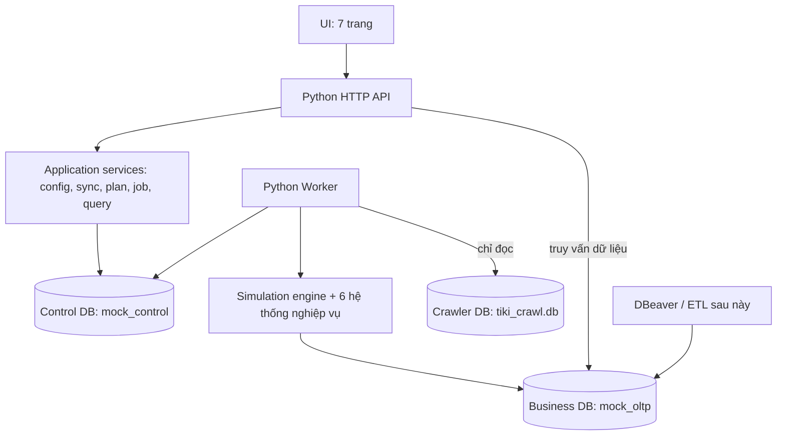

# Kế hoạch hệ thống mock — UI, workflow, backend và lưu trữ

> Đã chuyển sang triển khai theo yêu cầu người dùng. Nội dung dưới đây là thiết kế; xem [trạng thái thực tế](../reviews/MOCK_IMPLEMENTATION_STATUS.md) để biết tính năng đã chạy và giới hạn. Không hiểu “đã có thiết kế” là toàn bộ nghiệp vụ đã hoàn thành.

**Trạng thái:** Kế hoạch kiến trúc để review; chưa triển khai. Phần cấu hình hành động của 6 hệ thống được dùng làm đầu vào thiết kế theo xác nhận của người dùng. Kế hoạch này không tự bổ sung hay thay đổi quyền nghiệp vụ.

Các rule tại [MOCK_SYSTEM_RULES.md](../MOCK_SYSTEM_RULES.md) được giữ nguyên. Tài liệu cũ ngoài `docs/mock-design/` chỉ tham khảo. Python triển khai theo OOP trong `scripts/`.

## 1. Mục tiêu và giới hạn

Người dùng đồng bộ sản phẩm thật, cấu hình hành động ở 6 hệ thống, chạy thời gian mô phỏng và quan sát dữ liệu phát sinh vào PostgreSQL. UI phải chỉ rõ đang đọc nguồn nào, ghi vào đâu, đã chạy tới ngày nào và vì sao một hành động chưa thực hiện được.

Dữ liệu vận hành bộ mock phải tách hoàn toàn khỏi schema nghiệp vụ đầu ra. Không thêm bảng config, job, checkpoint, queue hoặc nhật ký generator vào 27 bảng nghiệp vụ. Chưa xây ETL/DW, website bán hàng thật, đăng nhập/phân quyền nhân viên hoặc tích hợp ngân hàng/carrier thật.

Đề xuất bản đầu chạy local, một tiến trình worker ghi trên một môi trường mock tại một thời điểm. Chưa yêu cầu nhiều người dùng hoặc xử lý phân tán.

## 2. Số trang: 7 trang chính

| # | Trang | Mục đích | Hành động chính |
|---|---|---|---|
| 1 | Tổng quan | Điểm bắt đầu và điều hướng; cho biết trạng thái thực tế | Xem DB nguồn/đích, ngày đã hoàn tất/ngày tiếp theo, catalog, job, lỗi; đi tới bước đang thiếu. |
| 2 | Đồng bộ Tiki | Nhập catalog mới từ crawler độc lập với lịch mock | Chọn phạm vi/giới hạn → xem trước → đồng bộ → xem báo cáo. |
| 3 | Cấu hình kịch bản | Cấu hình hành động của 6 hệ thống | Chọn hệ thống → nhóm tác động → hành động → ngày thường/ngày đặc biệt và form riêng. |
| 4 | Lập kế hoạch & Chạy | Chọn khoảng thời gian, kiểm tra khả thi và phát lệnh chạy | Chọn phiên bản config, ngày bắt đầu/kết thúc → preview → chạy. |
| 5 | Theo dõi lượt chạy | Theo dõi một job đang chạy/đã dừng; điều khiển tiến trình | Xem ngày, hành động, backlog, tốc độ; yêu cầu tạm dừng; tiếp tục sau kiểm tra. |
| 6 | Lịch sử & Kiểm tra dữ liệu | Tra cứu kết quả lâu dài và đối chiếu dữ liệu đầu ra | Lọc run/ngày/hệ thống/hành động; xem lỗi, bảng liên quan, số lượng, dữ liệu mẫu. |
| 7 | Thiết lập môi trường | Khai báo và kiểm tra các nguồn lưu trữ; chuẩn bị ban đầu | Kiểm tra kết nối; chọn ngày bắt đầu, seed, múi giờ; chuẩn bị cấu trúc và dữ liệu nền. |

Trang 3 có **6 tab hệ thống trong cùng một trang**, không thêm 6 mục điều hướng chính. Chi tiết hành động, ngày đặc biệt và job là panel/tab, không tính thêm page. Trang 2 là mục độc lập truy cập được ngay từ Tổng quan, không bị giấu trong Catalog & Seller.

Thanh trạng thái chung: môi trường đang chọn, tên DB nghiệp vụ đích, ngày mô phỏng đã hoàn tất và job đang chạy. Chưa setup thì chỉ dẫn tới trang 7; không buộc người dùng tự đoán tại sao preview không hoạt động.

## 3. Nội dung và hành vi từng trang

### Trang 1 — Tổng quan

- Các khối trạng thái: kết nối, số sản phẩm/shop/danh mục, ngày đã hoàn tất, ngày tiếp theo, lượt chạy hiện tại, yêu cầu tồn đọng.
- Checklist theo tình trạng: thiết lập môi trường → đồng bộ catalog → cấu hình dữ liệu nền/kịch bản → lập kế hoạch → chạy.
- Nút riêng “Đồng bộ Tiki”. Chỉ thông báo crawler có thể có dữ liệu mới nếu người dùng kiểm tra; không tự đồng bộ hoặc tự chạy mô phỏng.
- Phân biệt số liệu thực có trong DB và số dự kiến từ kế hoạch. Không hiện thông báo “đã tạo dữ liệu” chỉ vì config đã được lưu.

**Bên dưới:** các API đọc trạng thái Control DB và số liệu đọc từ Business DB, không gọi engine sinh dữ liệu.

### Trang 2 — Đồng bộ Tiki

- Hiện nguồn crawler, thời điểm kiểm tra, phạm vi danh mục/ID và giới hạn sản phẩm mới.
- Preview: sản phẩm/seller/danh mục dự kiến thêm; đã có; lỗi; phần hoãn. Hiện rõ “Chỉ thêm mới”.
- Bấm thực hiện tạo sync job. Chặn sync ghi trong lúc simulation job đang ghi cùng môi trường.
- Preview dùng snapshot nguồn để dữ liệu không đổi giữa xem trước và thực thi; lưu dấu vết snapshot ở Control DB. Nếu đích đã đổi thì yêu cầu preview lại.
- Không tạo kho, tồn đầu, khách hàng hoặc chiến dịch. Catalog mới chỉ trở thành đầu vào có thể dùng cho lượt chạy sau theo quy tắc hiệu lực.

**Bên dưới:** nguồn crawler mở read-only → snapshot/kiểm tra → dịch vụ sync → INSERT bản ghi mới vào Business DB. Kiểm tra bản ghi tồn tại bằng khóa đã chốt; không UPDATE/DELETE hoặc ghi ngược nguồn.

### Trang 3 — Cấu hình kịch bản

- Tab: Catalog & Seller / Khách hàng & Đơn hàng / Kho vận / Marketing / Web analytics / Tài chính.
- Mỗi tab: nhóm tác động → danh sách mã hành động → form riêng theo các file cấu hình hiện có.
- Form chung: bật/tắt; số ngày thường; từng ngày đặc biệt và số thay thế; đối tượng; khung giờ; các trường riêng rõ ràng.
- Lịch ngày đặc biệt dùng chung một danh sách ngày, nhưng số lượng và tham số là riêng từng hành động. Ví dụ 11/11 tăng checkout không tự tăng khóa shop.
- Ngay trên hành động hiển thị phụ thuộc, trạng thái sẵn sàng và lý do chưa hỗ trợ. Hiện nguồn điều khiển đối với hành động dùng chung để không sinh trùng ở hai tab.
- “Lưu bản nháp”, “Kiểm tra cấu hình”, “Lưu phiên bản dùng để chạy”. Không tự chạy và không đổi Business DB khi lưu config.
- Cho chỉnh sửa trực tiếp cấu hình đã lưu theo Rule 07. Mỗi kế hoạch/job dùng snapshot riêng; sửa cấu hình không thay đổi job đã tạo hoặc lịch sử. Kế hoạch cũ phải preview lại trước khi tạo job mới.

**Bên dưới:** kiểm tra schema config/quyền/phạm vi/các tỷ trọng → lưu Control DB. Các truy vấn chọn đối tượng chỉ đọc Business DB.

Các chế độ “xử lý toàn bộ đầu vào đến hạn” và “chuỗi hành vi theo phiên” nếu được chốt sẽ hiện đúng form riêng, không âm thầm thay quota người dùng nhập.

### Trang 4 — Lập kế hoạch & Chạy

- Chọn phiên bản kịch bản, một ngày, một tháng, một năm hoặc khoảng ngày tùy chọn. Giao diện luôn hiển thị ngày đầu–cuối thực tế; không để người dùng nhầm “tháng” với 30 ngày.
- Ngày bắt đầu mặc định là ngày tiếp theo được phép. Nếu khoảng chọn bắt đầu không khớp ngày tiếp theo thì chặn, chỉ rõ khoảng còn thiếu; không tự catch-up.
- Chọn tháng/năm mở ra khoảng lịch tương ứng. Nếu ngày tiếp theo nằm giữa kỳ, UI yêu cầu xác nhận/chọn lại thành phần còn lại rõ ràng; không âm thầm đổi khoảng.
- Preview: theo ngày/hệ thống/hành động; số yêu cầu, khả năng hiện tại, thiếu đầu vào, phụ thuộc, backlog dự kiến; ước lượng số dòng và dung lượng, gắn nhãn ước lượng.
- Kết quả phụ thuộc sự kiện tương lai không thể dự đoán chính xác tuyệt đối thì hiển thị khoảng/giả định, không hứa số thành công chắc chắn.
- Chỉ bật “Chạy” khi không còn lỗi chặn. Preview hết hiệu lực nếu config, catalog, checkpoint hoặc trạng thái đích đổi.
- Hiện ngay cạnh nút: ngày chạy, phiên bản config và DB đích. Lỗi hiển thị tại vị trí thao tác, không chỉ ở đầu trang dài.

**Bên dưới:** Planner đọc dữ liệu + snapshot config → tạo plan trong Control DB. Nút chạy gửi plan ID; backend kiểm tra lại độ mới và khóa ghi rồi xếp job, không chạy mô phỏng trong request HTTP.

### Trang 5 — Theo dõi lượt chạy

- Hiện job ID, phiên bản, DB đích, ngày đang xử lý, giờ mô phỏng, ngày hoàn tất và trạng thái tác vụ.
- Thống kê theo nhóm hành động: yêu cầu, thành công, từ chối, lỗi, thiếu đối tượng, còn chờ; số dòng Business DB đã commit được tách khỏi số đang chuẩn bị.
- “Tạm dừng” gửi yêu cầu; trạng thái chuyển “Đang chờ dừng” tới khi đến ranh giới an toàn. Không báo đã dừng chỉ vì bấm nút.
- “Tiếp tục” giữ nguyên job/config/seed và đi từ checkpoint an toàn; không chạy lại hành động đã hoàn tất. Nếu worker mất kết nối phải kiểm tra phục hồi trước.
- Đóng tab hoặc reload không dừng job. Kết nối lại đọc trạng thái đã lưu.

**Bên dưới:** API ghi yêu cầu điều khiển vào Control DB; worker đọc yêu cầu, commit đơn vị đang xử lý rồi dừng. UI nhận tiến độ từ backend; không giữ checkpoint trong localStorage.

### Trang 6 — Lịch sử & Kiểm tra dữ liệu

- Hai tab: lịch sử simulation và lịch sử sync. Mỗi job có config snapshot, thời gian thực chạy, khoảng ngày mô phỏng, kết quả, lỗi và checkpoint.
- Lọc ngày/hệ thống/hành động/đối tượng; xem chuỗi nguyên nhân–hệ quả, ví dụ khóa shop dẫn tới yêu cầu xử lý các đơn nào.
- Xem bảng nghiệp vụ có phân trang, lọc an toàn và thống kê; UI chỉ đọc, không cho sửa trực tiếp database từ lưới dữ liệu.
- Hiện trạng thái kiểm tra quan hệ ID, tiền, tồn kho và thời gian theo luật đã chốt; phân biệt lỗi nghiệp vụ với lỗi kỹ thuật.
- Hiện thông tin kết nối DBeaver: host, port, tên DB và schema; mật khẩu không hiện trong log hoặc báo cáo.

**Bên dưới:** read API đọc Control DB cho lịch sử và Business DB cho mẫu dữ liệu. Không chạy lại engine chỉ để xem báo cáo.

### Trang 7 — Thiết lập môi trường

- Khai báo riêng 3 kết nối: crawler read-only, Control DB và Business DB. Không cho Control DB và Business DB trỏ cùng database.
- Chọn ngày bắt đầu mô phỏng, múi giờ UTC+7 và seed. Ngày này do người dùng chọn, không tự lấy ngày thật hôm nay.
- Kiểm tra cấu trúc nghiệp vụ đúng phiên bản; chưa có thì tạo cấu trúc sau thao tác “Chuẩn bị môi trường”, không tự nạp dữ liệu khi chỉ kiểm tra kết nối.
- Panel dữ liệu nền: khách đã có, địa chỉ, kho/carrier, kênh/phương thức, chính sách cần thiết; số lượng và chính sách do người dùng cấu hình. Đây là bước bootstrap riêng, không giả vờ đã có tài khoản/đơn từ trước nếu chưa tạo.
- Catalog sync không tự bootstrap. Tồn đầu phải là một hành động nhập đầu kỳ có kiểm soát, dùng SKU thực đã nhập; tránh sinh hai lần qua bootstrap và lịch nhập.
- Seed/ngày bắt đầu không đổi ngầm sau khi có dữ liệu; muốn thử một lịch sử độc lập dùng môi trường đích riêng. Không đưa nút reset/xóa DB hàng loạt vào luồng thường.

**Bên dưới:** dịch vụ kết nối, migration kiểm soát phiên bản và bootstrap job. Khóa dùng chung với sync/run. Log che thông tin bí mật.

## 4. Workflow sử dụng

### 4.1. Lần đầu

1. Thiết lập: cấu hình nguồn crawler, Control DB, Business DB; chọn seed/ngày bắt đầu; chuẩn bị cấu trúc.
2. Đồng bộ: xem trước và nhập sản phẩm/shop/danh mục mới.
3. Thiết lập dữ liệu nền còn thiếu theo các hệ thống muốn bật, với preview riêng.
4. Cấu hình: vào 6 tab, chọn nhóm/hành động, nhập số ngày thường và các ngày đặc biệt; lưu phiên bản.
5. Lập kế hoạch: chọn khoảng ngày liên tục, preview, xử lý lỗi chặn, bấm chạy.
6. Theo dõi: xem dữ liệu được commit vào Business DB và các yêu cầu tồn; tạm dừng/tiếp tục nếu cần.
7. Lịch sử: kiểm tra báo cáo, xem bảng hoặc mở DBeaver.

### 4.2. Chạy tiếp và ngày sale

Ví dụ đã hoàn tất `2026-10-11`, muốn cấu hình riêng `2026-11-11`:

1. Ở trang cấu hình, nhập số của 11/11 cho từng hành động muốn thay đổi và lưu phiên bản.
2. Chạy tiếp `2026-10-12` đến `2026-11-10` theo phiên bản đã chọn.
3. Sau khi hoàn tất 10/11, chạy riêng `2026-11-11`. Không cần chạy lại các ngày cũ.

Có thể chạy cả khoảng đến 11/11 trong một job; planner tự chọn giá trị override của 11/11. Không được nhảy thẳng đến 11/11 khi chưa hoàn tất 10/11. Kết quả giao/hoàn của ngày sale có thể kéo sang những ngày sau.

### 4.3. Cào thêm dữ liệu

Crawler vẫn chạy độc lập. Khi cần bổ sung đầu vào, chờ worker dừng an toàn → vào Đồng bộ → preview → thực hiện. Sản phẩm đã có không bị sửa, kể cả giá mới. Sau sync preview lại các kế hoạch chưa chạy. Không chạy đồng thời sync và simulation trên cùng đích.

Đề xuất lưu mốc hiệu lực theo đồng hồ mô phỏng của lượt sync trong Control DB; sản phẩm mới không được tạo giao dịch trước thời điểm nó tồn tại. Chính sách created_at/trạng thái ban đầu sẽ chốt cùng thiết kế dữ liệu.

## 5. Kiến trúc tổng thể

Backend đề xuất một codebase Python OOP dưới `scripts/`, với các lớp trách nhiệm:

| Thành phần | Trách nhiệm |
|---|---|
| API controllers | Nhận/kiểm tra request, gọi service, trả lỗi có cấu trúc. |
| ConfigService | Bản nháp, phiên bản, validation và snapshot. |
| CatalogSyncService | Đọc snapshot crawler, diff và nhập append-only. |
| Planner | Giải cấu hình theo ngày, kiểm tra lịch/phụ thuộc, ước lượng. |
| JobService + Worker | Xếp job, khóa, điều khiển chạy, pause và recovery. |
| SimulationEngine | Đồng hồ mô phỏng, chọn hành động, xử lý chuỗi nhân quả theo thời gian. |
| 6 domain services | Thực thi quyền/điều kiện nghiệp vụ từng hệ thống; không sinh trùng hành động. |
| Repositories | Tách đọc crawler, Control DB và Business DB. |
| Query/ValidationService | Thống kê, dữ liệu mẫu và kiểm tra đầu ra. |

API và worker là hai tiến trình riêng, không dùng background thread sống nhờ request web. Có thể dùng chung máy và môi trường Python. Bản local dùng hàng đợi bền trong Control DB, chưa cần Redis/message broker. Các framework/libraries cụ thể lựa chọn khi triển khai, không phải logic đã chốt.

## 6. Nơi lưu dữ liệu: 3 nguồn tách biệt

| Nguồn | Công nghệ đề xuất | Nội dung | Quyền của mock |
|---|---|---|---|
| Crawler DB | SQLite hiện tại | Sản phẩm/JSON/checkpoint do crawler quản lý | Chỉ đọc; không migration hoặc ghi ngược. |
| Control DB | PostgreSQL database riêng `mock_control` | Config, job, checkpoint, queue, snapshot, audit, mapping kỹ thuật, báo cáo thực thi | Đọc/ghi dữ liệu vận hành mock. |
| Business DB | PostgreSQL database riêng `mock_oltp` | Chỉ schema nghiệp vụ các hệ thống được mô phỏng | Domain services ghi dữ liệu; UI truy vấn đọc. |

Hai database PostgreSQL có thể cùng server local nhưng **khác database, connection và quyền**. Đây là tách biệt logic hoàn toàn về dữ liệu, chưa phải hai máy chủ vật lý. Nếu muốn cách ly tài nguyên cũng có thể triển khai hai instance mà không đổi workflow.

DBeaver có thể kết nối riêng cả hai, nhưng dữ liệu đầu ra cho ETL là Business DB. Không trộn metadata generator vào dữ liệu nguồn nghiệp vụ. Không thêm trigger hoặc FK liên database để gắn hai bên.

### 6.1. Các nhóm bảng đề xuất trong Control DB

| Nhóm | Dữ liệu cần giữ |
|---|---|
| `environments`, `connection_profiles` | Môi trường, định danh nguồn/đích, trạng thái cấu trúc; lưu tham chiếu secret thay vì mật khẩu trong snapshot. |
| `scenario_drafts`, `scenario_versions`, `action_configs`, `special_days` | Bản nháp, cấu hình đã lưu có thể sửa, lịch sử lần sửa và snapshot thực thi bất biến. |
| `input_snapshots`, `sync_jobs`, `sync_items` | Snapshot nguồn, fingerprint, kết quả diff và bản ghi đã thêm/bỏ qua/lỗi. |
| `bootstrap_jobs` | Kế hoạch và kết quả tạo dữ liệu nền. |
| `plans`, `plan_days` | Khoảng chạy, version config/catalog/checkpoint, preview và thời hạn hiệu lực. |
| `jobs`, `job_commands`, `worker_leases` | Trạng thái bền, yêu cầu pause, chủ sở hữu và heartbeat worker. |
| `actions`, `scheduled_events`, `action_results` | Ý định thực thi, phụ thuộc, kết quả và backlog sang ngày sau. |
| `checkpoints`, `daily_progress`, `random_states` | Ngày hoàn tất, mốc an toàn trong ngày, trạng thái ngẫu nhiên để tiếp tục đúng. |
| `write_batches`, `write_manifests`, `id_allocations` | Ý định ghi và các khóa/giá trị kỳ vọng phục vụ chống trùng, đối chiếu sau lỗi. |
| `entity_provenance`, `runtime_metadata` | Nguồn dữ liệu, lý do tạm dừng, liên kết checkout, thông tin cần chốt tại giao dịch nhưng schema cũ chưa đủ. |
| `audit_entries`, `validation_results`, `daily_metrics` | Lịch sử tác vụ, lỗi/bất biến và thống kê. |

Đây là nhóm bảng đề xuất để thiết kế chi tiết, chưa phải DDL chốt. `runtime_metadata` không được dùng để giấu dữ liệu nghiệp vụ mà hệ thống nguồn cần cung cấp cho ETL; khi thiếu cột nghiệp vụ thật phải báo và chốt mở rộng Business schema. Metadata thuần điều khiển mới lưu riêng ở đây.

### 6.2. Checkpoint và tiếp tục

- Lưu cả ngày cuối hoàn tất và mốc đã commit trong ngày đang chạy; ngày tiếp theo chỉ được mở khi ngày hiện tại hoàn tất.
- Tạm dừng giữa ngày giữ cấu hình và công việc còn lại. Không giả vờ cả ngày chưa chạy rồi lặp những phần đã ghi.
- Pending events qua ngày/tháng/năm tiếp tục được giữ, không xóa khi job kết thúc một khoảng ngày.
- Một job lưu seed, RNG state, snapshot config, nguồn và version engine. Đổi seed/code/config khi tiếp tục không được hứa tái lập y hệt; phải kiểm tra tương thích.

## 7. UI giao tiếp với bên dưới như thế nào?

Đề xuất HTTP JSON API cùng origin. UI không truy cập PostgreSQL/SQLite trực tiếp, không giữ DSN/credential trong trình duyệt. Backend mới có quyền truy cập các database.

| Thao tác UI | Endpoint minh họa | Hành vi |
|---|---|---|
| Mở tổng quan | `GET /api/overview` | Đọc trạng thái đã lưu và tổng hợp. |
| Kiểm tra môi trường | `POST /api/environments/{id}/check` | Chỉ kiểm tra kết nối/cấu trúc, không sinh dữ liệu. |
| Chuẩn bị môi trường | `POST /api/environments/{id}/prepare` | Tác vụ cấu trúc được yêu cầu riêng. |
| Bootstrap | `POST /api/bootstrap-jobs` | Xếp job dữ liệu nền đã preview. |
| Lưu bản nháp / phiên bản | `PUT /api/scenario-drafts/{id}`, `POST /api/scenario-versions` | Chỉ lưu Control DB. |
| Xem trước sync | `POST /api/sync-previews` | Snapshot, diff, lưu preview; không ghi Business DB. |
| Đồng bộ | `POST /api/sync-jobs` | Xếp job tham chiếu preview còn hiệu lực. |
| Xem trước lịch chạy | `POST /api/plans` | Lưu plan, không phát sinh dữ liệu nghiệp vụ. |
| Chạy | `POST /api/jobs` | Nhận plan ID và khóa chống gửi lặp; trả `202 Accepted` và job ID. |
| Tạm dừng / tiếp tục | `POST /api/jobs/{id}/pause`, `/resume` | Ghi lệnh bền, trả trạng thái chờ xử lý. |
| Theo dõi | `GET /api/jobs/{id}`, `GET /api/jobs/{id}/events` | Snapshot trạng thái + luồng SSE theo tiến độ. |
| Xem lịch sử/dữ liệu | `GET /api/history`, `GET /api/data/{table}` | Phân trang, danh sách bảng cho phép, chỉ đọc. |

Endpoint là hợp đồng dự kiến, không phải API đã tồn tại. UI nhận tiến độ qua SSE; fallback polling có giới hạn khi mất kết nối. Sự kiện SSE phải có cursor để nối lại; mất thông báo không làm mất job hoặc checkpoint trong database.

Request ghi có khóa chống gửi lặp; bấm nút hai lần không tạo hai job. Nếu config/plan đã lỗi thời, trả lỗi xung đột có hướng dẫn preview lại. Backend kiểm tra mọi điều kiện, không tin chỉ vì UI đã disable nút. Lỗi trả mã, thông điệp, trường liên quan và request/job ID, không trả secret.

## 8. Luồng thực thi và dữ liệu chảy vào Business DB

1. Worker lấy job và khóa môi trường; phục hồi phần dang dở nếu có.
2. Nạp snapshot config/catalog, checkpoint và các sự kiện còn chờ.
3. Planner/engine giải số lượng ngày thường hoặc override theo ngày; chọn tác nhân/đối tượng hợp lệ.
4. Thực thi hành động theo đồng hồ mô phỏng; hệ thống chính xử lý trước, tác động liên quan xếp theo quan hệ và độ trễ.
5. Ghi Business DB theo transaction nhỏ có ranh giới nghiệp vụ; lưu tiến độ Control DB theo giao thức phục hồi.
6. Commit xong mới báo UI dữ liệu đã ghi; DBeaver thấy các transaction đã commit, không phải chỉ thấy dữ liệu cuối cả tháng.
7. Cuối ngày kiểm tra bất biến, chốt số dư cần thiết, đánh dấu ngày hoàn tất; nếu lỗi chặn thì không mở ngày tiếp theo.

Một transaction không được tách dở đơn và các dòng đơn để tạo trạng thái không hợp lệ. Một chuỗi liên hệ qua nhiều hệ thống có thể trải qua nhiều transaction, biểu hiện chờ/thất bại rõ ràng.

Đề xuất có chế độ tốc độ tối đa hoặc giới hạn hành động/giây để quan sát. Tốc độ thực thi không thay đổi thời gian nghiệp vụ mô phỏng hoặc số lượng cấu hình. Chi tiết kích thước batch sẽ đo khi triển khai, không hứa hiệu năng chưa benchmark.

### 8.1. Rủi ro quan trọng: hai database không có một commit chung

Commit Business DB và cập nhật Control DB không tự nguyên tử chỉ vì cùng PostgreSQL server. Worker có thể chết sau ghi nghiệp vụ nhưng trước ghi checkpoint. Không được tuyên bố chống trùng chỉ bằng lưu job ID.

Đề xuất bản đầu dùng một writer, manifest ghi bền trước khi ghi nghiệp vụ và đối chiếu phục hồi:

- Control DB lưu ý định batch, khóa bản ghi, giá trị trước/sau kỳ vọng và các ID đã cấp.
- Business DB thực hiện batch trong một transaction; không thêm bảng receipt vào schema nghiệp vụ.
- Sau commit, Control DB ghi kết quả/checkpoint. Batch tiếp theo chỉ chạy khi batch trước được xác nhận.
- Nếu lỗi ở khoảng giữa hai commit, worker đọc Business DB đối chiếu manifest: khớp trước thì có thể thực thi; khớp sau thì ghi nhận đã hoàn tất; khác cả hai hoặc không đủ bằng chứng thì dừng, báo cần kiểm tra. Không retry mù UPDATE cộng/trừ.
- Các bước con/phát sự kiện có khóa chống lặp ở Control DB; phục hồi chưa xong không phát tiếp batch mới.

Business DB là đích do engine quản lý; DBeaver/ETL chỉ đọc trong lúc chạy. Có ghi ngoài luồng thì phải phát hiện bất thường và dừng. Phương án phục hồi này cần thiết kế và kiểm thử lỗi cụ thể trước khi tuyên bố bảo đảm không trùng. Không dùng distributed transaction hoặc broker như một giải pháp mặc định chưa đánh giá.

## 9. Thứ tự triển khai và tiêu chí nghiệm thu

| Giai đoạn | Kết quả phải kiểm tra được |
|---|---|
| 1. Hợp đồng dữ liệu/control | 3 nguồn tách biệt; schema version; khóa sản phẩm/SKU và dữ liệu nền được chốt; form config lưu/đọc đúng. |
| 2. Khung UI và đồng bộ | 7 trang điều hướng được; sync preview không ghi đích; sync lặp không sửa/trùng bản ghi. |
| 3. Plan, worker và phục hồi | Chặn nhảy ngày; chặn job trùng; pause/reload/resume; inject lỗi giữa hai commit và phục hồi có kiểm chứng. |
| 4. Domain engine | Triển khai từng hệ thống bằng cùng hợp đồng action/event; kiểm tra hành động và tác động liên quan trên tập nhỏ. |
| 5. Luồng xuyên hệ thống | Checkout → kho/thanh toán → giao → trả/hoàn → đối soát; nguồn hành động không trùng giữa các màn. |
| 6. Quan sát và vận hành | UI/DBeaver thấy dữ liệu đã commit; lịch sử giải thích được yêu cầu/thiếu/lỗi; kiểm thử ngày thường/ngày đặc biệt và khoảng tháng/năm. |

Chưa chạy số lượng lớn trước khi kiểm thử phục hồi và toàn vẹn trên luồng nhỏ. Không dùng test chỉ kiểm tra có dòng dữ liệu để kết luận nghiệp vụ đúng.

## 10. Các quyết định kiến trúc đề xuất để review

- 7 trang chính; 6 hệ thống là tab của trang Cấu hình.
- Control DB PostgreSQL riêng hoàn toàn với Business DB PostgreSQL; crawler SQLite chỉ đọc.
- Python API + worker riêng; UI dùng HTTP JSON và SSE; một writer cho mỗi môi trường.
- Business DB ghi theo transaction nghiệp vụ nhỏ để quan sát dần; checkpoint có thể ở giữa ngày.
- Chế độ bản đầu local, bootstrap tách riêng sync, không tự chạy các bước sinh dữ liệu khi người dùng chỉ lưu/xem trước.

Các giá trị nghiệp vụ và điểm còn thiếu trong schema phải tiếp tục chốt ở thiết kế dữ liệu. Kế hoạch này chưa tạo code, database hoặc tác vụ chạy thực tế.
