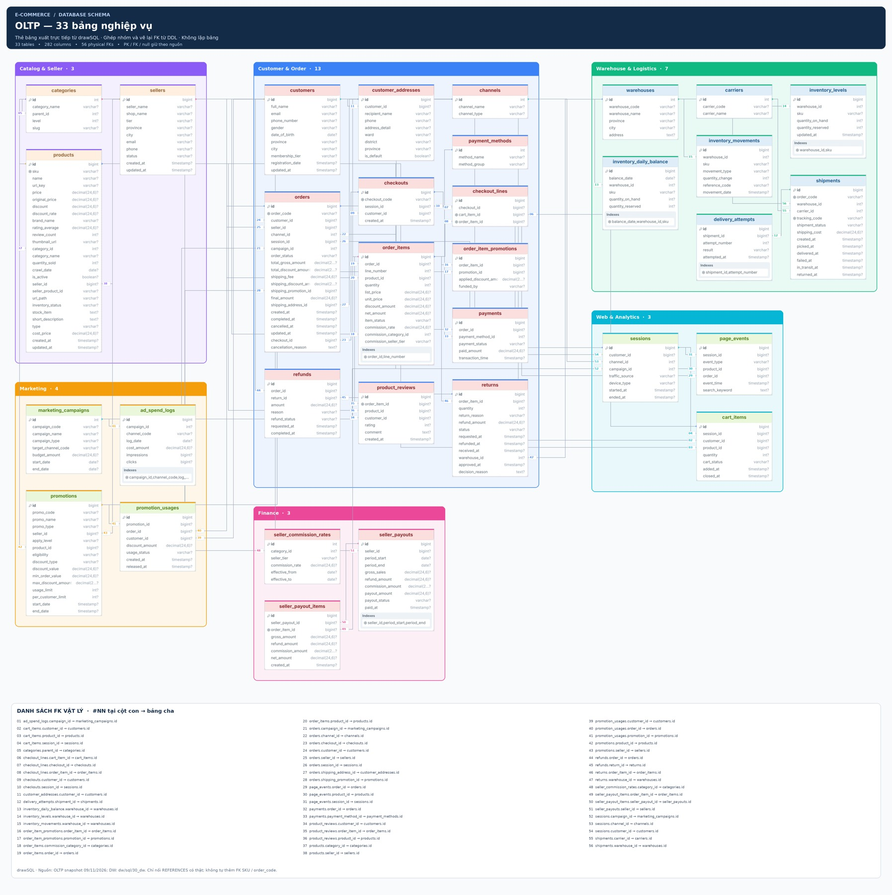
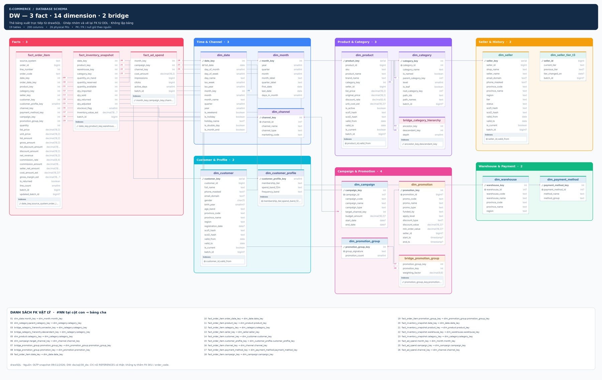

# Schema OLTP và DW dùng cho drawSQL

Chuẩn bị ngày 09/11/2026 từ checkout hiện tại. Chỉ xuất cấu trúc; không đưa dữ liệu giao dịch, tài khoản kết nối hoặc mật khẩu lên drawSQL.

## Nguồn chuẩn của lượt vẽ

- **OLTP:** `data/oltp_export/mock_oltp.dump`, snapshot ngày 09/11/2026. Đọc bằng `pg_restore --schema-only --no-owner --no-privileges`, không restore hay sửa database. Có **33 bảng, 282 cột và 56 khóa ngoại vật lý**.
- **DW:** các DDL trong `dw/sql/30_dw/`: **19 bảng logic** = 3 fact + 14 dimension + 2 bridge; **200 cột và 26 khóa ngoại vật lý**. Không bung từng partition tháng thành node riêng. `raw`, `stg`, `mart`, `audit`, `bench` là các lớp hỗ trợ ngoài sơ đồ lõi `dw.*` này.
- Không dùng `scripts/mock_platform/business_schema.json` 27 bảng làm đại diện cho snapshot OLTP 33 bảng. Sáu bảng bổ sung trong snapshot: `checkouts`, `checkout_lines`, `delivery_attempts`, `promotion_usages`, `refunds`, `seller_payout_items`.

## Nhóm OLTP

| Nhóm | Màu | Bảng |
|---|---|---|
| Catalog & Seller | Tím | categories, sellers, products |
| Khách hàng & Đơn hàng | Xanh dương | customers, customer_addresses, channels, payment_methods, checkouts, checkout_lines, orders, order_items, order_item_promotions, payments, refunds, returns, product_reviews |
| Kho vận | Xanh lá | warehouses, carriers, inventory_levels, inventory_movements, inventory_daily_balance, shipments, delivery_attempts |
| Marketing | Cam | marketing_campaigns, ad_spend_logs, promotions, promotion_usages |
| Web Analytics | Cyan | sessions, page_events, cart_items |
| Tài chính | Hồng | seller_commission_rates, seller_payouts, seller_payout_items |

## Nhóm DW

Fact (đỏ); thời gian/kênh (xanh dương); sản phẩm/danh mục (tím); người bán/lịch sử (cam); khách hàng/profile (cyan); chiến dịch/khuyến mãi (hồng); kho/phương thức thanh toán (xanh lá). Bảng `bridge_*` nằm cạnh chiều liên quan, tên bảng phân biệt rõ với `dim_*` và `fact_*`.

## Các quan hệ logic không phải FK

Sơ đồ cấu trúc chỉ nối FK có thật trong nguồn. Không tự thêm FK vào DDL chỉ để có đường nối:

- `inventory_*.sku` ↔ `products.sku`.
- `shipments.order_code` và `inventory_movements.reference_code` ↔ `orders.order_code`.
- Mã kênh marketing ↔ `channels` cần mapping.
- `dw.dim_seller_tier_t3.seller_id` ↔ `dw.dim_seller.seller_id` là quan hệ nghiệp vụ theo natural key; không có FK vật lý và SCD2 có nhiều phiên bản một seller.
- `batch_id`, `seller_id`, `root_category_key` không tự được xem là FK khi DDL không khai báo.

## Tệp nguồn có thể chỉnh sửa

- `oltp_drawsql.sql`, `dw_drawsql.sql`: chỉ DDL cấu trúc để import PostgreSQL.
- `oltp_grouped.dbml`, `dw_grouped.dbml`: cấu trúc cùng khai báo TableGroup/màu, để nhập bằng định dạng DBML khi công cụ hỗ trợ.
- `oltp_metadata.json`, `dw_metadata.json`: danh sách đầy đủ cột, PK, unique và FK để kiểm tra số lượng.
- `oltp_snapshot_schema.sql`: schema-only nguyên bản lấy từ snapshot; không có dữ liệu bảng.
- `prepare_schema.py`, `build_dbml.py`: tái tạo tệp nhập và metadata, không tác động DB.

## Kết quả hoàn tất

- [Ảnh OLTP đầy đủ — 33 bảng, 282 cột, 56 FK](exports/OLTP_FULL_33_TABLES.png).
- [Ảnh DW đầy đủ — 19 bảng, 200 cột, 26 FK](exports/DW_FULL_19_TABLES.png).
- [Tải toàn bộ ảnh và nguồn](SCHEMA_OLTP_DW_DRAWSQL.zip).





### Sơ đồ gốc có thể chỉnh trên drawSQL

| Phần | Link drawSQL | Bảng / cột / FK trong phần | Ảnh gốc |
|---|---|---|---|
| OLTP 1 — Catalog, dữ liệu chủ, marketing, tài chính | [Mở chỉnh sửa](https://drawsql.app/teams/manh-12/diagrams/oltp-1-catalog-marketing-finance) | 14 / 132 / 12 | [JPG](exports/oltp_1.jpg) · [PNG](exports/oltp_1.png) |
| OLTP 2 — Checkout, đơn hàng, thanh toán, sau bán | [Mở chỉnh sửa](https://drawsql.app/teams/manh-12/diagrams/oltp-2-checkout-orders-payments) | 15 / 145 / 21 | [JPG](exports/oltp_2.jpg) · [PNG](exports/oltp_2.png) |
| OLTP 3 — Kho vận và analytics | [Mở chỉnh sửa](https://drawsql.app/teams/manh-12/diagrams/oltp-3-logistics-web-analytics) | 15 / 139 / 19 | [JPG](exports/oltp_3.jpg) · [PNG](exports/oltp_3.png) |
| DW 1 — Fact và dimension dùng chung | [Mở chỉnh sửa](https://drawsql.app/teams/manh-12/diagrams/dw-1-facts-and-conformed-dimensions) | 15 / 176 / 22 | [JPG](exports/dw_1.jpg) · [PNG](exports/dw_1.png) |
| DW 2 — Bridge, khuyến mãi và lịch sử seller | [Mở chỉnh sửa](https://drawsql.app/teams/manh-12/diagrams/dw-2-bridges-promotions-seller-history) | 7 / 55 / 5 | [JPG](exports/dw_2.jpg) · [PNG](exports/dw_2.png) |

Từng phần có thể lặp bảng tham chiếu; cộng số bảng/cột/FK của các phần sẽ bị trùng. Bản tổng hợp chỉ giữ **mỗi bảng đúng một lần**. Hợp của ba phần OLTP bao phủ 33 bảng; hợp của hai phần DW bao phủ 19 bảng.

### Cách tạo ảnh tổng hợp và giới hạn

Đã thao tác trực tiếp trên drawSQL sau khi người dùng đăng nhập. Bản guest nhập tối đa 20 bảng; tài khoản hiện tại khi tạo diagram mới chỉ nhận tối đa **15 bảng**. Vì vậy không có một canvas native chứa đủ 33 bảng OLTP hoặc 19 bảng DW trong gói hiện tại. Không mua/nâng gói hoặc thay đổi quyền truy cập để vượt giới hạn.

Năm phần chính ở trên đã nhập thành công đủ số bảng, cột, quan hệ và TableGroup trong phạm vi từng phần; đã lưu vào tài khoản. Tất cả đều dùng PostgreSQL. Hai bản import thử ban đầu bị giới hạn bảng không thuộc bộ sản phẩm cuối.

Đã xuất **JPG trực tiếp bằng File → Export → Image → Advanced → JPG → Standard**. Xuất ảnh Large/WebP không trả được tệp ở những lần thử; JPG Standard thành công. Các tệp PNG của từng phần chỉ là chuyển định dạng từ JPG gốc, không tăng độ chi tiết.

`exports/compose_schema.py` cắt các thẻ bảng từ 5 ảnh JPG drawSQL, bố trí lại vào nhóm màu, loại bảng trùng và vẽ lại **toàn bộ FK vật lý theo metadata/DDL**. Đây là **ảnh ghép từ drawSQL**, không phải xuất nguyên một canvas đầy đủ từ tài khoản miễn phí. Không lấy SVG/JSON bằng cách né tính năng export Pro. Ảnh gốc có watermark drawSQL được giữ nguyên trong thư mục exports.

Các nhãn `#NN` nằm cạnh cột con; bảng đối chiếu phía dưới liệt kê đầy đủ `bảng_con.cột → bảng_cha.cột`. Đường nối có thể chung đoạn; dùng mã để đối chiếu chính xác. Có 8 FK OLTP nằm giữa các phần gốc, đã được khôi phục trong bản tổng hợp. DW có đủ 26 FK trong hợp hai phần, không còn FK liên phần bị bỏ sót.

Nhóm màu lớn trong bản ghép theo palette ở đầu tài liệu. Màu header trên từng thẻ bảng vẫn là màu drawSQL tự gán ở ảnh gốc. Một số tên/kiểu dài được drawSQL rút gọn khi hiển thị; SQL/DBML/metadata giữ giá trị đầy đủ.

Có thể tái tạo hai ảnh ghép từ các ảnh gốc bằng:

```bash
python3 docs/schema-drawsql/exports/compose_schema.py
```

File `panels_manifest.json` ghi tập bảng từng phần và FK liên phần; hai file `exports/*_inventory.json` ghi kiểm tra bao phủ bảng/cột/FK của ảnh tổng hợp. Script ghép dùng tọa độ của lần xuất này; nếu di chuyển bảng trên drawSQL và xuất lại thì cần cập nhật tọa độ cắt tương ứng.

## Một sơ đồ tương tác đủ 33 bảng / 6 hệ thống

[Mở bản độc lập](OLTP_33_TABLES_6_SYSTEMS.html). Tệp tự chứa, không cần mạng: có đủ 33 bảng, 282 cột và 56 FK trong đúng 6 group. Có phóng to/thu nhỏ, kéo nền, kéo nhóm/bảng và chọn cột để làm nổi quan hệ. Đây là bản độc lập, không phải một canvas hay link drawSQL và không ghi thay đổi vào database.

## DW tương tác theo Master Blueprint

[Mở DW Galaxy schema](DW_19_TABLES_GALAXY.html) — HTML tự chứa CSS, JavaScript và dữ liệu, mở trực tiếp bằng trình duyệt, không cần backend/mạng.

- Đối chiếu toàn bộ `docs/MASTER_BLUEPRINT.html` và DDL `dw/sql/30_dw/*.sql`: 19 bảng logic (3 fact, 14 dimension, 2 bridge), 200 cột, 26 FK vật lý. Không tính partition con/raw/stg/mart/audit vào 19 bảng.
- Bảy nhóm màu theo chức năng DW; không phải số hệ thống nguồn. Có zoom, kéo nền/nhóm/bảng, chọn cột tô sáng FK và mô tả grain/SCD từng bảng.
- “Thiết kế & Quy tắc” trình bày bus matrix, role-playing date, SCD/mini-dimension, bridge, quy tắc drill-across và pipeline ETL. Liên hệ logic qua seller_id không bị vẽ thành FK vật lý.
- Không đọc database trực tiếp; không cập nhật số batch/dòng khi hệ thống chạy. Vị trí kéo chỉ có hiệu lực trong lần mở hiện tại.
- Đã kiểm tra trên trình duyệt: 19 thẻ bảng, 200 cột, 7 nhóm, 26 đường FK; chọn `fact_order_item.order_date_key` trả đúng `dim_date.date_key`; hộp hướng dẫn mở/đóng được.

Tái tạo bằng `python3 docs/schema-drawsql/build_dw_single_view.py` (thư viện chuẩn Python; dùng template tương tác của `build_single_view.py` và `dw_metadata.json`). Metadata đã được tái sinh trong thư mục tạm và so khớp với DDL hiện tại. Các cột composite PK được hiển thị NOT NULL đúng ngữ nghĩa PostgreSQL.
