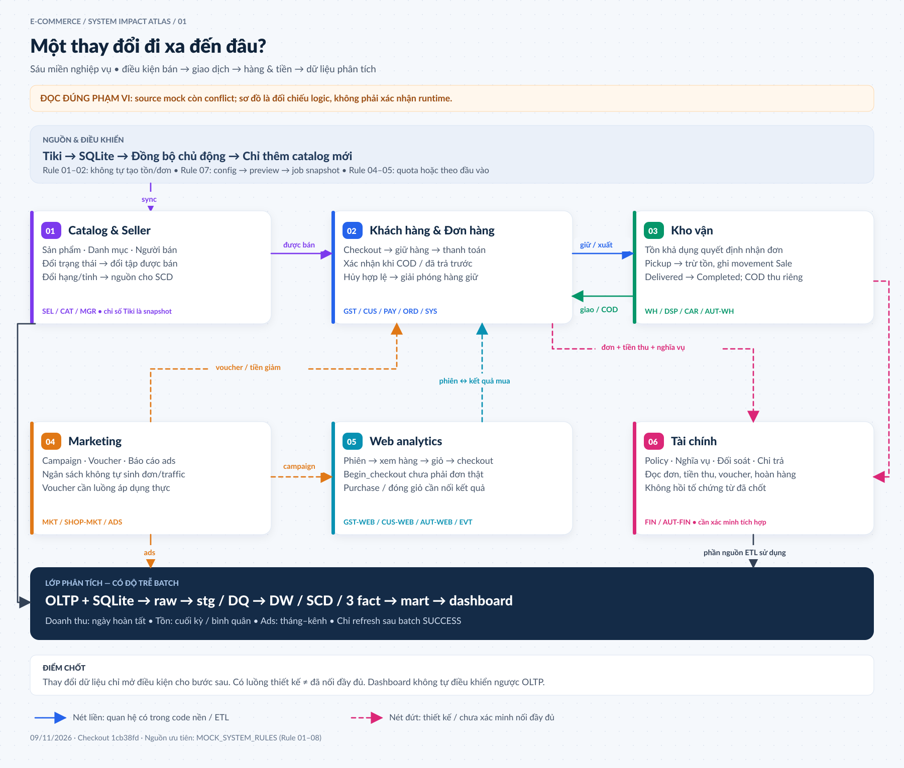
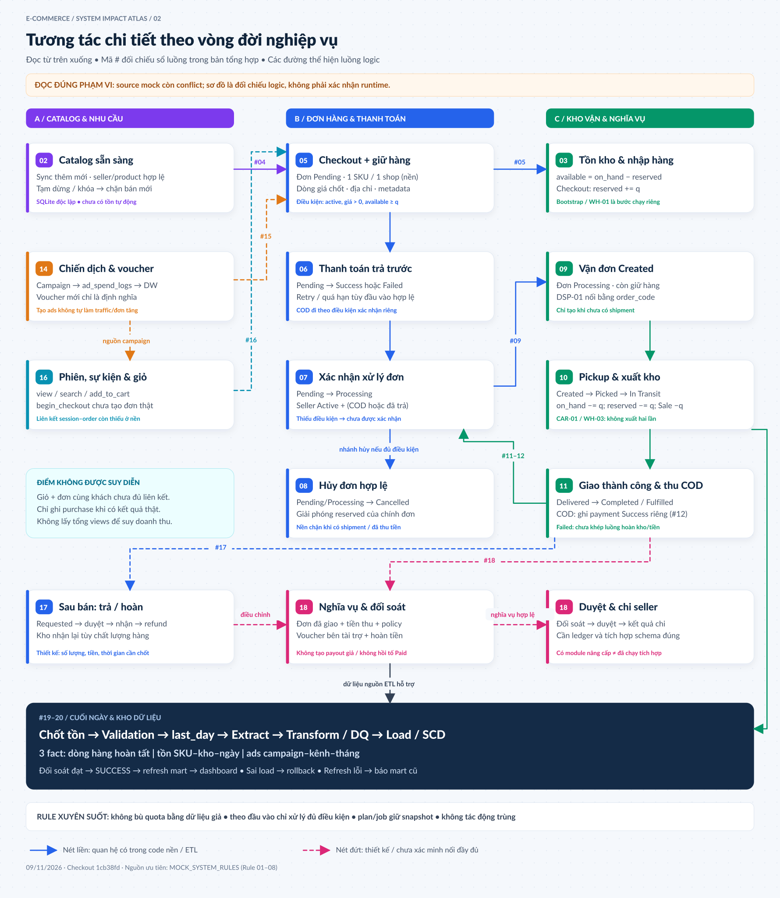

# Bản đồ dự án và quy tắc tác động giữa các hệ thống

> Đối chiếu ngày 09/11/2026 · Checkout `1cb38fd` · Tập trung thiết kế mock của người dùng.
> Đây là tài liệu tổng hợp, không bổ sung rule nghiệp vụ mới và không thay thế các quyết định đã chốt.

## 1. Đọc nhanh và hai sơ đồ

Dự án mô phỏng sàn thương mại điện tử đa người bán: **catalog tham chiếu thật từ Tiki → sáu miền nghiệp vụ mock → ETL → kho dữ liệu → mart → dashboard**. Sáu “hệ thống” là sáu miền nghiệp vụ trong cùng Mock Studio, dùng Business DB chung; không có căn cứ xem chúng là sáu microservice độc lập hay đã giao tiếp qua message broker.

- **Sơ đồ tổng quan**: nhìn từ một thay đổi để thấy miền nào bị ảnh hưởng, đâu là điều kiện chặn và đâu chỉ là khả năng sử dụng dữ liệu về sau.
- **Sơ đồ chi tiết**: theo vòng đời checkout, giữ hàng, thanh toán, vận chuyển, sau bán và đưa số liệu vào kho.
- Trong hình, **nét liền** chỉ quan hệ tìm thấy trong phần code đọc được hoặc luồng ETL hiện có; **nét đứt** chỉ hợp đồng thiết kế/chưa nối đầy đủ. Nét liền **không chứng nhận checkout này chạy được**, vì source mock hiện có conflict.

[Mở tổng quan kích thước đầy đủ](01_tong_quan_tac_dong.svg) · [Bản PNG](01_tong_quan_tac_dong.png)

[Mở chi tiết kích thước đầy đủ](02_chi_tiet_tuong_tac.svg) · [Bản PNG](02_chi_tiet_tuong_tac.png)

## 2. Nguồn nào quyết định logic?

| Nguồn | Cách sử dụng trong bản tổng hợp |
|---|---|
| [MOCK_SYSTEM_RULES](../mock-design/MOCK_SYSTEM_RULES.md) | Nguồn ưu tiên cho Rule 01–08 đã được xác nhận. |
| Sáu tài liệu `MOCK_*_CONFIG.md` trong [mock-design](../mock-design/README.md) | Thiết kế tác nhân, hành động, đơn vị đếm, phụ thuộc. Nhiều dòng vẫn là đề xuất. |
| [Trạng thái triển khai](../mock-design/MOCK_IMPLEMENTATION_STATUS.md) và [giới hạn engine](../mock-design/REALISTIC_CONFIG_CURRENT_ENGINE.md) | Mô tả một phiên bản tại thời điểm ghi; cần đối chiếu với source hiện tại. |
| [DATA_GENERATION_RULES](../DATA_GENERATION_RULES.md) | Bộ đặc tả cũ 1.323 dòng: mã R/S/V, công thức và tình huống tham khảo; **không tự nâng thành rule mới đã duyệt**. |
| `scripts/mock_platform/`, `dw/`, `dashboard/`, `bench/` | Đối chiếu cấu trúc, handler, bảng và đường truyền tác động có trong source. |
| [Blueprint](../MASTER_BLUEPRINT.md), [M1](../M1_KHAO_SAT_NGUON_CHU_DE_TICH_HOP.md), [M2](../M2_GRAIN_PHAN_TANG.md), M3 và nhật ký implementation | Thiết kế/tài liệu bằng chứng của lớp DW; số liệu là mốc đã ghi nhận, không phải truy vấn DB mới trong lượt này. |

**Mâu thuẫn quan trọng:** `CLAUDE.md` còn mô tả dự án chưa có ETL/test, nhưng hiện có `dw/etl/load.py`, test và dashboard. Một số tài liệu đầu file ghi “chưa có SCD thật”, trong khi phần cập nhật/Blueprint đã có ví dụ batch sau. Không suy trạng thái chỉ từ tiêu đề, timestamp hoặc một câu cũ.

**Giới hạn checkout:** `scripts/mock_platform/domain.py`, `storage.py`, `worker.py` chứa marker `<<<<<<< / ======= / >>>>>>>`. Kiểm tra tĩnh bằng `ast.parse` đều báo SyntaxError. Các file `engine/actors.py`, `engine/finance.py`, `engine/selection.py` còn tham chiếu package sau refactor không hiện diện đầy đủ tại đây. Có đoạn code nâng cấp không có nghĩa luồng nâng cấp đã được nối và chạy. Các báo cáo [review nhánh](../mock-design/reviews/QUY_BRANCH_MERGE_REVIEW_2026-11-08.md) và [nền Git](../mock-design/reviews/GIT_BASELINE_QUYBRUNO_2026-11-08.md) cũng ghi nhận tình trạng pha trộn này; nhận định hiện tại dựa thêm vào kiểm tra source tại checkout này.

## 3. Toàn cảnh các lớp trong dự án

| Lớp | Vai trò | Nơi đọc/ghi chính | Ranh giới tác động |
|---|---|---|---|
| Crawler Tiki | Thu thập sản phẩm và JSON tham chiếu | `scripts/crawl_tiki.py` → SQLite | Không tự ghi Business DB. |
| Đồng bộ chủ động | Nhập catalog mới hợp lệ | Đọc SQLite; thêm `products/categories/sellers` vào OLTP | Không cập nhật đè, không tạo tồn hay đơn. |
| Mock Studio UI/API | Cấu hình, preview, tạo và theo dõi job | `web/`, `api.py`, `service.py`; Control DB | Lưu config/preview không đồng nghĩa thực thi nghiệp vụ. |
| Worker/Domain | Thực thi hành động theo ngày và đầu vào | `worker.py`, `domain.py`; Business DB | Sáu miền cùng chia sẻ dữ liệu; source hiện bị conflict. |
| Control DB | Config, version, plan snapshot, job, runtime, manifest, receipt, checkpoint | `mock_control` | Phục vụ điều khiển/khôi phục; tách dữ liệu nghiệp vụ. |
| Business DB | Trạng thái và giao dịch mô phỏng | `mock_oltp`, schema cơ sở 27 bảng | OLTP current state; ledger/snapshot nghiệp vụ là bảng riêng. |
| ETL | Trích xuất, chuẩn hóa, DQ, SCD, nạp và đối soát | `dw/etl/`; `dwh.raw/stg/dw/audit` | Đọc nguồn, không sửa nguồn để ép khớp kho. |
| Mart và dashboard | Tổng hợp KPI, lịch sử, đối soát và chất lượng | `dw/sql/40_mart/`, `dashboard/app.py` | Chỉ phản ánh dữ liệu đã nạp; có độ trễ batch/refresh. |
| Benchmark/demo/test | Chứng minh grain, SCD, idempotent và hiệu năng | `bench/`, `demo/`, `dw/tests/` | Dữ liệu nhân bản/ca kiểm soát không phải dữ liệu vận hành thật. |
| Runner tùy chọn | Điều phối API mock theo lịch cấu hình | `scripts/mock_runner/` | Pipeline mock không đồng nghĩa scheduler ETL; cần phân biệt launcher với lệnh sinh dữ liệu. |

## 4. Tám rule đã chốt — ý nghĩa và hệ quả

| Rule | Quyết định | Hệ quả khi vẽ hoặc phân tích tác động |
|---|---|---|
| **01** | Đồng bộ crawler → mock chỉ thêm mới; bản ghi đã tồn tại bỏ qua toàn bộ | Crawl đổi giá A không làm A trong mock đổi giá, không làm đơn cũ đổi tiền. Sync lặp không tạo trùng. |
| **02** | Đồng bộ là chức năng ngoài lịch Catalog & Seller; người dùng chủ động gọi | Sản phẩm mới chỉ là đầu vào; không vẽ mũi tên tự sinh tồn, đơn, ads, analytics hoặc đối soát. |
| **03** | Rule mới ở `docs/mock-design/`; tài liệu cũ chỉ tham khảo; đề xuất chưa thành quyết định | Các tỷ lệ COD, lịch sale, ngưỡng trả hàng, hoa hồng trong luật cũ không tự áp cho engine mới. |
| **04** | Số lần ngày đặc biệt thay thế số ngày thường; thiếu override dùng số thường; 0 là không yêu cầu | Mỗi hành động độc lập. Ngày sale không tự nhân mọi hành động hoặc tự tăng nguồn lực xử lý. |
| **05** | Xử lý hệ quả hỗ trợ quota hoặc toàn bộ đầu vào đủ điều kiện | “Theo đầu vào” bỏ qua quota thường/đặc biệt; không tạo đơn/yêu cầu giả để đủ việc. Có thể còn backlog. |
| **06** | Giữ product ID Tiki; thiếu/trùng SKU hoặc nhiều chào bán xung đột thì báo lỗi và bỏ qua | Không cấp mã giả, không đổi ID để lách sync, không âm thầm ghi đè. |
| **07** | Cho sửa cùng cấu hình đã lưu; plan/job giữ snapshot, chống ghi đè đồng thời | Sửa config chỉ ảnh hưởng kế hoạch mới sau preview lại; job đã tạo/chạy/dừng giữ snapshot cũ. |
| **08** | Cào chủ động chỉ ghi SQLite; reset có xác nhận xóa toàn bộ 27 bảng OLTP và runtime liên quan | Reset không phải thao tác ngày thường. Giữ SQLite/cấu hình/lịch sử đã đánh dấu; cần sync → bootstrap → preview → chạy lại. |

**Ví dụ Rule 04:** hành động đặt hàng ngày thường 20, ngày 11/11 là 80 ⇒ yêu cầu 80, không phải 100 hay 1.600. Xác nhận đơn chạy “Theo đầu vào” chỉ xử lý đơn hợp lệ thực sự có, không mặc định có 80 đơn.

**Reset và DW:** Rule 08 mô tả reset OLTP, không cấp quyền tự xóa `dwh`. Sau reset, dữ liệu kho cũ, watermark và khóa nguồn có thể không còn phù hợp với đợt mới; cần quy trình tái lập/định danh đợt dữ liệu riêng trước khi tiếp tục ETL. Đây là hệ quả phân tích cần xử lý, không phải rule tự động xóa DW đã chốt.

## 5. Sáu miền nghiệp vụ và chủ sở hữu logic

| Miền | Tác nhân chính | Bảng lõi trong schema cơ sở | Miền nhận ảnh hưởng |
|---|---|---|---|
| **Catalog & Seller** | Seller, quản trị catalog, quản lý seller, khách truy cập | `products`, `categories`, `sellers` | Đơn hàng kiểm điều kiện bán; kho dùng SKU; marketing dùng phạm vi; tài chính dùng danh mục/hạng; DW theo dõi thuộc tính. |
| **Khách hàng & Đơn hàng** | Khách vãng lai/đăng nhập, seller xử lý đơn, CSKH, thanh toán mô phỏng, tự động | `customers`, `customer_addresses`, `channels`, `payment_methods`, `orders`, `order_items`, `payments`, `order_item_promotions`, `returns`, `product_reviews` | Kho giữ/xả/xuất; analytics nhận kết quả mua theo thiết kế; finance đọc nghĩa vụ; DW ghi bán hàng. |
| **Kho vận** | Nhân viên kho, điều phối, carrier mô phỏng, tự động | `warehouses`, `carriers`, `inventory_levels`, `inventory_movements`, `inventory_daily_balance`, `shipments` | Khả năng checkout; đơn hoàn tất khi giao; thanh toán COD; tồn kho DW. |
| **Marketing** | Marketing sàn/shop, nền tảng ads mô phỏng, tự động | `promotions`, `marketing_campaigns`, `ad_spend_logs` | Điều kiện voucher/nguồn phiên/attribution theo thiết kế; chi quảng cáo DW. |
| **Web analytics** | Khách vãng lai/đăng nhập, ghi nhận sự kiện, tự động | `sessions`, `page_events`, `cart_items` | Đầu vào checkout và campaign theo thiết kế; không tự coi begin_checkout là đơn thành công. |
| **Tài chính** | Quản lý chính sách, đối soát, duyệt, dịch vụ chi trả, seller tra cứu | `seller_commission_rates`, `seller_payouts` | Tính nghĩa vụ từ giao dịch; chính sách có hiệu lực cho giao dịch phù hợp; không sửa tiền đơn cũ để khớp payout. |

Registry hiện có **89 mã hành động**: Catalog 17; Orders 24; Warehouse 13; Marketing 9; Analytics 17; Finance 9. Con số “66 handler bật” là báo cáo phiên bản trong `MOCK_IMPLEMENTATION_STATUS`, không phải kiểm chứng runtime mới. Module finance nâng cấp có nhắc `seller_payout_items`, trong khi schema cơ sở 27 bảng không có bảng đó: không trộn hai phiên bản thành một schema đang chạy.

## 6. Hợp đồng liên kết và điểm dễ sai

| Dữ liệu đi qua ranh giới | Khóa/nội dung truyền | Điều phải giữ |
|---|---|---|
| Catalog → đơn/analytics/promotion | `products.id` → `product_id` | Định danh sản phẩm, seller hợp lệ, trạng thái tại thời điểm dùng. |
| Catalog → kho | `products.sku` ↔ `inventory_*.sku` | SKU duy nhất/hợp lệ; không lấy `stock_item`, `inventory_status` hoặc `quantity_sold` làm số tồn mô phỏng. |
| Đơn → kho vận | `orders.order_code` ↔ `shipments.order_code`, `inventory_movements.reference_code` | Không nối nhầm `orders.id` với chuỗi mã đơn. |
| Marketing → đơn/DW | `WEB/MOBILE_APP/LIVE` ↔ `Web/App/Livestream` ↔ `channels.id` | Ánh xạ mã tại ETL; không JOIN thẳng hai hệ mã. |
| Analytics → checkout | `session_id`, khách/giỏ và kết quả `order_id` | Phải là cùng hành trình thực; chưa nối thì không tính conversion. |
| Đơn ↔ voucher | `order_item_promotions`: voucher và tiền giảm đã phân bổ | Không chỉ có định nghĩa voucher rồi kết luận đơn đã được giảm. |
| Catalog/đơn → finance | seller, danh mục, hạng, thời điểm, policy giao dịch | Thay catalog/hạng về sau không được hồi tố nghĩa vụ đã chốt. Cơ chế snapshot phải hiện hữu mới đảm bảo được. |
| Nguồn → DW | Khóa nghiệp vụ → surrogate key theo khoảng hiệu lực | Khóa khách vãng lai `-1` khác khóa không tra được `0`. |
| Crawler → cây danh mục | SQLite chứa gốc; OLTP sản phẩm tham chiếu lá; raw JSON có path | Cùng tên cột `category_id` không có nghĩa cùng ngữ nghĩa. |

Nguồn: [mapping Tiki](../mock-design/TIKI_PRODUCT_FIELD_MAPPING.md), [schema OLTP](../OLTP_SCHEMA.md), [M1 tích hợp](../M1_KHAO_SAT_NGUON_CHU_DE_TICH_HOP.md), `extract.py` và `transform.py`.

## 7. Sổ luồng tương tác chi tiết

Các bước “code nền” dưới đây mô tả nhánh logic đọc được ở `domain.py`, không khẳng định có thể thực thi khi file còn conflict. Nhánh “thiết kế” là hợp đồng cần hoàn thiện/xác minh.

| # | Kích hoạt → hệ thống nhận | Dữ liệu/trạng thái thay đổi | Điều kiện và phạm vi |
|---|---|---|---|
| **01** | Crawl → SQLite | Upsert snapshot sản phẩm/raw/checkpoint | Crawler độc lập. Không tự sync mock. |
| **02** | Sync chủ động → Catalog | Thêm product/category/seller chưa có | Append-only, kiểm ID/SKU; chưa có tồn hoặc giao dịch. |
| **03** | Bootstrap/nhập hàng → Kho | Có `inventory_levels`, movement Import; dữ liệu nền khác được tạo ở bước riêng | Không phải hệ quả tự động của sync. |
| **04** | Catalog → Checkout | Chọn sản phẩm active, seller Active, giá dương | Tạm dừng/gỡ/khóa shop thu hẹp tập có thể đặt. |
| **05** | Checkout → Kho | `reserved += q`; tạo đơn/dòng/địa chỉ và metadata kho/phương thức | Cần `on_hand - reserved >= q`. Code nền: một SKU/một shop. |
| **06** | Checkout → thanh toán trả trước | Tạo payment Pending; kết quả Success/Failed | `PAY-01` xử lý request thật; thất bại chưa đồng nghĩa hủy ngay. |
| **07** | Thanh toán/COD → xác nhận đơn | Pending → Processing | Code nền: seller Active và COD hoặc có payment Success. |
| **08** | Hủy hợp lệ → Kho | Cancelled ở đơn/dòng; `reserved -= q` | Code nền chặn đơn đã có shipment hoặc payment Success; không tự hoàn tiền đơn đã thu. |
| **09** | Đơn Processing → vận đơn | Shipment Created, nối bằng order_code | Đơn còn giữ hàng; chưa có vận đơn. |
| **10** | Lấy hàng → ledger kho | Shipment Picked; `on_hand -= q`, `reserved -= q`; Sale `-q` | `CAR-01` và `WH-03` cùng xử lý giai đoạn này; không trừ hai lần. |
| **11** | Carrier → đơn hàng | Picked → In Transit → Delivered; đơn Completed; dòng Fulfilled | Code nền: giao thành công đặt `completed_at = delivered_at`. Failed chưa có vòng xử lý hệ quả đầy đủ. |
| **12** | Giao COD thành công → payments | Thêm payment Success bằng nghĩa vụ `final_amount` | Chỉ đơn COD Completed chưa thu thành công; không thu COD giao thất bại. |
| **13** | Đơn đã giao → đánh giá | Tạo product_review | Code nền chọn khách đăng nhập, dòng Fulfilled chưa đánh giá; không sửa chỉ số review snapshot Tiki. |
| **14** | Chiến dịch → báo cáo ads → ETL | `marketing_campaigns`, `ad_spend_logs` | Code nền có kiểm tra; tạo campaign không tự tăng phiên/đơn. |
| **15** | Marketing ↔ checkout | Kiểm voucher, giữ/hoàn lượt, phân bổ giảm giá | Thiết kế; chưa nối đầy đủ trong code nền. Không tự áp công thức cũ. |
| **16** | Analytics ↔ checkout | Giỏ/phiên → đơn; purchase → giỏ Ordered | Thiết kế; code nền có search/view/cart/begin_checkout nhưng chưa có checkout nối đơn đầy đủ. |
| **17** | Sau bán → kho/thanh toán | Yêu cầu trả → duyệt → nhận hàng → hoàn tiền | Thiết kế; còn phụ thuộc điều kiện/quantity/chất lượng hàng và chính sách. Không coi đã hoàn tất. |
| **18** | Đơn + tiền thu + policy → finance | Đối soát → duyệt → chi | Có code nâng cấp riêng nhưng package/schema chưa khớp; cần xác minh tích hợp. |
| **19** | Cuối ngày → snapshot kho/checkpoint | `inventory_daily_balance`; validation; `last_day` | Checkpoint chỉ tiến khi kiểm tra cuối ngày đạt theo worker. |
| **20** | Nguồn → raw → stg → DW → mart | Batch bất biến, DQ/cách ly, SCD và 3 fact, refresh KPI | Nạp dimension/fact/đối soát trong transaction; refresh mart sau SUCCESS. |

## 8. Ma trận: tác động vào một hệ thống sẽ ảnh hưởng gì?

Ký hiệu: **Đ** = tác động trực tiếp tìm thấy trong code nền; **K** = chỉ làm đổi điều kiện/nguồn cho hành động kế tiếp; **T** = hợp đồng thiết kế/chưa xác minh nối đầy đủ; **B** = sau ETL/refresh. Dấu `—` nghĩa không có đường trực tiếp được xác định trong phạm vi này. Cột Đơn hàng gồm khách hàng/thanh toán.

| Nơi tác động ↓ / Nơi nhận → | Catalog | Đơn hàng | Kho vận | Marketing | Analytics | Tài chính | DW/KPI |
|---|---|---|---|---|---|---|---|
| Catalog & Seller | Đ | K | K: SKU/phạm vi | K: shop/sản phẩm | K: sản phẩm hợp lệ | T: hạng/danh mục | B: SCD, nhóm báo cáo |
| Khách hàng & Đơn hàng | — | Đ | Đ: giữ/xả tồn | T: tiêu/hoàn voucher | T: purchase/giỏ | T: nghĩa vụ | B: doanh thu, khách |
| Kho vận | — | Đ: giao/COD | Đ | — | T: hệ quả đơn | T: giao và thu tiền | B: tồn, thời điểm doanh thu |
| Marketing | K: phạm vi đọc | T: voucher/attribution | — | Đ | T: nguồn campaign | T: bên tài trợ | B: chi phí, CTR/ROAS có giới hạn |
| Web analytics | K: đọc catalog | T: checkout từ giỏ | — | T: attribution | Đ | — | T: fact hành vi chưa có trong 3 fact hiện tại |
| Tài chính | K: đọc hạng/danh mục | T: policy giao dịch | — | T: đọc bên tài trợ | — | T: luồng nâng cấp | B: chỉ dữ liệu đã được ETL sử dụng |
| Điều khiển/sửa config | K | K | K | K | K | K | Gián tiếp, qua dữ liệu chạy mới |

Tác động kinh doanh không đồng nghĩa UPDATE ngay ở mọi miền. Ví dụ tăng ngân sách quảng cáo chỉ làm đổi ngân sách; không có bằng chứng engine nền dùng nó để tự tăng traffic hoặc conversion. Tương tự, sửa tên shop chủ yếu đổi nhãn báo cáo, không tự tăng doanh thu.

## 9. Những tình huống dây chuyền cần hiểu rõ

| Thao tác ban đầu | Chuỗi ảnh hưởng | Điểm chặn / điều chưa có |
|---|---|---|
| **Cào lại A giảm giá; có B mới** | SQLite đổi → sync bỏ qua A, thêm B → B có thể được dùng trong kế hoạch riêng | Không tự cập nhật A, không tự tạo tồn B, không có đơn B ngay sau sync. |
| **Khóa seller (`MGR-02`)** | Seller Suspended → sản phẩm inactive → checkout mới không chọn → xác nhận đơn Pending bị chặn → DW thấy SCD khi ETL chạy | Code nền không tự gọi cancel cho mọi đơn chưa lấy hàng. Bộ luật cũ có nói hủy, nhưng không được trình bày như đã chạy ở đây. |
| **Tăng yêu cầu đặt hàng ngày sale** | Checkout tăng → reserved tăng → tồn khả dụng giảm → có thể từ chối thêm đơn → nhiều payment/shipments nếu bước sau đủ điều kiện | Số yêu cầu không bằng số đơn thành công; quota xử lý nhỏ tạo backlog. Không tự nhập hàng hoặc tạo campaign. |
| **Tắt/chậm thanh toán trả trước** | Payment chưa Success → ORD-01 không chọn → chưa vận đơn → giữ hàng vẫn chiếm tồn → hủy quá hạn hợp lệ mới xả tồn | Không biến Failed thành Completed. COD có điều kiện riêng. |
| **Tắt/chậm lấy hàng** | Đơn đã giữ tồn, vận đơn Created → chưa Sale → on_hand chưa giảm nhưng available đã thấp | Tăng quota giao không bỏ qua bước lấy hàng. |
| **Giao thành công** | Shipment Delivered → đơn Completed/Fulfilled → COD có thể thu → đánh giá đủ điều kiện → ETL đưa dòng vào doanh thu | Hoàn tất đơn và thu tiền là hai mốc. Payment muộn có thể dùng khóa 0 tạm trong DW. |
| **Giao thất bại** | Shipment Failed → không đạt nhánh Completed → không tính như doanh thu giao thành công | Nhánh hoàn kho/hoàn tiền/đóng đơn còn thiếu trong code nền; không suy có Return tự động. |
| **Tạo voucher** | Có định nghĩa → có thể làm nguồn cho luồng áp dụng sau khi nối đủ | Code nền không tự giảm final_amount, không tiêu lượt; tạo nhiều voucher chưa làm doanh thu đổi. |
| **Tạo nhiều view/add_to_cart** | Events/cart tăng → có dữ liệu hành vi | Chưa nối đơn nên không kết luận tăng doanh số hoặc tỷ lệ bỏ giỏ thật. |
| **Đổi tỉnh khách / hạng seller** | UPDATE source → snapshot ETL → SCD2; seller tier còn SCD3; báo cáo phân nhóm thay đổi theo phiên bản | ETL đọc thưa bỏ lỡ trung gian; hạng khách đi qua mini-dimension và có giới hạn lịch sử. |
| **Sửa cấu hình đã lưu** | Control revision đổi → plan cũ cần preview lại → job mới dùng snapshot mới | Job queued/running/paused không nhận sửa giữa chừng. Không làm OLTP đổi ngay. |
| **Reset OLTP** | Xóa nghiệp vụ/runtime → plan cũ hết hiệu lực → sync/bootstrap lại | Kho cũ không tự reset. Không tiếp tục watermark cũ mà mặc định đúng. |

## 10. Bộ luật sinh dữ liệu cũ: giữ giá trị tham khảo nào?

[DATA_GENERATION_RULES](../DATA_GENERATION_RULES.md) có ba nhóm mã: **R-…** (quy tắc), **S-…** (tình huống), **V-…** (bất biến). Khi dùng phải đọc cùng Rule 03 mới.

| Nhóm | Nội dung và chuỗi tác động dự kiến | Trạng thái sử dụng |
|---|---|---|
| R-ID / R-SIM | ID nguồn, seed, sắp xếp trước sampling, đồng hồ chung, chạy nối tiếp, updated_at, current state | Nguyên tắc tham khảo; không khẳng định seed hiện dùng một RNG toàn cục: code nền tạo RNG theo action ID. |
| R-DEM | Ngày thường/sale/Tết, giờ mua, mùa vụ danh mục, độ trễ carrier | Phân bố cũ không tự thành cấu hình mặc định. Rule 04 quyết định quota mới. |
| R-PRD / R-SEL / R-CUS / R-ADR / R-CHG | Sản phẩm, seller, khách và địa chỉ thay đổi theo thời gian → điều kiện bán, SCD, phạm vi policy | Phân biệt chỉ định kết quả để thử với đánh giá thực theo hiệu suất. |
| R-PRC / R-PRM | Giá chốt tại dòng, voucher shop/sàn/freeship, phân bổ phần dư, bên tài trợ, hoàn lượt | Là thiết kế tham khảo, chưa mặc định tất cả được engine nền hỗ trợ. |
| R-ORD / R-PAY / R-SHP | Vòng đời đơn, payment ledger, retry, COD, vận chuyển, hủy | Phải kiểm từng trạng thái; không trộn COD Pending ở spec cũ với code nền chỉ tạo Success khi thu. |
| R-INV | Khả dụng = on_hand − reserved; giữ lúc checkout, xuất lúc pickup; tồn cuối ngày; bổ sung | Phân biệt cơ chế giữ/xuất có trong code nền với tự bổ sung theo nhu cầu còn đề xuất. |
| R-RET / R-REV | Trả một phần/toàn bộ, hoàn tiền, nhập lại có điều kiện; review sau mua | Luồng return/refund chưa được chứng nhận tích hợp; review nền đơn giản hơn spec. |
| R-MKT / R-CLK | Ads nhiều kênh, báo cáo trễ, phễu phiên/giỏ/mua, attribution | Tổng lượng cùng tăng theo config không chứng minh có phễu liên kết thực. |
| R-FIN | Chính sách theo thời điểm, ghi có seller, voucher sàn, hoàn hàng và kỳ đối soát | Giữ nghĩa vụ lịch sử; module nâng cấp chưa thể xem là luồng chạy tại checkout. |
| R-ERR; V-01…V-23 | Inject lỗi sau kiểm sạch, manifest ngoài OLTP; kiểm tiền/khóa/thời gian/trạng thái/tồn; phân bố chỉ cảnh báo | Bộ validate hiện tại không bao phủ mọi bất biến. Công cụ DW inject lỗi vào raw là luồng khác với sinh lỗi OLTP. |

**Thứ tự ưu tiên trong đặc tả cũ:** toàn vẹn dữ liệu > logic nghiệp vụ > phân bố thống kê. Trong thiết kế mới cũng không được sửa dữ liệu trái điều kiện chỉ để hoàn thành quota.

## 11. Từ tác động nghiệp vụ đến kho và KPI

| Thay đổi nguồn | Đường đi trong kho | Cách hiểu trên báo cáo |
|---|---|---|
| Đơn vừa được tạo | raw/stg theo batch; chưa đủ điều kiện fact doanh thu | Không ghi doanh thu bán hoàn tất chỉ vì có checkout. |
| Đơn Completed, dòng Fulfilled/Returned | `fact_order_item`: grain `(source_system, order_id, line_number)` | Ngày doanh thu = completed_at; ngày đặt là vai trò ngày khác. |
| Nhập/xuất/giữ hàng và chốt ngày | `fact_inventory_snapshot`: sản phẩm × kho × ngày; đối chiếu movement | Tồn là semi-additive: cuối kỳ hoặc bình quân, không SUM tồn qua ngày. |
| Chi phí quảng cáo ngày | stg giữ ngày → `fact_ad_spend`: campaign × channel × month | Upsert tháng đang mở. Tổng hợp doanh thu/ads qua chiều chung không chứng minh attribution nhân quả. |
| Đổi tên/liên hệ | SCD1 theo danh sách cột loader | Ghi đè thuộc tính mô tả, không giữ lịch sử tên đầy đủ. |
| Đổi hạng/tỉnh/trạng thái, giá/danh mục nếu nguồn có thay đổi | SCD2; seller tier còn SCD3; khách có mini-dimension | Fact tra phiên bản theo completed_at/balance_date. Policy hoa hồng theo ngày đặt là hợp đồng khác. |
| Voucher đã áp có dữ liệu nguồn | Bridge promotion group và weighting factor | Định nghĩa promotion rỗng liên kết không tạo ra giảm giá thật. |
| Batch đối soát không đạt | Rollback load; batch FAILED | Mart chưa refresh; không sửa nguồn để “cho qua”. |
| Load SUCCESS nhưng refresh lỗi | Fact đã nạp; mart giữ bản cũ | Dashboard phải chỉ rõ độ mới; không mặc định số trên màn đã phản ánh batch mới. |

**Ranh giới lịch sử:** REPEATABLE READ tạo snapshot nhất quán tại lúc đọc, không tự tái dựng đúng trạng thái cuối ngày watermark nếu mock đã ghi ngày sau. Snapshot-diff không thấy mọi lần đổi giữa hai extract. Chi phí/lợi nhuận `_est` là ước tính khi nguồn thiếu giá vốn.

DW hiện có DDL/loader cho **3 fact, 14 dimension và 2 bridge**, cùng 8 materialized view trong mart. Các fact hành vi, hoàn hàng, fulfillment, settlement trong lộ trình không được xem là đã có chỉ vì schema nguồn có bảng tương ứng. Báo cáo T1–T7 ghi 58/58 PASS ở mốc của tài liệu; lượt tổng hợp này không chạy lại DB hoặc bộ kiểm thử nghiệp vụ.

## 12. Checklist đọc sơ đồ để tránh hiểu sai

1. **Đầu vào mới**: sync chỉ mở rộng catalog; bootstrap/nhập tồn là bước riêng.
2. **Trạng thái hợp lệ**: mỗi hành động chỉ xử lý đối tượng đủ điều kiện, không phát sinh dữ liệu giả để bù quota.
3. **Tiền và hàng**: đặt hàng giữ tồn; pickup mới trừ tồn vật lý; Delivered mới làm đơn hoàn tất; COD thu tiền là bước riêng.
4. **Thiết kế và tích hợp**: voucher, attribution, trả/hoàn, đối soát cần đường nối thực; source pha trộn không thể chứng nhận bằng sơ đồ.
5. **Độ trễ**: tác động lên OLTP chưa đồng nghĩa dashboard đổi ngay; cần extract/transform/load thành công và refresh.
6. **Lịch sử**: catalog current state, snapshot crawler và SCD của DW là ba khái niệm khác nhau.
7. **Chiều ngược**: dashboard/ETL không tự điều khiển nghiệp vụ; không có vòng tự tăng ngân sách/nhập hàng từ KPI được chứng minh trong source.

## 13. Nguồn để kiểm tra và chỉnh sơ đồ

- Rule: [MOCK_SYSTEM_RULES.md](../mock-design/MOCK_SYSTEM_RULES.md).
- Sáu miền: [Catalog](../mock-design/MOCK_CATALOG_SELLER_CONFIG.md), [Đơn hàng](../mock-design/MOCK_CUSTOMER_ORDER_CONFIG.md), [Kho vận](../mock-design/MOCK_WAREHOUSE_LOGISTICS_CONFIG.md), [Marketing](../mock-design/MOCK_MARKETING_CONFIG.md), [Analytics](../mock-design/MOCK_WEB_ANALYTICS_CONFIG.md), [Tài chính](../mock-design/MOCK_FINANCE_CONFIG.md).
- Kiến trúc điều khiển: [MOCK_PLATFORM_ARCHITECTURE_PLAN.md](../mock-design/MOCK_PLATFORM_ARCHITECTURE_PLAN.md), [Tổng quan/reset](../mock-design/MOCK_OVERVIEW_CONTROLS.md).
- Code mock: [service.py](../../scripts/mock_platform/service.py), [worker.py](../../scripts/mock_platform/worker.py), [domain.py](../../scripts/mock_platform/domain.py), [storage.py](../../scripts/mock_platform/storage.py), [validation.py](../../scripts/mock_platform/validation.py), [registry](../../scripts/mock_platform/actions.json), [schema](../../scripts/mock_platform/business_schema.json), [finance nâng cấp](../../scripts/mock_platform/engine/finance.py).
- ETL: [extract](../../dw/etl/extract.py), [transform](../../dw/etl/transform.py), [load](../../dw/etl/load.py), [facts](../../dw/sql/30_dw/303_facts.sql), [mart](../../dw/sql/40_mart/401_mart.sql), [dashboard](../../dashboard/app.py).
- Bằng chứng DW: [Blueprint](../MASTER_BLUEPRINT.md), [nhật ký triển khai](../implementation/README.md), [SCD](../implementation/08a_tong-hop-scd.md), [kiểm thử](../BAO_CAO_KIEM_THU_T1_T7.md).
- Nguồn vẽ có thể chỉnh và tái tạo SVG/PNG: [render_diagrams.py](render_diagrams.py). Sơ đồ trình bày luồng logic, không mô tả broker/event bus hay hạ tầng phân tán không có trong dự án.

Phạm vi rà soát: cấu trúc toàn repository, tài liệu thiết kế chính và mock-design, các quy tắc/tình huống sinh dữ liệu, code điều khiển/handler mock, crawler, ETL/DDL/mart, dashboard, runner, test/benchmark và tài liệu bằng chứng liên quan. Không đọc dữ liệu nhị phân dump hoặc chạy sinh/reset/crawl/ETL trên database của người dùng.
